# 02. Technical Requirements Document (TRD) — SOA-Market

> **Nguồn chuẩn:** SRS SOA-Market v2.2 (`CON-01..07`, `OQ-01..16`, Chương 4, 5, 6, 7, Phụ lục B & F)  
> **Quyết định kỹ thuật đã chốt:** Backend Go 1.23+ Cloud-Native (**không sử dụng Redis**), `pgx/v5 + sqlc`, `robfig/cron` + PostgreSQL locks, Traefik + Go ForwardAuth (`NATS JetStream KV`), Frontend React + Vite SPA tách **2 repository riêng biệt** (`soa-market-backend` & `soa-market-frontend`).

---

## 1. Kiến trúc tổng thể & Mức độ tuân thủ SOA

### 1.1. Tại sao chọn Coarse-Grained SOA + API Gateway + Message Broker?
- **Không chọn Monolith:** Các miền có nhịp thay đổi và yêu cầu bảo mật/mở rộng khác nhau (tiền tệ ở `SVC-PAY`, tải đọc tìm kiếm ở `SVC-PRD`, tích hợp ngoài ở `SVC-SHP`), lỗi dịch vụ phụ (`SVC-REV`, `SVC-NTF`, `SVC-RPT`) không được kéo sập luồng mua hàng (`NFR-REL-005`).
- **Không chọn ESB truyền thống:** Tránh dồn logic nghiệp vụ vào một trục trung tâm dễ trở thành điểm nghẽn (SPOF); mọi dịch vụ dùng chung chuẩn JSON UTF-8 nên không cần lớp chuyển đổi định dạng XML/SOAP phức tạp.
- **Khác Microservices cực nhỏ:** 10 dịch vụ được phân rã ở **mức chi tiết thô theo năng lực nghiệp vụ** (`SVC-ORD` gộp Giỏ hàng + Đơn hàng; `SVC-IDN` gộp Xác thực + Hồ sơ; `SVC-PRD` gộp Sản phẩm + Danh mục + Tồn kho), hợp đồng dịch vụ được quản trị tập trung (`contracts/`), có bộ điều phối quy trình (`SVC-ORD`, `SVC-CPL`) và bồi thường Saga.

### 1.2. Sơ đồ kiến trúc thành phần (Component Architecture)

```mermaid
flowchart TB
    subgraph Client["Repo 2: soa-market-frontend (Nginx + React/Vite SPA)"]
        WEB["3 Portals: Buyer (/) | Seller (/seller/*) | Admin-CSKH (/admin/*)"]
    end

    subgraph Edge["API Gateway & Service Discovery"]
        TRK["Traefik v3 (TLS, Routing, Access Log, Consul Catalog)"]
        GWA["gateway-auth (Go ForwardAuth: JWT JWKS, NATS KV Revoked Check, Rate Limit, X-Correlation-Id)"]
        CSL["HashiCorp Consul (Service Registry, Health Checks, Dynamic KV Config)"]
    end

    subgraph Core["Giai đoạn 1: 6 Core SOA Services (Go 1.23+ Gin+Huma)"]
        IDN["SVC-IDN (Identity & Access)"]
        SEL["SVC-SEL (Seller & Shop)"]
        PRD["SVC-PRD (Product, Catalog & Inventory)"]
        ORD["SVC-ORD (Cart & Order Orchestrator)"]
        PAY["SVC-PAY (Payment & Ledger)"]
        SHP["SVC-SHP (Shipping & Tracking)"]
    end

    subgraph Ext["Giai đoạn 2: 4 Extended SOA Services (Go 1.23+ Gin+Huma)"]
        REV["SVC-REV (Review)"]
        CPL["SVC-CPL (Complaint Orchestrator)"]
        NTF["SVC-NTF (Notification)"]
        RPT["SVC-RPT (Admin, Audit & Reporting)"]
    end

    subgraph DataInfra["Data, Messaging & Observability Infra"]
        NATS["NATS JetStream (Domain Event Streams, DLQ, KV Store)"]
        PG["PostgreSQL 16 (10 Isolated Schemas + 10 Dedicated DB Roles)"]
        MINIO["MinIO (S3-Compatible Object Storage)"]
        OBS["OTel Collector + Prometheus + Grafana + Loki + Tempo (profile: observability)"]
    end

    subgraph Partners["External Partners & Adapters"]
        VNP["VNPay Sandbox / MockPaymentAdapter"]
        GHN["GHN Sandbox / MockShippingAdapter"]
        MAIL["Mailpit SMTP / Production SMTP"]
    end

    WEB -->|HTTPS REST/JSON| TRK
    TRK <-->|ForwardAuth| GWA
    TRK -.->|Service Discovery| CSL
    GWA <-->|Revoked Cache & Watch| NATS
    GWA -.->|JWKS /v1/auth/keys| IDN

    TRK --> IDN & SEL & PRD & ORD & PAY & SHP & REV & CPL & NTF & RPT

    ORD -->|Sync REST| PRD & SHP & PAY & SEL
    CPL -->|Sync REST| ORD & PAY & SHP
    RPT -->|Sync REST fallback| ORD & PAY
    IDN -->|Sync REST OTP| NTF

    IDN & SEL & PRD & ORD & PAY & SHP & REV & CPL & NTF & RPT <-->|Async Events Outbox/Sub| NATS
    IDN & SEL & PRD & ORD & PAY & SHP & REV & CPL & NTF & RPT -->|Own Schema ONLY| PG
    IDN & SEL & PRD & ORD & PAY & SHP & REV & CPL & NTF & RPT -.->|Register + Config KV| CSL
    IDN & SEL & PRD & ORD & PAY & SHP & REV & CPL & NTF & RPT -.->|OTLP + /metrics| OBS

    SEL & PRD & REV & CPL -->|S3 API| MINIO
    PAY -->|PaymentGatewayAdapter| VNP
    SHP -->|ShippingCarrierAdapter| GHN
    NTF -->|EmailAdapter| MAIL
    VNP & GHN -->|HTTPS Webhook HMAC| TRK
```



### 1.3. Bảng tuân thủ 12 yêu cầu kiến trúc SOA (`SOA-R01` → `SOA-R12`)

| Mã | Nguyên tắc SOA | Cơ chế cài đặt bắt buộc trong SOA-Market |
| :---: | :--- | :--- |
| `SOA-R01` | Hợp đồng chuẩn có phiên bản | Huma v2 tự sinh OpenAPI 3.0 (`/openapi.yaml`) cho từng dịch vụ; prefix `/v1`; JSON Schema cho 34 sự kiện lưu tại `contracts/`; chỉ chấp nhận thay đổi tương thích ngược trong `/v1`. |
| `SOA-R02` | Tự chủ dữ liệu tuyệt đối | 10 PostgreSQL schema (`svc_idn`..`svc_rpt`) + **10 PostgreSQL user/role tách quyền cứng** (chỉ `GRANT` trên schema của chính mình, `REVOKE ALL` trên schema khác). Tham chiếu liên dịch vụ chỉ qua UUID. |
| `SOA-R03` | Độc lập build/test/deploy/scale | Mỗi dịch vụ là **1 Go module độc lập** (`services/svc-xxx/go.mod`) + `Dockerfile` riêng + migration riêng; không import package nội bộ của dịch vụ khác. |
| `SOA-R04` | Không giữ trạng thái phiên | Dịch vụ stateless hoàn toàn (không lưu session in-memory); trạng thái Saga lưu trong PostgreSQL (`checkout_processes`); hỗ trợ `docker compose up --scale svc-ord=2`. |
| `SOA-R05` | Cô lập đối tác ngoài | Mọi tích hợp ngoài đi qua Go interface (`PaymentGatewayAdapter`, `ShippingCarrierAdapter`, `EmailAdapter`); chuyển đổi Mock ↔ Sandbox chỉ qua biến môi trường. |
| `SOA-R06` | Không mất sự kiện & Idempotent | **Transactional Outbox** trong cùng DB transaction + NATS JetStream persistence + bảng `processed_events` (`eventId` dedup & `aggregateVersion` chống out-of-order) + `DLQ` stream. |
| `SOA-R07` | Chịu lỗi lời gọi đồng bộ | Shared HTTP client (`pkg/httpclient`) tích hợp timeout (3s nội bộ, 10s đối tác), retry backoff tối đa `N_RETRY=3` (chỉ thao tác idempotent), Circuit Breaker `sony/gobreaker` (mở khi lỗi > 50% trong 20s, half-open sau 30s). |
| `SOA-R08` | Saga & Bồi thường | `SVC-ORD` (Checkout Saga) & `SVC-CPL` (Complaint Execution) có hành động bồi thường idempotent; tác vụ đối soát tiền – đơn phát hiện sai lệch trong 24h đưa vào `SVC-RPT` Exception List. |
| `SOA-R09` | Giảm cấp có kiểm soát | Ngắt `SVC-REV`, `SVC-NTF`, `SVC-RPT` hoặc tracking của `SVC-SHP` không làm 5xx trang sản phẩm/gian hàng/đơn hàng/đặt hàng; FE hiển thị Fallback Banner kèm nút thử lại. |
| `SOA-R10` | Truy vết đầu cuối | `gateway-auth` sinh `X-Correlation-Id` (UUID v4) nếu chưa có, lan truyền qua mọi HTTP header, NATS message header, structured JSON log (`slog`/`zerolog`) và OpenTelemetry Trace Span. |
| `SOA-R11` | Phòng thủ nhiều lớp | Traefik TLS + `gateway-auth` xác thực JWT + NATS KV revoked cache + rate limit; từng dịch vụ kiểm tra lại RBAC + quyền sở hữu tài nguyên (chống IDOR); webhook xác thực HMAC-SHA256 + `T_SKEW`. |
| `SOA-R12` | Khám phá & Sức khỏe dịch vụ | Mỗi dịch vụ tự đăng ký Consul khi khởi động, hủy đăng ký khi graceful shutdown (`SIGTERM`), công bố `GET /health/live` và `GET /health/ready` (kiểm tra PostgreSQL + NATS). |

---

## 2. Công nghệ Frontend (`soa-market-frontend`)

| Thành phần | Công nghệ chốt | Lý do & Quy tắc sử dụng |
| :--- | :--- | :--- |
| **Build & Core** | **React 19 + Vite 6 + TypeScript 5 (strict)** | Build tĩnh cực nhẹ (~20MB qua Nginx), không phức tạp SSR/hydration với JWT Bearer, tương thích hoàn hảo với Docker Compose & AI coding. |
| **Routing** | **React Router v7** | 1 ứng dụng SPA thống nhất chia 3 vùng route: `/` (Buyer), `/seller/*` (Seller), `/admin/*` (Admin & CSKH) kèm `RoleGuard`. |
| **Styling & UI Kit** | **Tailwind CSS v4 + shadcn/ui + Lucide Icons** | Kiểm soát tuyệt đối Design System, tương phản WCAG 2.1 AA, responsive 360px–1920px, tái sử dụng component đồng bộ cả 3 cổng. |
| **Server State** | **TanStack Query v5** | Caching thông minh, tự tách query độc lập theo dịch vụ để khi `SVC-REV` lỗi thì chỉ block đánh giá hiển thị Fallback Banner (`NFR-REL-005`). |
| **API Client (Contract-First)** | **`openapi-typescript` + `openapi-fetch`** | Sinh TypeScript types tự động từ file OpenAPI 3.0 của `soa-market-backend` — bảo đảm FE & BE không bao giờ lệch hợp đồng. |
| **Form & Validation** | **React Hook Form + Zod** | Validate chuẩn theo quy tắc SRS (mật khẩu ≥ 8 ký tự chữ+số, `weightGram` 10–50.000, lý do bắt buộc theo `BR-GEN-04`, dung lượng ảnh ≤ 5MB). |
| **Đa ngôn ngữ / Định dạng** | **`i18next` + `dayjs` (`Asia/Ho_Chi_Minh`)** | Tách toàn bộ chuỗi tiếng Việt vào `locales/vi/*.json` (`NFR-USA-001`), format tiền `Intl.NumberFormat('vi-VN')` + `₫`, chuyển UTC → UTC+7. |
| **Biểu đồ (Admin/Seller)** | **Recharts** | Hiển thị biểu đồ doanh thu, tỷ lệ hủy, hiệu suất nhà bán (`FR-RPT-001`, `FR-RPT-002`). |
| **Serving** | **Nginx (Alpine)** | Serve static bundle sau Traefik, hỗ trợ SPA history fallback và gzip/brotli. |

---

## 3. Công nghệ Backend (`soa-market-backend`)

### 3.1. Bộ công nghệ cốt lõi (Go Cloud-Native — Zero Redis)

| Lớp | Công nghệ chốt | Chi tiết cài đặt |
| :--- | :--- | :--- |
| **Ngôn ngữ** | **Go 1.23+** | Biên dịch binary tĩnh nhỏ gọn (~15–25MB/container), goroutine xử lý tải đồng thời cao (200 RPS), tiêu thụ RAM thấp cho 10 dịch vụ chạy song song. |
| **HTTP & OpenAPI** | **Gin + Huma v2** (`humagin`) | Định nghĩa struct Request/Response một lần, tự động validate đầu vào (HTTP 422 chi tiết theo trường) và tự động xuất hợp đồng **OpenAPI 3.0** tại `/openapi.yaml` & `/docs` (`CON-03`, `NFR-MNT-006`). |
| **CSDL & Truy vấn** | **PostgreSQL 16 + `pgx/v5` + `sqlc` + `golang-migrate`** | `sqlc` sinh code Go an toàn kiểu dữ liệu từ SQL thuần; kiểm soát chính xác khóa lạc quan (`WHERE id = $1 AND version = $2`), `FOR UPDATE SKIP LOCKED` và giao dịch Outbox. |
| **Message Broker & KV** | **NATS JetStream** (`nats.go`) | Truyền 34 sự kiện miền bền vững (file storage), hỗ trợ Queue Group/Durable Pull Consumers cho nhiều bản sao chia tải (`NFR-SCA-004`), luồng **DLQ** sau `N_RETRY=3`, và **JetStream KV** cho Gateway revoked-token cache (thay hoàn toàn Redis). |
| **Tác vụ nền & Lập lịch** | **`robfig/cron/v3` + PostgreSQL Locks** | Không dùng Redis/Asynq. Tác vụ quét theo lô (`T_PAY`, `T_CONFIRM`, `T_COMPLETE`, `T_RESERVE`, `T_CPL_SELLER`, `T_CPL_NEGOTIATE`, Outbox Relay) dùng `SELECT ... FOR UPDATE SKIP LOCKED` và `pg_try_advisory_lock` đảm bảo an toàn đa bản sao (`NFR-REL-009`). |
| **Service Registry & Config** | **HashiCorp Consul + Viper** | Tự đăng ký dịch vụ khi boot (`consul/api`), health check `/health/ready` mỗi 10s; nạp động 21 tham số `PRM-01..21` từ **Consul KV** kết hợp lắng nghe sự kiện `config.changed` (không cần rebuild binary — `NFR-MNT-005`). |
| **API Gateway** | **Traefik v3 + `gateway-auth` (Go ForwardAuth)** | Traefik đọc Consul Catalog định tuyến tự động, giữ nguyên raw body cho webhook HMAC; `gateway-auth` kiểm tra JWT (JWKS), kiểm tra `revoked_users` trên NATS KV, rate limit in-memory/KV (100 req/min/user, 20 req/min/IP), sinh `X-Correlation-Id`. |
| **Resilience** | **`sony/gobreaker/v2` + custom retry backoff** | Đóng gói trong `pkg/httpclient`: timeout 3s (nội bộ) / 10s (đối tác), retry lũy tiến `N_RETRY=3` (chỉ GET hoặc request có `Idempotency-Key`), ngắt mạch >50% lỗi trong 20s, half-open sau 30s (`NFR-REL-002`, `NFR-REL-003`). |
| **Observability** | **Go `log/slog` (JSON) + OpenTelemetry + Prometheus + Grafana/Loki/Tempo** | Mọi log có `correlationId`, `service`, `traceId`, `userId` (đã che PII); expose `/metrics` cho Prometheus; bật qua Docker profile `observability`. |
| **Object Storage** | **MinIO (S3 API — `minio-go/v7`)** | Buckets: `public-products`, `public-shops`, `public-reviews`, `private-kyc`, `private-evidence`. Mọi tệp private chỉ tải/xem qua dịch vụ sở hữu sau khi check quyền (`NFR-SEC-011`). |
| **Kiểm thử** | **`go test -race` + `testcontainers-go` + `k6`** | Unit + contract test bằng `go test -race`; integration test dựng Postgres/NATS/Consul thật bằng `testcontainers-go`; load test 200 RPS bằng `k6` (`SRS §9.2`). |

### 3.2. Danh mục 10 dịch vụ & Đồ thị phụ thuộc đồng bộ (DAG — không có chu trình)

| Mã DV | Tên dịch vụ | Cổng nội bộ | Schema DB | Gọi đồng bộ tới | Số API (GW/INT/WH) | Sự kiện (Phát/Nhận) |
| :---: | :--- | :---: | :---: | :--- | :---: | :---: |
| `SVC-IDN` | Identity & Access | `8081` | `svc_idn` | `SVC-NTF` (OTP/Reset PW) | `20` (20/0/0) | `2` / `1` |
| `SVC-SEL` | Seller & Shop | `8082` | `svc_sel` | *(không)* | `13` (12/1/0) | `4` / `2` |
| `SVC-PRD` | Product, Catalog & Inventory | `8083` | `svc_prd` | *(không)* | `18` (14/4/0) | `1` / `5` |
| `SVC-ORD` | Cart & Order (Orchestrator) | `8084` | `svc_ord` | `SVC-PRD`, `SVC-SHP`, `SVC-PAY`, `SVC-SEL` | `15` (14/1/0) | `9` / `11` |
| `SVC-PAY` | Payment & Ledger | `8085` | `svc_pay` | *(không — gọi VNPay/Mock)* | `11` (5/5/1) | `4` / `7` |
| `SVC-SHP` | Shipping & Tracking | `8086` | `svc_shp` | *(không — gọi GHN/Mock)* | `8` (5/2/1) | `7` / `3` |
| `SVC-REV` | Review & Rating | `8087` | `svc_rev` | *(không)* | `7` (7/0/0) | `2` / `2` |
| `SVC-CPL` | Complaint (Orchestrator) | `8088` | `svc_cpl` | `SVC-ORD`, `SVC-PAY`, `SVC-SHP` | `10` (10/0/0) | `3` / `4` |
| `SVC-NTF` | Notification | `8089` | `svc_ntf` | *(không — gọi Mailpit/SMTP)* | `4` (3/1/0) | `0` / `28` |
| `SVC-RPT` | Admin, Audit & Reporting | `8090` | `svc_rpt` | `SVC-ORD`, `SVC-PAY` *(chỉ fallback chi tiết realtime)* | `12` (12/0/0) | `1` / `24` |
| `GW-AUTH` | Gateway ForwardAuth | `8080` | *(NATS KV)* | `SVC-IDN` (JWKS cache) | Internal only | `0` / `1` (`user.status_changed`) |

> **Quy tắc bắt buộc:** Chuỗi gọi đồng bộ tối đa **2 tầng** (VD: `Gateway → SVC-ORD → SVC-PRD`). Tuyệt đối không có chu trình gọi đồng bộ (`SRS §7.4.3`).

---

## 4. Xác thực, Phân quyền & Bảo mật (`NFR-SEC-001` → `012`)

### 4.1. Luồng JWT + Thu hồi tức thì không cần Redis
1. **Ký & Xác minh:** `SVC-IDN` ký Access Token JWT (**RS256** — cặp khóa bất đối xứng RSA) với thời hạn `T_ACCESS=15m`, payload gồm `sub` (`userId`), `roles` (`[]string`), `iat`, `exp`, `jti`. `SVC-IDN` công bố khóa công khai tại `GET /v1/auth/keys` (JWKS).
2. **Refresh Token Rotation:** `T_REFRESH=7d`, lưu dạng băm SHA-256 trong `svc_idn.refresh_tokens` kèm `token_family_id`. Mỗi lần gọi `POST /v1/auth/token/refresh`, token cũ bị thu hồi và cấp cặp mới; nếu phát hiện dùng lại token đã thu hồi (**reuse detection**), thu hồi ngay toàn bộ `token_family_id` (`FR-ACC-002 E4`).
3. **Thu hồi Access Token tức thì (`FR-ACC-006`, `NFR-SEC-001`):**
   - Khi Admin khóa tài khoản, `SVC-IDN` thu hồi mọi refresh token và phát sự kiện `user.status_changed { userId, to: "LOCKED", revokedBefore }`.
   - `gateway-auth` đăng ký nhận sự kiện trên NATS JetStream và ghi `revoked_users:<userId> = unix_timestamp` vào **NATS JetStream KV** (TTL = `T_ACCESS` tối đa 60 phút) đồng thời đồng bộ vào bộ nhớ cục bộ qua JetStream KV Watcher.
   - Mọi request kế tiếp mang JWT có `iat <= revokedBefore` bị `gateway-auth` từ chối ngay lập tức với **HTTP 401/403**.
4. **Truyền danh tính xuống dịch vụ & Chống giả mạo nội bộ:**
   - Sau khi xác thực, `gateway-auth` trả header `X-User-Id`, `X-User-Roles`, `X-Correlation-Id` và chữ ký nội bộ `X-Gateway-Signature` (HMAC-SHA256 dùng `INTERNAL_GATEWAY_SECRET`) cho Traefik chuyển tiếp xuống dịch vụ.
   - Các đường dẫn `/internal/v1/*` **tuyệt đối không định tuyến trên Traefik** (chỉ mở trong Docker private network) và yêu cầu header `X-Internal-Service` + `X-Internal-Signature` (`HMAC-SHA256` với `INTERNAL_SERVICE_SECRET` + timestamp trong `60s`).
   - Từng dịch vụ **bắt buộc tự kiểm tra RBAC và quyền sở hữu tài nguyên (IDOR check)** theo `X-User-Id` (`NFR-SEC-002`, `BR-GEN-05`).

### 4.2. Bảo mật dữ liệu, Webhook, Tệp tải lên & Pháp lý
- **Mật khẩu (`NFR-SEC-003`):** Băm bằng **Argon2id** (hoặc `bcrypt` cost ≥ 12) có salt riêng; tuyệt đối không ghi log.
- **Không lưu dữ liệu thẻ (`CON-04`, `NFR-SEC-007`):** Chỉ chuyển hướng sang URL thanh toán của cổng; không tiếp nhận số thẻ/CVV.
- **Webhook (`NFR-SEC-005`):** Xác minh chữ ký **HMAC-SHA256 trên raw request body** (Traefik không biến đổi body), kiểm tra timestamp nằm trong `±T_SKEW (300s)` và kiểm tra `webhook_event_logs` chống phát lại. Sai chữ ký → HTTP `401` + security log.
- **Giới hạn tốc độ (`NFR-SEC-006`):** `100 req/phút/account` cho API thường; `20 req/phút/IP` cho hành động nhạy cảm (`/v1/auth/login`, `/v1/checkout`); sai mật khẩu 5 lần/15 phút → khóa tạm 15 phút; gửi lại OTP tối đa 3 lần/giờ/tài khoản; vượt ngưỡng → HTTP `429` kèm `Retry-After`.
- **Tệp tải lên (`NFR-SEC-011`, `NFR-CMP-003`):** Kiểm tra magic bytes thực tế (không tin phần mở rộng), ảnh chỉ nhận JPEG/PNG/WebP ≤ 5MB, bằng chứng nhận thêm MP4/WebM/PDF ≤ 20MB (cấu hình được), đổi tên thành UUID, tính SHA-256 cho `Evidence`, kiểm tra mẫu độc hại (hỗ trợ EICAR scanner hook), lưu trên MinIO ngoài thư mục thực thi.
- **Pháp lý NĐ 13/2023 & NĐ 52/2013 (`CON-05`, `OQ-12`):** Bắt buộc lưu `privacyConsentedAt` & `privacyPolicyVersion` khi đăng ký; khi xóa tài khoản chỉ ẩn danh hóa PII (`email`, `fullName`, `phone`) giữ nguyên lịch sử giao dịch; lưu giữ log vận hành ≥ 90 ngày, `AuditLog` ≥ 24 tháng (append-only, không API sửa/xóa), giao dịch/đơn hàng ≥ 10 năm.

---

## 5. Quy ước REST API & Danh mục đầy đủ 118 API

### 5.1. Quy ước REST & Mô hình lỗi chuẩn (`SRS §5.4`)
- **Định dạng:** JSON UTF-8, `camelCase`, thời gian ISO 8601 UTC (`2026-11-22T07:00:00Z`), tiền tệ số nguyên VND (`150000`).
- **Headers chuẩn:** `Authorization: Bearer <jwt>`, `Idempotency-Key: <uuid>` (bắt buộc cho các API ghi quan trọng, lưu ≥ 24h), `X-Correlation-Id: <uuid>`.
- **Phân trang chuẩn:** Query `?page=1&pageSize=20&sort=...` (max `pageSize=100`); response `{ "data": [...], "pagination": { "page": 1, "pageSize": 20, "totalItems": 120, "totalPages": 6 } }`.
- **Cấu trúc lỗi chuẩn (RFC 7807 / Huma Error Model):**
```json
{
  "code": "INSUFFICIENT_STOCK",
  "message": "Một số sản phẩm trong giỏ hàng không đủ số lượng tồn kho.",
  "details": [
    { "field": "items[1].variantId", "reason": "Chỉ còn 2 sản phẩm khả dụng" }
  ],
  "correlationId": "9f1c2d3e-4b5a-6c7d-8e9f-0a1b2c3d4e5f"
}
```
- **Ánh xạ HTTP Status:** `400` (sai cú pháp), `401` (chưa xác thực/token lỗi/chữ ký webhook sai), `403` (không đủ quyền/IDOR/tài khoản khóa), `404` (không tìm thấy), `409` (xung đột trạng thái/version/trùng lặp), `410` (reservation hết hạn khi commit), `422` (vi phạm quy tắc nghiệp vụ), `429` (rate limit), `502/503/504` (lỗi phụ thuộc/ngắt mạch mở).

### 5.2. Danh mục đầy đủ 118 API theo 10 dịch vụ (`SRS Phụ lục B`)

> **Ký hiệu Mức phơi bày:** `GW` = Công khai qua Traefik API Gateway (102 API) | `INT` = Nội bộ mạng Docker giữa các dịch vụ (14 API) | `WH` = Webhook đối tác ngoài qua Traefik (2 API).

#### B.1. `SVC-IDN` — Identity & Access (20 API: 20 GW)
| Method | Path | FR | Mức | Quyền |
| :---: | :--- | :---: | :---: | :--- |
| `POST` | `/v1/auth/register` | FR-ACC-001 | GW | Public |
| `POST` | `/v1/auth/otp/verify` | FR-ACC-001 | GW | Public |
| `POST` | `/v1/auth/otp/resend` | FR-ACC-001 | GW | Public |
| `POST` | `/v1/auth/login` | FR-ACC-002 | GW | Public |
| `POST` | `/v1/auth/token/refresh` | FR-ACC-002 | GW | Public (Refresh Token) |
| `POST` | `/v1/auth/logout` | FR-ACC-002 | GW | Authenticated |
| `GET` | `/v1/auth/keys` | FR-ACC-002 | GW | Public (JWKS) |
| `GET` | `/v1/users/me` | FR-ACC-003 | GW | Authenticated |
| `PUT` | `/v1/users/me` | FR-ACC-003 | GW | Authenticated |
| `GET` | `/v1/users/me/addresses` | FR-ACC-003 | GW | Authenticated |
| `POST` | `/v1/users/me/addresses` | FR-ACC-003 | GW | Authenticated |
| `PUT` | `/v1/users/me/addresses/{id}` | FR-ACC-003 | GW | Authenticated |
| `DELETE` | `/v1/users/me/addresses/{id}` | FR-ACC-003 | GW | Authenticated |
| `POST` | `/v1/auth/password/forgot` | FR-ACC-004 | GW | Public |
| `POST` | `/v1/auth/password/reset` | FR-ACC-004 | GW | Public (Reset Token) |
| `PUT` | `/v1/users/me/password` | FR-ACC-004 | GW | Authenticated |
| `GET` | `/v1/admin/users` | FR-ACC-006 | GW | `ADMINISTRATOR` |
| `PUT` | `/v1/admin/users/{id}/roles` | FR-ACC-005 | GW | `ADMINISTRATOR` |
| `POST` | `/v1/admin/users/{id}/lock` | FR-ACC-006 | GW | `ADMINISTRATOR` |
| `POST` | `/v1/admin/users/{id}/unlock` | FR-ACC-006 | GW | `ADMINISTRATOR` |

#### B.2. `SVC-SEL` — Seller & Shop (13 API: 12 GW, 1 INT)
| Method | Path | FR | Mức | Quyền |
| :---: | :--- | :---: | :---: | :--- |
| `POST` | `/v1/seller-applications` | FR-SEL-001 | GW | `BUYER` |
| `GET` | `/v1/seller-applications/me` | FR-SEL-001 | GW | `BUYER` |
| `GET` | `/v1/admin/seller-applications` | FR-SEL-002 | GW | `ADMINISTRATOR` |
| `POST` | `/v1/admin/seller-applications/{id}/approve` | FR-SEL-002 | GW | `ADMINISTRATOR` |
| `POST` | `/v1/admin/seller-applications/{id}/reject` | FR-SEL-002 | GW | `ADMINISTRATOR` |
| `GET` | `/v1/seller/shop` | FR-SEL-003 | GW | `SELLER` |
| `PUT` | `/v1/seller/shop` | FR-SEL-003 | GW | `SELLER` |
| `PUT` | `/v1/seller/shop/pickup-address` | FR-SEL-003 | GW | `SELLER` |
| `POST` | `/v1/seller/shop/suspend` | FR-SEL-004 | GW | `SELLER` |
| `POST` | `/v1/seller/shop/resume` | FR-SEL-004 | GW | `SELLER` |
| `POST` | `/v1/admin/shops/{id}/status` | FR-SEL-004 | GW | `ADMINISTRATOR` |
| `GET` | `/v1/shops/{id}` | FR-SEL-005 | GW | Public |
| `GET` | `/internal/v1/shops/{id}` | FR-ORD-004 | INT | Internal Service |

#### B.3. `SVC-PRD` — Product, Catalog & Inventory (18 API: 14 GW, 4 INT)
| Method | Path | FR | Mức | Quyền |
| :---: | :--- | :---: | :---: | :--- |
| `POST` | `/v1/seller/products` | FR-PRD-001 | GW | `SELLER` |
| `PUT` | `/v1/seller/products/{id}` | FR-PRD-002 | GW | `SELLER` |
| `POST` | `/v1/seller/products/{id}/hide` | FR-PRD-003 | GW | `SELLER` |
| `DELETE` | `/v1/seller/products/{id}` | FR-PRD-003 | GW | `SELLER` |
| `GET` | `/v1/products/{id}` | FR-PRD-004 | GW | Public |
| `GET` | `/v1/products` | FR-PRD-006 | GW | Public |
| `GET` | `/v1/categories` | FR-PRD-005 | GW | Public |
| `POST` | `/v1/admin/categories` | FR-PRD-005 | GW | `ADMINISTRATOR` |
| `PUT` | `/v1/admin/categories/{id}` | FR-PRD-005 | GW | `ADMINISTRATOR` |
| `DELETE` | `/v1/admin/categories/{id}` | FR-PRD-005 | GW | `ADMINISTRATOR` |
| `GET` | `/v1/seller/inventory` | FR-PRD-007 | GW | `SELLER` |
| `PUT` | `/v1/seller/variants/{id}/stock` | FR-PRD-007 | GW | `SELLER` |
| `GET` | `/v1/admin/products/review-queue` | FR-PRD-009 | GW | `ADMINISTRATOR` |
| `POST` | `/v1/admin/products/{id}/decision` | FR-PRD-009 | GW | `ADMINISTRATOR` |
| `POST` | `/internal/v1/products/validate` | FR-CRT-003 | INT | Internal Service |
| `POST` | `/internal/v1/inventory/validate-and-reserve` | FR-PRD-008 | INT | Internal Service (`Idempotency-Key`) |
| `POST` | `/internal/v1/inventory/reservations/{id}/commit` | FR-PRD-008 | INT | Internal Service (`Idempotency-Key`) |
| `POST` | `/internal/v1/inventory/reservations/{id}/release` | FR-PRD-008 | INT | Internal Service (`Idempotency-Key`) |

#### B.4. `SVC-ORD` — Cart & Order (15 API: 14 GW, 1 INT)
| Method | Path | FR | Mức | Quyền |
| :---: | :--- | :---: | :---: | :--- |
| `GET` | `/v1/cart` | FR-CRT-003 | GW | `BUYER` |
| `POST` | `/v1/cart/items` | FR-CRT-001 | GW | `BUYER` |
| `PUT` | `/v1/cart/items/{id}` | FR-CRT-002 | GW | `BUYER` |
| `DELETE` | `/v1/cart/items/{id}` | FR-CRT-002 | GW | `BUYER` |
| `POST` | `/v1/checkout/summary` | FR-CRT-004 | GW | `BUYER` |
| `POST` | `/v1/checkout` | FR-ORD-001 | GW | `BUYER` (`Idempotency-Key`) |
| `GET` | `/v1/orders` | FR-ORD-009 | GW | `BUYER` |
| `GET` | `/v1/orders/{id}` | FR-ORD-009 | GW | `BUYER` |
| `GET` | `/v1/seller-orders` | FR-ORD-009 | GW | `SELLER` |
| `GET` | `/v1/seller-orders/{id}` | FR-ORD-004 | GW | `SELLER` |
| `POST` | `/v1/seller-orders/{id}/confirm` | FR-ORD-004 | GW | `SELLER` |
| `POST` | `/v1/seller-orders/{id}/reject` | FR-ORD-004 | GW | `SELLER` |
| `POST` | `/v1/seller-orders/{id}/cancel` | FR-ORD-007 | GW | `BUYER`, `SELLER` |
| `POST` | `/v1/seller-orders/{id}/receipt` | FR-ORD-010 | GW | `BUYER` |
| `GET` | `/internal/v1/seller-orders/{id}` | FR-CPL-002 | INT | Internal Service |

#### B.5. `SVC-PAY` — Payment & Ledger (11 API: 5 GW, 5 INT, 1 WH)
| Method | Path | FR | Mức | Quyền |
| :---: | :--- | :---: | :---: | :--- |
| `POST` | `/internal/v1/payments` | FR-PAY-001 | INT | Internal Service (`Idempotency-Key`) |
| `GET` | `/internal/v1/payments` | FR-PAY-003 | INT | Internal Service |
| `POST` | `/internal/v1/payments/{id}/inquiry` | FR-PAY-003 | INT | Internal Service |
| `POST` | `/v1/webhooks/payment/{gateway}` | FR-PAY-002 | WH | HMAC Signature + `T_SKEW` |
| `GET` | `/v1/payments` | FR-PAY-007 | GW | `BUYER`, `ADMINISTRATOR`, `CS` |
| `GET` | `/v1/payments/{id}` | FR-PAY-007 | GW | `BUYER`, `ADMINISTRATOR`, `CS` |
| `POST` | `/internal/v1/refunds` | FR-PAY-005 | INT | Internal Service (`Idempotency-Key`) |
| `GET` | `/internal/v1/allocations` | FR-PAY-004 | INT | Internal Service |
| `GET` | `/v1/admin/refunds` | FR-PAY-005 | GW | `ADMINISTRATOR`, `CS` |
| `POST` | `/v1/admin/refunds/{id}/mark-manual-success` | FR-PAY-005 | GW | `ADMINISTRATOR` |
| `GET` | `/v1/admin/payables` | FR-PAY-006 | GW | `ADMINISTRATOR` |

#### B.6. `SVC-SHP` — Shipping & Tracking (8 API: 5 GW, 2 INT, 1 WH)
| Method | Path | FR | Mức | Quyền |
| :---: | :--- | :---: | :---: | :--- |
| `POST` | `/internal/v1/shipping/quotes` | FR-SHP-001 | INT | Internal Service |
| `GET` | `/v1/shipments` | FR-SHP-003 | GW | `BUYER`, `SELLER`, `CS` |
| `GET` | `/v1/shipments/{id}/tracking` | FR-SHP-005 | GW | `BUYER`, `SELLER`, `CS` |
| `GET` | `/v1/shipments/{id}/label` | FR-SHP-003 | GW | `SELLER` |
| `POST` | `/v1/shipments/{id}/cancel` | FR-SHP-003 | GW | `SELLER` |
| `POST` | `/v1/shipments/{id}/retry` | FR-SHP-002 | GW | `SELLER`, `ADMINISTRATOR` |
| `POST` | `/v1/webhooks/shipping/{carrier}` | FR-SHP-004 | WH | HMAC Signature + `T_SKEW` |
| `POST` | `/internal/v1/return-shipments` | FR-CPL-008 | INT | Internal Service (`Idempotency-Key`) |

#### B.7. `SVC-REV` — Review & Rating (7 API: 7 GW)
| Method | Path | FR | Mức | Quyền |
| :---: | :--- | :---: | :---: | :--- |
| `POST` | `/v1/reviews` | FR-REV-001 | GW | `BUYER` |
| `GET` | `/v1/products/{id}/reviews` | FR-REV-002 | GW | Public |
| `GET` | `/v1/shops/{id}/reviews/summary` | FR-REV-002 | GW | Public |
| `POST` | `/v1/reviews/{id}/reply` | FR-REV-003 | GW | `SELLER` |
| `POST` | `/v1/reviews/{id}/reports` | FR-REV-004 | GW | Authenticated |
| `GET` | `/v1/admin/reviews/moderation-queue` | FR-REV-005 | GW | `ADMINISTRATOR` |
| `POST` | `/v1/admin/reviews/{id}/moderate` | FR-REV-005 | GW | `ADMINISTRATOR` |

#### B.8. `SVC-CPL` — Complaint (10 API: 10 GW)
| Method | Path | FR | Mức | Quyền |
| :---: | :--- | :---: | :---: | :--- |
| `POST` | `/v1/complaints` | FR-CPL-001 | GW | `BUYER` (`Idempotency-Key`) |
| `POST` | `/v1/complaints/{id}/withdraw` | FR-CPL-001 | GW | `BUYER` |
| `POST` | `/v1/complaints/{id}/evidence` | FR-CPL-003 | GW | `BUYER`, `SELLER`, `CS` |
| `GET` | `/v1/complaints` | FR-CPL-009 | GW | `BUYER`, `SELLER`, `CS`, `ADMINISTRATOR` |
| `GET` | `/v1/complaints/{id}` | FR-CPL-009 | GW | `BUYER`, `SELLER`, `CS`, `ADMINISTRATOR` |
| `POST` | `/v1/complaints/{id}/responses` | FR-CPL-004 | GW | `BUYER`, `SELLER` |
| `POST` | `/v1/complaints/{id}/escalate` | FR-CPL-004 | GW | `BUYER`, `SELLER` |
| `GET` | `/v1/cs/complaints/queue` | FR-CPL-006 | GW | `CS` |
| `POST` | `/v1/cs/complaints/{id}/claim` | FR-CPL-006 | GW | `CS` |
| `POST` | `/v1/cs/complaints/{id}/decision` | FR-CPL-007 | GW | `CS` |

#### B.9. `SVC-NTF` — Notification (4 API: 3 GW, 1 INT)
| Method | Path | FR | Mức | Quyền |
| :---: | :--- | :---: | :---: | :--- |
| `POST` | `/internal/v1/notifications` | FR-NTF-001 | INT | Internal Service |
| `GET` | `/v1/notifications` | FR-NTF-002 | GW | Authenticated |
| `POST` | `/v1/notifications/{id}/read` | FR-NTF-002 | GW | Authenticated |
| `POST` | `/v1/notifications/read-all` | FR-NTF-002 | GW | Authenticated |

#### B.10. `SVC-RPT` — Admin, Audit & Reporting (12 API: 12 GW)
| Method | Path | FR | Mức | Quyền |
| :---: | :--- | :---: | :---: | :--- |
| `GET` | `/v1/admin/orders` | FR-ADM-001 | GW | `ADMINISTRATOR`, `CS` |
| `GET` | `/v1/admin/transactions` | FR-ADM-001 | GW | `ADMINISTRATOR`, `CS` |
| `GET` | `/v1/admin/exceptions` | FR-ADM-001 | GW | `ADMINISTRATOR`, `CS` |
| `GET` | `/v1/admin/config/params` | FR-ADM-002 | GW | `ADMINISTRATOR` |
| `PUT` | `/v1/admin/config/params/{name}` | FR-ADM-002 | GW | `ADMINISTRATOR` |
| `GET` | `/v1/admin/audit-logs` | FR-ADM-003 | GW | `ADMINISTRATOR` |
| `GET` | `/v1/admin/system/health` | FR-ADM-004 | GW | `ADMINISTRATOR` |
| `GET` | `/v1/admin/system/dlq` | FR-ADM-004 | GW | `ADMINISTRATOR` |
| `POST` | `/v1/admin/system/dlq/{id}/replay` | FR-ADM-004 | GW | `ADMINISTRATOR` |
| `GET` | `/v1/admin/reports/overview` | FR-RPT-001 | GW | `ADMINISTRATOR` |
| `GET` | `/v1/admin/reports/sellers` | FR-RPT-002 | GW | `ADMINISTRATOR` |
| `GET` | `/v1/seller/reports/performance` | FR-RPT-002 | GW | `SELLER` |

*(Ghi chú triển khai: Ngoài 118 API nghiệp vụ chuẩn SRS trên, mỗi dịch vụ công bố 3 endpoint hạ tầng tiêu chuẩn: `GET /health/live`, `GET /health/ready`, `GET /metrics` và `GET /openapi.json` chỉ dùng trong mạng nội bộ/CI).*

---

## 6. Hợp đồng sự kiện miền (34 Domain Events trên NATS JetStream)

### 6.1. Cấu trúc phong bì sự kiện chuẩn (`EventEnvelope` — Bảng 7.19)
```json
{
  "eventId": "0193a8b2-1234-7000-8000-000000000001",
  "eventType": "payment.succeeded",
  "schemaVersion": 1,
  "aggregateVersion": 2,
  "occurredAt": "2026-11-22T07:15:00Z",
  "producer": "SVC-PAY",
  "aggregateId": "0193a8b1-9999-7000-8000-000000000002",
  "correlationId": "9f1c2d3e-4b5a-6c7d-8e9f-0a1b2c3d4e5f",
  "payload": {}
}
```
- **Quy ước Subject NATS:** `events.<eventType>` (VD: `events.payment.succeeded`, `events.sellerorder.cancelled`, `events.audit.recorded`).
- **Stream & DLQ:** Stream chính `SOA_EVENTS` (`events.>`), giới hạn retry tiêu thụ `MaxDeliver = N_RETRY + 1 = 4` với backoff `[2s, 10s, 30s]`; quá hạn đẩy sang stream `SOA_DLQ` (`dlq.<consumer>.<eventType>`) kèm metadata lỗi để `SVC-RPT` hiển thị và replay (`FR-ADM-004`).

### 6.2. Danh mục đầy đủ 34 sự kiện miền (`SRS Phụ lục F`)

| # | `eventType` | Bên phát | Bên nhận | Payload khóa |
| :-: | :--- | :---: | :--- | :--- |
| 1 | `user.registered` | `SVC-IDN` | `NTF`, `RPT` | `userId`, `email`, `registeredAt` |
| 2 | `user.status_changed` | `SVC-IDN` | `GW-AUTH`, `NTF`, `RPT` | `userId`, `from`, `to`, `reason`, `revokedBefore` |
| 3 | `seller.application_submitted` | `SVC-SEL` | `NTF` | `applicationId`, `userId`, `shopName` |
| 4 | `seller.approved` | `SVC-SEL` | `IDN`, `NTF`, `RPT` | `applicationId`, `userId`, `shopId` |
| 5 | `seller.rejected` | `SVC-SEL` | `NTF` | `applicationId`, `userId`, `reason` |
| 6 | `shop.status_changed` | `SVC-SEL` | `PRD`, `ORD`, `NTF`, `RPT` | `shopId`, `from`, `to`, `reason` |
| 7 | `product.published` | `SVC-PRD` | `RPT` | `productId`, `shopId`, `categoryId` |
| 8 | `order.created` | `SVC-ORD` | `RPT` | `orderId`, `buyerId`, `grandTotal`, `sellerOrderIds[]` |
| 9 | `order.paid` | `SVC-ORD` | `NTF`, `RPT` | `orderId`, `buyerId`, `sellerOrders[{id, shopId}]` |
| 10 | `order.cancelled` | `SVC-ORD` | `PAY`, `NTF`, `RPT` | `orderId`, `reason` |
| 11 | `order.completed` | `SVC-ORD` | `RPT` | `orderId`, `completedAt` |
| 12 | `order.payment_rejected` | `SVC-ORD` | `PAY`, `NTF` | `orderId`, `paymentId`, `reason` |
| 13 | `sellerorder.confirmed` | `SVC-ORD` | `SHP`, `NTF`, `RPT` | `sellerOrderId`, `shopId`, `pickupAddress`, `deliveryAddress`, `parcel` |
| 14 | `sellerorder.cancelled` | `SVC-ORD` | `PAY`, `PRD`, `SHP`, `NTF`, `RPT` | `sellerOrderId`, `orderId`, `allocationAmount`, `items[]`, `reason`, `cause` |
| 15 | `sellerorder.delivered` | `SVC-ORD` | `REV`, `CPL`, `NTF`, `RPT` | `sellerOrderId`, `buyerId`, `shopId`, `items[{orderItemId, productId}]`, `deliveredAt` |
| 16 | `sellerorder.completed` | `SVC-ORD` | `PAY`, `NTF`, `RPT` | `sellerOrderId`, `shopId`, `itemsAmount`, `completedAt`, `cause` |
| 17 | `payment.succeeded` | `SVC-PAY` | `ORD`, `NTF`, `RPT` | `paymentId`, `orderId`, `amount`, `allocations[]`, `gatewayRef` |
| 18 | `payment.failed` | `SVC-PAY` | `ORD`, `NTF` | `paymentId`, `orderId`, `reasonCode` |
| 19 | `refund.completed` | `SVC-PAY` | `CPL`, `NTF`, `RPT` | `refundId`, `sellerOrderId`, `amount`, `source`, `complaintId` |
| 20 | `refund.failed` | `SVC-PAY` | `NTF`, `RPT` | `refundId`, `sellerOrderId`, `amount`, `attempts`, `reason` |
| 21 | `shipment.created` | `SVC-SHP` | `ORD`, `NTF` | `shipmentId`, `sellerOrderId`, `trackingCode`, `carrier`, `etaAt` |
| 22 | `shipment.creation_failed` | `SVC-SHP` | `NTF`, `RPT` | `shipmentId`, `sellerOrderId`, `reason` |
| 23 | `shipment.picked_up` | `SVC-SHP` | `ORD`, `NTF` | `shipmentId`, `sellerOrderId`, `occurredAt` |
| 24 | `shipment.delivery_attempt_failed` | `SVC-SHP` | `NTF` | `shipmentId`, `sellerOrderId`, `attemptNo`, `reason` |
| 25 | `shipment.delivered` | `SVC-SHP` | `ORD`, `NTF` | `shipmentId`, `sellerOrderId`, `occurredAt` |
| 26 | `shipment.returned` | `SVC-SHP` | `ORD`, `NTF`, `CPL` | `shipmentId`, `sellerOrderId`, `kind` (`DELIVERY_FAILED`/`RETURN_BY_COMPLAINT`), `occurredAt` |
| 27 | `shipment.cancelled` | `SVC-SHP` | `ORD`, `RPT` | `shipmentId`, `sellerOrderId` |
| 28 | `review.published` | `SVC-REV` | `PRD`, `SEL`, `NTF`, `RPT` | `reviewId`, `productId`, `shopId`, `rating`, `productAvg`, `productCount`, `shopAvg`, `shopCount` |
| 29 | `review.visibility_changed` | `SVC-REV` | `PRD`, `SEL`, `NTF`, `RPT` | `reviewId`, `productId`, `shopId`, `visible`, `productAvg`, `productCount`, `shopAvg`, `shopCount` |
| 30 | `complaint.opened` | `SVC-CPL` | `ORD`, `PAY`, `NTF`, `RPT` | `complaintId`, `sellerOrderId`, `orderId`, `type` |
| 31 | `complaint.escalated` | `SVC-CPL` | `NTF`, `RPT` | `complaintId`, `sellerOrderId`, `cause` |
| 32 | `complaint.closed` | `SVC-CPL` | `ORD`, `PAY`, `NTF`, `RPT` | `complaintId`, `sellerOrderId`, `outcome`, `responsibleParty` |
| 33 | `config.changed` | `SVC-RPT` | `ORD`, `PAY`, `SHP`, `REV`, `CPL`, `PRD`, `IDN` | `paramName`, `value`, `version`, `effectiveFrom` |
| 34 | `audit.recorded` | *Mọi DV* | `RPT` | `actor`, `role`, `action`, `entityType`, `entityId`, `before`, `after`, `reason`, `correlationId`, `at` |

---

## 7. Hợp dịch vụ (Saga Orchestration) & Xử lý sự cố phân tán

### 7.1. Checkout Saga (`SVC-ORD` điều phối)
| Bước | Dịch vụ | Thao tác xuôi | Bồi thường (Compensation) khi bước sau lỗi |
| :-: | :---: | :--- | :--- |
| 1 | `SVC-PRD` | `POST /internal/v1/inventory/validate-and-reserve` (all-or-nothing, `T_RESERVE=15m`) | `POST /internal/v1/inventory/reservations/{id}/release` (và cron tự hết hạn `EXPIRED`) |
| 2 | `SVC-ORD` | Tạo `Order` + `k SellerOrder` (`PENDING_PAYMENT`) + `CheckoutProcess` | Đặt `Order` & mọi `SellerOrder` sang `CANCELLED` |
| 3 | `SVC-PAY` | `POST /internal/v1/payments` (tạo phiên + `PaymentAllocation` theo `SellerOrder`) | Giao dịch `FAILED` / `EXPIRED` (không nợ tiền) |
| 4 | `SVC-PAY` | Webhook `payment.succeeded` | Hoàn tiền toàn phần (nếu thanh toán đến muộn — `FR-ORD-008`) hoặc theo từng `SellerOrder` |
| 5 | `SVC-PRD` | `POST /internal/v1/inventory/reservations/{id}/commit` (trừ `onHand` & `reserved`) | Cộng lại `onHand` khi nhận `sellerorder.cancelled` (chỉ khi hàng chưa rời kho; không tự cộng khi `shipment.returned` — `BR-PRD-08`) |
| 6 | `SVC-SHP` | Nhận `sellerorder.confirmed` → tạo vận đơn ĐVVC | Hủy vận đơn khi còn `CREATED`; nếu tạo lỗi (`CREATE_FAILED`) giữ `CONFIRMED` + cảnh báo + cho Nhà bán bấm retry (`BR-SHP-05`) |

### 7.2. Cơ chế đồng bộ cấu hình động không cần rebuild (`NFR-MNT-005`)
1. Admin gọi `PUT /v1/admin/config/params/{name}` trên `SVC-RPT`.
2. `SVC-RPT` kiểm tra miền giá trị hợp lệ, lưu phiên bản mới vào `svc_rpt.business_parameters`, ghi key `soa-market/params/<name>` lên **Consul KV**, và phát sự kiện `config.changed` + `audit.recorded` qua Outbox.
3. Các dịch vụ Go giữ `ConfigCache` thread-safe (`atomic.Pointer`) được làm mới ngay khi nhận `config.changed` hoặc qua Consul KV Watch/poll 60s. Các đối tượng đã tạo trước đó vẫn giữ hạn đã chụp (`paymentDueAt`, `confirmDueAt`).

---

## 8. Tích hợp bên thứ ba & Bộ giả lập tiêm lỗi (Third-Party Integrations)

| Đối tác | Interface Go | Cài đặt mặc định (Dev/Demo) | Cài đặt Sandbox (Env switch) | Khả năng tiêm lỗi (Fault Injection) |
| :--- | :--- | :--- | :--- | :--- |
| **Cổng thanh toán** | `PaymentGatewayAdapter` | `MockPaymentAdapter` (chạy trang thanh toán giả lập + API điều khiển tiêm lỗi) | `VnPayAdapter` (VNPay Sandbox v2.1.0, HMAC-SHA512) | Cấu hình `delayMs`, `forceFail`, `duplicateWebhook`, `badSignature`, `dropWebhook` (test `inquiry`), `delayedSuccessAfterExpiry` (test `FR-ORD-008`). |
| **Đơn vị vận chuyển** | `ShippingCarrierAdapter` | `MockShippingAdapter` (báo giá + tạo mã vận đơn + kích hoạt webhook các chặng giao/hoàn) | `GhnAdapter` (GHN Sandbox API) | Cấu hình `failCreateCount` (test retry & `CREATE_FAILED`), `simulateDeliveryFailed` (3 lần → `RETURNED`), `outOfOrderWebhook` (`PICKED_UP` sau `DELIVERED`), `badSignature`. |
| **Email / OTP** | `EmailAdapter` | `SmtpEmailAdapter` kết nối **Mailpit** (`smtp:1025`, Web UI `http://localhost:8025`) | `SmtpEmailAdapter` kết nối Resend/Gmail SMTP | Bật cờ `EMAIL_FAIL_MODE=true` hoặc tắt Mailpit để kiểm chứng `NFR-REL-005` (lỗi email không ảnh hưởng đặt hàng/thanh toán). |
| **Lưu trữ tệp** | `ObjectStorageAdapter` | `MinioStorageAdapter` (MinIO S3 trong Docker Compose) | AWS S3 / Cloudflare R2 (cùng S3 SDK) | Kiểm thử vượt dung lượng, giả mạo phần mở rộng (magic bytes), chuỗi kiểm thử virus `EICAR` (`TC-CPL-03`). |

---

## 9. AI Models / Tools trong dự án

- **Trong runtime ứng dụng:** **Không sử dụng bất kỳ AI/LLM model nào.** Toàn bộ kiểm duyệt tự động dùng danh sách từ khóa cấm có thể cấu hình (`badwords`), đảm bảo hành vi tất định, kiểm thử tự động ổn định 100% và đúng phạm vi SRS v2.2.
- **Trong quy trình phát triển (Vibe Coding):** Nhóm 5 người sử dụng AI Coding Agents (Cursor/Antigravity/Claude/Copilot) tuân thủ nghiêm 6 tài liệu trong `docs/vibecoding/` và sinh mã theo hợp đồng OpenAPI 3.0 + `sqlc` từng Phase (chi tiết ở `06-Implementation-Plan.md`).

---

## 10. Cấu trúc 2 Repository & Triển khai (Deployment Setup)

- **Repo 1 — `soa-market-backend`:** Chứa 10 dịch vụ Go độc lập (`services/svc-*/go.mod` + `Dockerfile`), `services/gateway-auth/`, `pkg/` (chỉ chứa thư viện kỹ thuật thuần: logging, otel, outbox, httpclient, envelope, auth-verify — **không chứa business logic**), `contracts/` (OpenAPI 3.0 + Event JSON Schemas), `infra/` (Docker Compose, Postgres init 10 schema & 10 role, Traefik, Consul, NATS, MinIO, Mailpit, Observability stack), `tests/` (E2E + fault injection + `k6`).
- **Repo 2 — `soa-market-frontend`:** Ứng dụng React + Vite SPA, có script `npm run sync-contracts` kéo OpenAPI JSON từ `soa-market-backend` (qua thư mục/URL Gateway hoặc artifact release) để chạy `openapi-typescript`, build Nginx image kết nối vào cùng Docker network của Traefik (`soa-net`).
- **Docker Compose Profiles:**
  - Mặc định (`docker compose up -d`): PostgreSQL, NATS JetStream, Consul, MinIO, Mailpit, Traefik, `gateway-auth` + 6 dịch vụ lõi (hoặc đủ 10 dịch vụ).
  - Profile giám sát (`docker compose --profile observability up -d`): thêm OTel Collector, Prometheus, Loki, Tempo, Grafana — giúp máy sinh viên 8–16GB RAM chạy mượt hàng ngày và bật full tracing khi demo bảo vệ.
  - Hỗ trợ mở rộng ngang: `docker compose up -d --scale svc-ord=2 --scale svc-prd=2` (Consul + Traefik tự cân bằng tải).

---

## 11. Tóm tắt Hồ sơ Quyết định Kiến trúc (ADRs — `NFR-MNT-006`)

| ADR | Quyết định | Lý do chính |
| :---: | :--- | :--- |
| **ADR-01** | Go 1.23+ (Gin + Huma) thay Python/Django | Tối ưu RAM/CPU khi chạy đồng thời 10 dịch vụ trên Docker Compose; goroutine xử lý tải tranh chấp tồn kho tốt; Huma tự sinh OpenAPI 3.0 không lệch mã. |
| **ADR-02** | Traefik + `gateway-auth` + NATS JetStream KV (Zero Redis) | Tận dụng Consul Catalog auto-discovery của Traefik và JetStream KV sẵn có trong NATS để thu hồi JWT tức thì (`FR-ACC-006`) mà không phát sinh thêm dịch vụ Redis. |
| **ADR-03** | `pgx/v5 + sqlc` + `robfig/cron` + PostgreSQL Locks | SQL tường minh kiểm soát chặt khóa lạc quan, giao dịch Outbox và `FOR UPDATE SKIP LOCKED` / Advisory Lock cho đa bản sao mà không phụ thuộc ORM hay Redis/Asynq. |
| **ADR-04** | 1 PostgreSQL Container + 10 Schema + 10 DB Role tách quyền cứng | Cưỡng chế vật lý `SOA-R02` ở tầng quyền CSDL (mỗi dịch vụ chỉ đọc/ghi schema của mình) trong khi tiết kiệm ~1.5GB RAM local; dễ dàng tách sang 10 instance cloud chỉ bằng đổi `DATABASE_URL`. |
| **ADR-05** | Tách 2 Repository (`soa-market-backend` & `soa-market-frontend`) | Chứng minh rõ ranh giới Consumer – Service Provider theo nguyên lý Loose Coupling & Contract-First của SOA; Frontend hoàn toàn độc lập vòng đời phát hành qua OpenAPI 3.0. |
