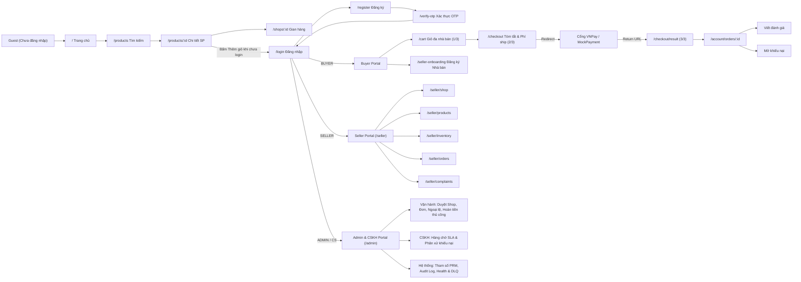

# 03. App Flow Document — SOA-Market

> **Nguồn chuẩn:** SRS SOA-Market v2.2 (Bảng 5.1, Chương 3, Chương 6, `NFR-USA-001..006`, `NFR-REL-005`)  
> **Kiến trúc Frontend:** 1 ứng dụng React + Vite SPA thống nhất (`soa-market-frontend`) chia 3 vùng route theo vai trò: **Cổng Người mua (`/`)**, **Cổng Nhà bán (`/seller/*`)**, **Cổng Quản trị – CSKH (`/admin/*`)**.

---

## 1. Bản đồ toàn bộ màn hình & Tuyến đường (Complete Route Map)

### 1.1. Cổng Người mua (Buyer & Guest Portal — `/`)
| # | Route | Tên màn hình | Vai trò | API chính | GĐ |
| :-: | :--- | :--- | :--- | :--- | :-: |
| B1 | `/` | Trang chủ & Danh mục nổi bật | Guest, Buyer | `GET /v1/categories`, `GET /v1/products` | 1 |
| B2 | `/products` | Tìm kiếm, lọc & sắp xếp sản phẩm | Guest, Buyer | `GET /v1/products`, `GET /v1/categories` | 1 |
| B3 | `/products/:id` | Chi tiết sản phẩm & Khối đánh giá | Guest, Buyer | `GET /v1/products/{id}`, `GET /v1/products/{id}/reviews`, `GET /v1/shops/{id}` | 1/2 |
| B4 | `/shops/:id` | Trang gian hàng công khai | Guest, Buyer | `GET /v1/shops/{id}`, `GET /v1/products?shopId=`, `GET /v1/shops/{id}/reviews/summary` | 1/2 |
| B5 | `/login`, `/register`, `/verify-otp`, `/forgot-password`, `/reset-password` | Cụm xác thực tài khoản | Guest | `POST /v1/auth/*` | 1 |
| B6 | `/account/profile` | Hồ sơ cá nhân & Đổi mật khẩu | Buyer, Seller | `GET/PUT /v1/users/me`, `PUT /v1/users/me/password` | 1 |
| B7 | `/account/addresses` | Sổ địa chỉ giao hàng | Buyer, Seller | `GET/POST/PUT/DELETE /v1/users/me/addresses` | 1 |
| B8 | `/cart` | Giỏ hàng đa nhà bán *(Màn hình 1/3 Checkout)* | Buyer | `GET /v1/cart`, `PUT/DELETE /v1/cart/items/{id}` | 1 |
| B9 | `/checkout` | Tóm tắt đơn hàng theo từng nhà bán & Thanh toán *(Màn hình 2/3 Checkout)* | Buyer | `POST /v1/checkout/summary`, `POST /v1/checkout` | 1 |
| B10 | `/checkout/result` | Trang kết quả quay về từ Cổng thanh toán *(Màn hình 3/3)* | Buyer | `GET /v1/orders/{id}`, `GET /v1/payments/{id}` | 1 |
| B11 | `/account/orders` | Danh sách đơn hàng của tôi | Buyer | `GET /v1/orders` | 1 |
| B12 | `/account/orders/:id` | Chi tiết đơn tổng, từng gói `SellerOrder`, hành trình & hoàn tiền | Buyer | `GET /v1/orders/{id}`, `GET /v1/shipments`, `GET /v1/shipments/{id}/tracking`, `POST /v1/seller-orders/{id}/cancel`, `POST /v1/seller-orders/{id}/receipt` | 1 |
| B13 | `/account/reviews` | Viết đánh giá sản phẩm đã nhận | Buyer | `POST /v1/reviews` | 2 |
| B14 | `/account/complaints` & `/account/complaints/:id` | Danh sách, tạo mới & theo dõi khiếu nại | Buyer | `POST/GET /v1/complaints`, `POST /v1/complaints/{id}/{withdraw,evidence,responses,escalate}` | 2 |
| B15 | `/account/notifications` | Trung tâm thông báo trong ứng dụng | Buyer, Seller | `GET /v1/notifications`, `POST /v1/notifications/{id}/read`, `POST /v1/notifications/read-all` | 2 |
| B16 | `/seller-onboarding` | Đăng ký làm nhà bán & Xem trạng thái hồ sơ | Buyer | `POST /v1/seller-applications`, `GET /v1/seller-applications/me` | 1 |

### 1.2. Cổng Nhà bán (Seller Portal — `/seller/*`, yêu cầu vai trò `SELLER`)
| # | Route | Tên màn hình | API chính | GĐ |
| :-: | :--- | :--- | :--- | :-: |
| S1 | `/seller` | Tổng quan gian hàng & Báo cáo hiệu suất | `GET /v1/seller/reports/performance`, `GET /v1/seller-orders` | 1/2 |
| S2 | `/seller/shop` | Thông tin gian hàng, Trạng thái & Địa chỉ lấy hàng | `GET/PUT /v1/seller/shop`, `PUT /v1/seller/shop/pickup-address`, `POST /v1/seller/shop/{suspend,resume}` | 1 |
| S3 | `/seller/products` & `/seller/products/new` & `/seller/products/:id/edit` | Quản lý sản phẩm & biến thể SKU | `POST/PUT/DELETE /v1/seller/products`, `POST /v1/seller/products/{id}/hide` | 1 |
| S4 | `/seller/inventory` | Quản lý tồn kho vật lý / giữ chỗ / khả dụng | `GET /v1/seller/inventory`, `PUT /v1/seller/variants/{id}/stock` | 1 |
| S5 | `/seller/orders` & `/seller/orders/:id` | Xử lý `SellerOrder`, Vận đơn & In nhãn | `GET /v1/seller-orders`, `POST /v1/seller-orders/{id}/{confirm,reject,cancel}`, `GET /v1/shipments/{id}/label`, `POST /v1/shipments/{id}/{retry,cancel}` | 1 |
| S6 | `/seller/reviews` | Phản hồi & Báo cáo đánh giá vi phạm | `GET /v1/products/{id}/reviews`, `POST /v1/reviews/{id}/reply`, `POST /v1/reviews/{id}/reports` | 2 |
| S7 | `/seller/complaints` & `/seller/complaints/:id` | Phản hồi & Thương lượng khiếu nại | `GET /v1/complaints`, `POST /v1/complaints/{id}/{responses,evidence,escalate}` | 2 |

### 1.3. Cổng Quản trị – CSKH (Admin & CS Portal — `/admin/*`, tối đa 3 cấp menu theo `NFR-USA-006`)
| # | Route | Tên màn hình | Vai trò | API chính | GĐ |
| :-: | :--- | :--- | :--- | :--- | :-: |
| A1 | `/admin` | Bảng điều khiển toàn sàn & Báo cáo thống kê | `ADMINISTRATOR` | `GET /v1/admin/reports/overview`, `GET /v1/admin/exceptions` | 2 |
| A2 | `/admin/seller-applications` | Duyệt hồ sơ đăng ký nhà bán | `ADMINISTRATOR` | `GET /v1/admin/seller-applications`, `POST .../approve`, `POST .../reject` | 1 |
| A3 | `/admin/users` | Quản lý tài khoản, vai trò RBAC & khóa/mở | `ADMINISTRATOR` | `GET /v1/admin/users`, `PUT .../roles`, `POST .../{lock,unlock}` | 1 |
| A4 | `/admin/shops` | Quản lý trạng thái gian hàng & Hiệu suất nhà bán | `ADMINISTRATOR` | `POST /v1/admin/shops/{id}/status`, `GET /v1/admin/reports/sellers` | 1/2 |
| A5 | `/admin/categories` | Quản lý cây danh mục 2 cấp | `ADMINISTRATOR` | `GET /v1/categories`, `POST/PUT/DELETE /v1/admin/categories` | 1 |
| A6 | `/admin/moderation/products` | Hàng chờ kiểm duyệt sản phẩm | `ADMINISTRATOR` | `GET /v1/admin/products/review-queue`, `POST .../decision` | 1/2 |
| A7 | `/admin/moderation/reviews` | Hàng chờ kiểm duyệt đánh giá | `ADMINISTRATOR` | `GET /v1/admin/reviews/moderation-queue`, `POST .../moderate` | 2 |
| A8 | `/admin/complaints/queue` & `/admin/complaints/:id` | Hàng chờ CSKH (SLA countdown) & Phân xử khiếu nại | `CS`, `ADMINISTRATOR` | `GET /v1/cs/complaints/queue`, `POST .../claim`, `POST .../decision`, `POST .../evidence` | 2 |
| A9 | `/admin/orders` & `/admin/transactions` | Giám sát đơn hàng & giao dịch toàn sàn | `ADMINISTRATOR`, `CS` | `GET /v1/admin/orders`, `GET /v1/admin/transactions`, `GET /v1/payments` | 2 |
| A10 | `/admin/exceptions` | Danh sách ngoại lệ, Hoàn tiền thủ công & Đối soát | `ADMINISTRATOR`, `CS` | `GET /v1/admin/exceptions`, `GET /v1/admin/refunds`, `POST /v1/admin/refunds/{id}/mark-manual-success`, `GET /v1/admin/payables` | 1/2 |
| A11 | `/admin/config/params` | Quản lý 21 tham số nghiệp vụ động (`PRM-01..21`) | `ADMINISTRATOR` | `GET/PUT /v1/admin/config/params` | 2 |
| A12 | `/admin/audit-logs` | Tra cứu nhật ký kiểm toán bất biến | `ADMINISTRATOR` | `GET /v1/admin/audit-logs` | 2 |
| A13 | `/admin/system` | Giám sát sức khỏe 10 dịch vụ & Replay DLQ | `ADMINISTRATOR` | `GET /v1/admin/system/health`, `GET /v1/admin/system/dlq`, `POST .../replay` | 2 |

---

## 2. Sơ đồ điều hướng tổng thể (Navigation Architecture)

### Quy tắc chuyển cổng & Route Guards
- **Buyer ↔ Seller:** Tài khoản có cả 2 vai trò (`BUYER`, `SELLER`) nhìn thấy nút **"Kênh Người bán"** trên Header Buyer và **"Về sàn mua sắm"** trên Header Seller. Khi hồ sơ vừa được duyệt (`seller.approved`), lần refresh token / đăng nhập kế tiếp tự kích hoạt menu Seller (`FR-ACC-005 AC3`).
- **Route Guard:** Truy cập route cần đăng nhập khi chưa có token → redirect `/login?redirect=<currentPath>`; truy cập route sai vai trò → trang **403 Không có quyền truy cập** kèm nút quay về cổng hợp lệ.
- **Thu hồi phiên tức thì (`FR-ACC-006`):** Nếu tài khoản đang đăng nhập bị Admin khóa, ngay ở API call tiếp theo nhận `401/403 (ACCOUNT_LOCKED)` → xóa token cục bộ, chuyển về `/login` và hiện banner cảnh báo đỏ *"Tài khoản của bạn đã bị khóa bởi quản trị viên"*.

---

## 3. Luồng Xác thực & Bảo mật (Login / Signup / Password Flows)

### 3.1. Đăng ký + OTP + Đồng ý NĐ 13/2023 (`/register` → `/verify-otp`)
1. **Form `/register`:** Nhập `fullName`, `email`, `phone`, `password` (≥ 8 ký tự gồm chữ và số), `confirmPassword`, và **checkbox đồng ý Thỏa thuận xử lý dữ liệu cá nhân** *(mặc định KHÔNG được tích sẵn — `FR-ACC-001` NĐ 13/2023)*.
2. **Nút "Đăng ký":** Disable nếu chưa tích checkbox; gọi `POST /v1/auth/register`.
   - *Success (201):* Chuyển sang `/verify-otp?email=...`, bắt đầu đếm ngược hiệu lực OTP (`T_OTP=5 phút`).
   - *Error 409:* *"Email này đã được đăng ký. Vui lòng đăng nhập hoặc khôi phục mật khẩu."* (không tiết lộ thông tin tài khoản).
   - *Error 422:* Highlight từng trường sai (VD: mật khẩu thiếu chữ số, chưa đồng ý NĐ 13/2023).
   - *Error 503 (Email service lỗi):* Vẫn chuyển `/verify-otp` kèm thông báo *"Tài khoản đã tạo nhưng chưa gửi được mã OTP, vui lòng bấm Gửi lại mã sau ít phút"*.
3. **Màn hình `/verify-otp`:** Ô nhập 6 chữ số OTP + nút **"Xác nhận"** (`POST /v1/auth/otp/verify`) + nút **"Gửi lại mã"** (`POST /v1/auth/otp/resend`, cooldown 60s, tối đa 3 lần/giờ — `NFR-SEC-006`).
   - *Success (200):* Toast xanh *"Kích hoạt tài khoản thành công!"* → chuyển `/login`.
   - *Error (Sai OTP quá `N_OTP=5` lần hoặc hết hạn):* Vô hiệu mã cũ, hiện lỗi đỏ *"Mã OTP đã hết hạn hoặc nhập sai quá số lần quy định. Vui lòng bấm Gửi lại mã"*.
   - *Error 429:* *"Bạn đã yêu cầu gửi lại OTP quá 3 lần trong 1 giờ. Vui lòng thử lại sau."*

### 3.2. Đăng nhập, Token Refresh & Quên mật khẩu
- **Đăng nhập (`/login`):** `POST /v1/auth/login`. Sai email/mật khẩu trả thông điệp chung *"Email hoặc mật khẩu không chính xác"* (`401`); sai 5 lần/15 phút trả `429` *"Tạm khóa đăng nhập 15 phút do nhập sai nhiều lần"*; tài khoản bị khóa trả `403` kèm lý do.
- **Silent Refresh:** Axios/fetch interceptor bắt `401 (TOKEN_EXPIRED)` → gọi `POST /v1/auth/token/refresh` (chỉ 1 request refresh đồng thời bằng mutex queue). Nếu refresh trả `401` (đăng xuất / reuse detected / đổi mật khẩu) → đăng xuất ngay và về `/login`.
- **Đăng xuất:** Cho chọn *"Đăng xuất thiết bị này"* hoặc *"Đăng xuất khỏi tất cả thiết bị"* (`POST /v1/auth/logout { allDevices: boolean }`).
- **Quên mật khẩu (`/forgot-password` → `/reset-password?token=...`):** Dù email có tồn tại hay không đều trả chung thông điệp *"Nếu email hợp lệ, chúng tôi đã gửi liên kết đặt lại mật khẩu"* (`FR-ACC-004 A1`). Đổi thành công → thu hồi mọi phiên cũ.

---

## 4. Các hành trình cốt lõi & Chi tiết tương tác (User Journeys)

### 4.1. Hành trình 1: Duyệt, Tìm kiếm, Chi tiết Sản phẩm & Gian hàng
- **Màn hình `/products`:** Thanh tìm kiếm từ khóa + Sidebar lọc (Cây danh mục 2 cấp, Khoảng giá min–max, Điểm sao ≥ 4★/3★, Chỉ hiện còn hàng, Gian hàng) + Dropdown sắp xếp (Mới nhất, Phổ biến, Giá tăng/giảm) + Phân trang.
  - *Empty state:* Minh họa kính lúp + *"Không tìm thấy sản phẩm phù hợp với bộ lọc hiện tại"* + nút **"Xóa tất cả bộ lọc"**.
  - *Error 422 (Giá min > Giá max):* Viền đỏ ô giá + *"Giá tối thiểu không được lớn hơn giá tối đa"*.
  - *Error 503:* Banner thử lại *"Hệ thống tìm kiếm đang tạm gián đoạn"*.
- **Màn hình `/products/:id`:** Gallery ảnh (≤ 8 ảnh), chọn biến thể SKU (màu/cỡ), hiển thị giá VND, số lượng khả dụng, tên gian hàng (link `/shops/:id`) và khối Đánh giá (`SVC-REV`).
  - *Biến thể hết hàng (`available == 0`):* Badge **"Hết hàng"**, nút **"Thêm vào giỏ"** chuyển disabled.
  - *Nhà bán xem sản phẩm chính gian hàng mình:* Nút "Thêm vào giỏ" hiển thị tooltip *"Bạn không thể mua sản phẩm của chính gian hàng mình (`BR-SEL-05`)"* và bị disable (backend cũng chặn `403`).
  - *Sản phẩm DRAFT/HIDDEN/DELETED (người mua truy cập):* Trang **404 Sản phẩm không tồn tại hoặc đã ngừng kinh doanh** (riêng chủ shop thấy banner *"Chế độ xem trước của Nhà bán"*).
  - *Giảm cấp `SVC-REV` (`NFR-REL-005`):* Thông tin sản phẩm và nút "Thêm vào giỏ" vẫn hoạt động 100%; riêng khối Đánh giá hiển thị **Fallback Banner**: *"Tạm thời không thể tải danh sách đánh giá."* + nút **"Thử tải lại khối này"**.

### 4.2. Hành trình 2: Giỏ hàng đa nhà bán → Checkout ≤ 3 màn hình → Thanh toán
Đây là **luồng cốt lõi của SOA-Market (`NFR-USA-002`, `NFR-USA-005`)**:

1. **Màn hình 1/3 — Giỏ hàng đa nhà bán (`/cart`):**
   - Các dòng hàng được gom vào từng **Shop Package Card** riêng biệt (mỗi nhà bán 1 khung có checkbox chọn cả shop và checkbox từng biến thể).
   - **Tự động đối chiếu (`FR-CRT-003`):** Khi mở giỏ, `SVC-ORD` gọi lô `SVC-PRD` trả cờ cảnh báo:
     - *Giá đổi:* Hiện badge vàng *"Giá đã thay đổi từ 100.000 ₫ → 120.000 ₫"* nhưng vẫn cho giữ chọn nếu còn hàng.
     - *Hết hàng / Bị ẩn / Shop tạm ngưng:* **Tự động bỏ chọn (uncheck)**, làm mờ dòng hàng, hiện badge đỏ lý do, cho phép người mua vẫn bấm **"Tiếp tục đặt hàng (X sản phẩm hợp lệ)"** chỉ với 1 cú click.
   - *Empty state:* Biểu tượng giỏ hàng trống + *"Giỏ hàng của bạn đang trống"* + nút **"Khám phá sản phẩm ngay"**.
   - *Error `SVC-PRD` ngừng hoạt động:* Vẫn hiển thị danh sách giỏ đã lưu gần nhất kèm banner cảnh báo cam *"Không thể cập nhật giá và tồn kho mới nhất lúc này"* + **vô hiệu hóa nút "Tiếp tục đặt hàng"** + nút **"Làm mới giỏ hàng"**.

2. **Màn hình 2/3 — Tóm tắt đơn hàng & Xác nhận đặt hàng (`/checkout`):**
   - Chọn địa chỉ giao hàng từ sổ địa chỉ (nếu chưa có → mở Modal thêm địa chỉ tại chỗ không rời luồng!). Đổi địa chỉ tự động gọi lại `POST /v1/checkout/summary` để tính lại phí ship từng nhà bán (cache 5 phút).
   - Hiển thị rõ **từng gói `SellerOrder` dự kiến** theo từng Shop: danh sách sản phẩm + đơn giá + **phí vận chuyển riêng từng shop** + thời gian giao dự kiến (`ETA`) + tạm tính từng shop. *(Nếu `SVC-SHP` dùng bảng phí dự phòng, hiển thị nhãn "Phí ước tính")*.
   - Nếu 1 nhà bán không hỗ trợ giao tới địa chỉ đã chọn: đánh dấu cảnh báo đỏ riêng card nhà bán đó + nút **"Bỏ sản phẩm của shop này"** hoặc **"Đổi địa chỉ giao"**.
   - Khối tổng kết bên phải (sticky): `Tổng tiền hàng` + `Tổng phí vận chuyển (k nhà bán)` = **`Tổng thanh toán (1 lần)`** + Chọn cổng thanh toán (`VNPay Sandbox` / `MockPayment`) + Nút **"Đặt hàng & Thanh toán"**.
   - **Hành vi nút "Đặt hàng & Thanh toán":**
     - Frontend sinh **`Idempotency-Key` (UUID v4)** cho phiên bấm nút (giữ nguyên key nếu retry cùng payload, đổi key nếu người dùng sửa giỏ/địa chỉ), khóa nút + spinner *"Đang giữ chỗ tồn kho và khởi tạo thanh toán..."*.
     - Gọi `POST /v1/checkout`.
     - *Success (201):* Điều hướng ngay sang `paymentUrl` của cổng thanh toán (VNPay hoặc MockPayment UI) kèm hiển thị đếm ngược hạn `T_PAY` (15 phút).
     - *Error 409 / 422 (All-or-nothing thiếu kho hoặc shop vừa khóa):* Mở Modal liệt kê chính xác từng biến thể lỗi + tồn kho khả dụng mới nhất + nút **"Quay lại giỏ hàng điều chỉnh"**.
     - *Error 502/503 (`SVC-PRD` / `SVC-PAY` timeout):* Toast/Alert đỏ *"Hệ thống đang bận, đơn hàng chưa được tạo (hoặc đang chờ thanh toán). Vui lòng thử lại sau giây lát."*

3. **Màn hình 3/3 — Kết quả thanh toán (`/checkout/result`):**
   - Người mua quay về từ cổng thanh toán. Trang gọi polling ngắn `GET /v1/orders/{id}` (tối đa 5 lần × 2s chờ webhook đồng bộ).
   - *State `PAID`:* Màn hình thành công màu xanh, hiện mã `Order`, danh sách `k` mã `SellerOrder` đang ở trạng thái **"Chờ nhà bán xác nhận"**, nút **"Xem chi tiết đơn hàng"**.
   - *State `PENDING_PAYMENT` (chưa nhận webhook hoặc thanh toán thất bại nhưng còn trong `T_PAY`):* Hiển thị đồng hồ đếm ngược `T_PAY` còn lại + nút **"Thanh toán lại ngay"** (tạo giao dịch mới cho cùng `Order`) + nút **"Kiểm tra lại trạng thái"**.
   - *State `CANCELLED` (quá `T_PAY` hoặc thanh toán đến muộn `FR-ORD-008`):* Banner thông báo rõ: nếu phát hiện thanh toán đến muộn hiển thị *"Thanh toán đến sau khi đơn hết hạn — hệ thống đã tự động khởi tạo hoàn 100% tiền về phương thức gốc của bạn"*.

### 4.3. Hành trình 3: Theo dõi đơn đa gói hàng, Hủy, Nhận hàng & Hoàn tiền một phần (`/account/orders/:id`)
- Hiển thị **Header Đơn tổng (`Order`)**: mã đơn, trạng thái tổng suy ra, địa chỉ giao đã chụp, thông tin 1 lần thanh toán.
- **Bảng đối chiếu hoàn tiền một phần (`FR-ORD-009`):** Tự động xuất hiện ngay dưới Header khi có ít nhất 1 `SellerOrder` bị hủy/hoàn tiền:
  `Tổng đã thanh toán` − `Tổng đã hoàn (liệt kê từng gói bị hủy)` = **`Giá trị đơn thực tế còn lại`**.
- **Danh sách thẻ từng `SellerOrder` độc lập:** Mỗi thẻ hiện tên shop, badge trạng thái riêng, hạn nhà bán xác nhận / tự hoàn tất, danh sách `OrderItem` (giá chụp bất biến), mã vận đơn + **Timeline hành trình vận chuyển riêng** *(nếu `SVC-SHP` lỗi → hiển thị Fallback Banner riêng phần hành trình, không sập trang đơn!)*.
- **Nút hành động theo trạng thái `SellerOrder`:**
  - `PENDING_PAYMENT` hoặc `AWAITING_CONFIRMATION`: Nút **"Hủy gói hàng này"** → Modal chọn lý do hủy → `POST /v1/seller-orders/{id}/cancel`. *(Cảnh báo rõ: chỉ hủy cả gói `SellerOrder` này, không ảnh hưởng các gói khác; nếu đã thanh toán sẽ hoàn đủ phần tiền phân bổ của gói này).*
  - `CONFIRMED` / `SHIPPING`: Không có nút hủy; nếu người mua bấm trợ giúp → hướng dẫn *"Đơn đã bàn giao vận chuyển, nếu gặp sự cố hoặc quá hạn giao vui lòng mở Khiếu nại"*. (Khi `SHIPPING` quá `etaAt` → bật nút **"Khiếu nại chưa nhận được hàng"**).
  - `DELIVERED`: Nút chính **"Đã nhận được hàng"** (`POST /v1/seller-orders/{id}/receipt` → chuyển `COMPLETED`), nút **"Mở khiếu nại"** (nếu còn trong `T_CPL_OPEN=3 ngày` và chưa có khiếu nại cùng loại), nút **"Đánh giá sản phẩm"** (từng `OrderItem` trong `T_REVIEW=14 ngày`). Hiển thị đếm ngược *"Tự động hoàn tất sau X ngày Y giờ nếu không có khiếu nại"*.
  - `COMPLETED`: Nút **"Đánh giá sản phẩm"** (nếu còn trong 14 ngày & chưa đánh giá).

### 4.4. Hành trình 4: Nhà bán (Onboarding → Shop → Sản phẩm/Kho → Xử lý Đơn & Vận đơn)
- **Đăng ký Nhà bán (`/seller-onboarding`):** Chọn loại hình (`Cá nhân` hoặc `Tổ chức`), nhập `shopName`, `identityOrBusinessNumber` (CCCD 12 số hoặc Mã số DN), `taxCode`, tải ảnh CCCD 2 mặt / Giấy ĐKKD (`FR-SEL-001`). Nếu đã nộp → hiển thị màn hình trạng thái (`PENDING` / `APPROVED` / `REJECTED` kèm lý do từ chối và nút **"Nộp hồ sơ mới"**).
- **Quản lý gian hàng (`/seller/shop`):** Cập nhật tên/mô tả/logo/chính sách + **Địa chỉ lấy hàng (`PickupAddress`)** (hiện cảnh báo đỏ trên cùng nếu chưa cấu hình địa chỉ lấy hàng!). Nút **"Tạm ngưng gian hàng"** / **"Mở lại gian hàng"** (nếu gian hàng bị Admin đặt `LOCKED`, khóa mọi nút chỉnh sửa trạng thái & sản phẩm kèm lý do khóa).
- **Quản lý sản phẩm (`/seller/products`) & Tồn kho (`/seller/inventory`):**
  - Form tạo/sửa sản phẩm: chọn danh mục lá (2 cấp), tải tối đa 8 ảnh (JPEG/PNG/WebP ≤ 5MB), bảng thêm biến thể SKU bắt buộc `price > 0` (VND) và `weightGram` (10–50.000g), `dimensions` tùy chọn (tooltip ghi rõ mặc định 20×15×10 cm). Có nút **"Lưu nháp (DRAFT)"** hoặc **"Đăng bán"**.
  - Bảng tồn kho: hiển thị 3 cột rõ ràng `Tồn vật lý (onHand)` | `Đang giữ chỗ (reserved)` | `Khả dụng (available)`. Nút **"Điều chỉnh tồn kho"** gửi kèm `version` hiện tại; nếu `onHand < reserved` báo lỗi `422`; nếu có đơn vừa đặt làm lệch version báo `409` kèm nút **"Tải lại số liệu mới nhất"**.
- **Xử lý đơn hàng (`/seller/orders/:id`):**
  - Chỉ hiển thị `SellerOrder` của chính shop (không lộ đơn shop khác).
  - Trạng thái `AWAITING_CONFIRMATION`: Đếm ngược `T_CONFIRM=24h` + Nút xanh **"Xác nhận đơn & Tạo vận đơn"** (`POST .../confirm`, chặn nếu thiếu địa chỉ lấy hàng kèm link cấu hình ngay) + Nút đỏ **"Từ chối đơn"** (bắt buộc nhập lý do — `422` nếu trống).
  - Trạng thái `CONFIRMED`:
    - Nếu vận đơn `CREATED`: Nút **"In nhãn vận chuyển"** (`GET /v1/shipments/{id}/label`), nút **"Hủy đơn trước lấy hàng"** (`POST .../cancel`, nhập lý do; nếu ĐVVC đã `PICKED_UP` nhận `409` hoàn nguyên).
    - Nếu vận đơn **`CREATE_FAILED`** (`FR-SHP-002 E1`): Hiển thị cảnh báo đỏ nêu lý do từ ĐVVC + Nút **"Tạo lại vận đơn"** (`POST /v1/shipments/{id}/retry`) + link sửa địa chỉ lấy hàng.

### 4.5. Hành trình 5: Khiếu nại nhiều bên (Buyer ↔ Seller ↔ CSKH)
1. **Người mua tạo khiếu nại (`/account/complaints`):** Chọn `SellerOrder` hợp lệ (hoặc chọn nhiều `SellerOrder` trong cùng 1 `Order` — giao diện thông báo rõ *"Hệ thống sẽ tự tách thành k khiếu nại độc lập theo từng nhà bán"*), chọn loại vấn đề (`NOT_RECEIVED`, `WRONG_ITEM`, `DAMAGED`, `NOT_AS_DESCRIBED`, `OTHER`), phương án mong muốn (`FULL_REFUND`, `PARTIAL_REFUND`, `RETURN_REFUND`, `EXCHANGE`), mô tả và tải ≤ 5 tệp bằng chứng (ảnh/video ngắn/PDF).
2. **Thương lượng (`AWAITING_SELLER` / `NEGOTIATING`):** Cả Buyer và Seller xem dòng thời gian bất biến, hạn đếm ngược `T_CPL_SELLER=24h` / `T_CPL_NEGOTIATE=48h`, tải thêm bằng chứng (tối đa 5 tệp/bên). Seller chọn: *Chấp nhận*, *Đề xuất hoàn một phần (nhập số tiền VND ≤ số còn lại)* hoặc *Phản bác*. Buyer có nút **"Chấp nhận đề xuất"**, **"Từ chối / Yêu cầu CSKH can thiệp (`ESCALATED`)"**, hoặc **"Rút khiếu nại (`WITHDRAWN`)"** (chỉ trước `EXECUTING`).
3. **CSKH phân xử (`/admin/complaints/queue` → `/admin/complaints/:id`):**
   - Hàng chờ `ESCALATED` mặc định sắp xếp theo **SLA countdown ngắn nhất lên đầu** (`FR-ADM-001`), có nút **"Nhận xử lý (Claim)"** (`409` nếu CSKH khác vừa nhận).
   - Màn hình **Split-View**: Cột trái hiển thị hồ sơ tổng hợp (`SellerOrder`, thanh toán/số dư còn lại, vận đơn — có Fallback Banner nếu dịch vụ nguồn chậm + tab **"Các khiếu nại cùng Order"**); Cột giữa là dòng thời gian & bằng chứng (có hiển thị mã băm SHA-256); Cột phải là form **Ra quyết định** (`outcome`, `refundAmount`, `responsibleParty`, `reason` bắt buộc).
   - Khi chuyển `EXECUTING` (VD: `RETURN_REFUND`): Hiển thị trạng thái vận đơn hoàn hàng; chỉ khi ĐVVC báo `shipment.returned` (hoặc nhà bán xác nhận) thì hệ thống gửi lệnh hoàn tiền, và chỉ khi `refund.completed` thì khiếu nại tự đóng `CLOSED`.

### 4.6. Hành trình 6: Quản trị viên (Duyệt, Ngoại lệ, Cấu hình động, DLQ & Báo cáo)
- **Mọi hành động quản trị có tác động bên thứ ba (`BR-GEN-04`):** Bấm Từ chối hồ sơ nhà bán, Khóa tài khoản, Khóa gian hàng, Ẩn/Từ chối sản phẩm, Ẩn đánh giá, Đổi tham số `PRM-xx`, Xác nhận hoàn tiền thủ công, Replay DLQ → **đều mở Audit Confirmation Dialog bắt buộc nhập `reason` (tối thiểu 10 ký tự)** trước khi submit.
- **Danh sách ngoại lệ & Hoàn tiền thủ công (`/admin/exceptions`):** Hiển thị 4 nhóm: *Hoàn tiền thất bại sau `N_RETRY`*, *Tạo vận đơn `CREATE_FAILED`*, *Thanh toán muộn / Lệch số tiền*, *Đơn kẹt trạng thái*. Với `Refund FAILED`: nút **"Xác nhận đã hoàn tiền thủ công"** mở modal nhập `bankTransactionRef` và `reason` → `POST /v1/admin/refunds/{id}/mark-manual-success`.
- **Tham số động (`/admin/config/params`):** Bảng 21 `PRM-xx` hiển thị giá trị hiện tại, khoảng cho phép, phiên bản; bấm Sửa → kiểm tra miền giá trị → lưu kèm lý do (hiển thị banner xanh *"Cấu hình đã đồng bộ qua Consul KV & sự kiện `config.changed`, áp dụng ngay cho đối tượng mới mà không cần khởi động lại dịch vụ"*).
- **Giám sát sức khỏe & DLQ (`/admin/system`):** Lưới 10 card trạng thái dịch vụ (`/health/ready` + độ trễ + tỷ lệ lỗi 5xx) + Bảng **Dead-Letter Queue** hiển thị `eventId`, `eventType`, consumer lỗi, nguyên nhân, tuổi thông điệp + nút **"Đưa lại hàng đợi xử lý (Replay)"** (có audit log).
- **Báo cáo & Bản sao đọc (`/admin`, `/admin/orders`, `/admin/audit-logs`):** Luôn hiển thị **Sync Timestamp Badge** ở góc phải trên: *"Dữ liệu tổng hợp cập nhật lúc HH:mm:ss (nhất quán cuối cùng)"* + nút làm mới (`FR-ADM-001 E1`, `FR-RPT-001`).

---

## 5. Bảng chuẩn hóa Empty / Error / Loading / Success States toàn ứng dụng

| Tình huống | Quy tắc hiển thị bắt buộc cho AI coding |
| :--- | :--- |
| **Loading** | Dùng **Skeleton placeholder** đúng khung card/table (không dùng full-page blocking spinner trừ lúc khởi tạo phiên ban đầu). Nút đang submit hiển thị spinner nhỏ bên trái + disable chống bấm đúp. |
| **Empty State** | Gồm icon trung tính + 1 câu giải thích ngữ cảnh bằng tiếng Việt + 1 nút hành động tiếp theo (VD: *"Chưa có đơn hàng nào"* + *"Tiếp tục mua sắm"*). |
| **Validation Error (`422`)** | Highlight viền đỏ đúng field dựa trên mảng `details[].field` từ Huma Error Model + chữ đỏ dưới field; scroll tới field lỗi đầu tiên. |
| **Conflict Error (`409`)** | Banner/Modal giải thích xung đột trạng thái hoặc dữ liệu đã thay đổi (VD: xung đột `version` tồn kho, 2 CSKH cùng claim, đơn đã chuyển `SHIPPING`) + nút **"Tải lại dữ liệu mới nhất"**. |
| **Rate Limit (`429`)** | Toast/Alert cam: *"Bạn thao tác quá nhanh. Vui lòng thử lại sau X giây."* (đọc header `Retry-After`). |
| **Degradation (`502/503/504` ở dịch vụ phụ)** | **Tuyệt đối không hiện màn hình trắng hay trang lỗi 500 toàn trang** cho khối `SVC-REV`, `SVC-SHP` tracking, `SVC-NTF`, `SVC-RPT` — hiển thị **Fallback Banner** gọn trong vùng component đó kèm nút **"Thử tải lại khối này"** (`NFR-REL-005`). |
| **Success Feedback** | Thao tác nhanh (thêm giỏ, lưu địa chỉ, đánh dấu đã đọc): Toast xanh ở góc phải trên tự đóng sau 4s. Thao tác quan trọng (đặt hàng, duyệt nhà bán, ra quyết định khiếu nại): chuyển trang hoặc banner xác nhận kèm mã đối tượng copy được. |
