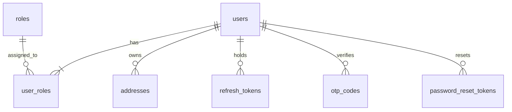
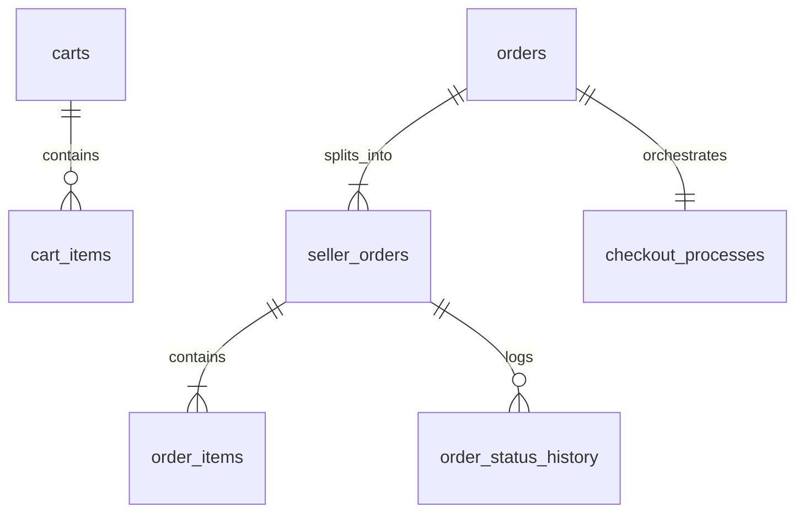

# 05. Backend Schema Document — SOA-Market

> **Nguồn chuẩn:** SRS SOA-Market v2.2 (Chương 8, Bảng 8.1–8.23, `DC-01..DC-21`, `CON-03`, `CON-07`, `SOA-R02`, `OQ-04..16`)  
> **Cơ sở dữ liệu:** **PostgreSQL 16** (truy cập qua **`pgx/v5` + `sqlc` + `golang-migrate`**) — 1 container PostgreSQL trong Docker Compose chia **10 schema độc lập (`svc_idn` → `svc_rpt`)** + **10 PostgreSQL user/role tách quyền cứng**.  
> **Broker State (Zero Redis):** **NATS JetStream** (Streams + DLQ + KV Bucket `revoked_users`).

---

## 1. Quy tắc toàn cục & Cưỡng chế SOA-R02 ở tầng PostgreSQL

### 1.1. Quy ước kiểu dữ liệu & Ràng buộc chung (`DC-20`, `DC-21`)
- **Khóa chính (PK):** `UUID` (khuyến nghị sinh UUID v7 ở tầng Go để tối ưu B-tree index, fallback `gen_random_uuid()`).
- **Không khóa ngoại chéo schema (`DC-20`, `SOA-R02`):** Các liên kết xuyên dịch vụ chỉ lưu cột `UUID` (ghi chú `REF -> svc_xxx.table`) và **tuyệt đối không khai báo `REFERENCES` sang schema khác**.
- **Tiền tệ (`DC-21`, `BR-GEN-03`):** `BIGINT` (đơn vị VND nguyên, không thập phân, không dùng `FLOAT`/`NUMERIC`).
- **Thời gian (`DC-21`, `ASM-06`):** `TIMESTAMPTZ` luôn lưu **UTC** (`DEFAULT NOW()`).
- **Khóa lạc quan (Optimistic Locking):** Cột `version INTEGER NOT NULL DEFAULT 1` trên mọi thực thể có tranh chấp ghi (`products`, `inventory_items`, `orders`, `seller_orders`, `seller_applications`, `complaints`, `reviews`). Mọi câu lệnh `sqlc` cập nhật bắt buộc kèm `WHERE id = $1 AND version = $2` và `SET version = version + 1`.
- **Lập lịch đa bản sao không cần Redis (`NFR-REL-009`):** Bảng cần cron xử lý theo lô đều có partial index theo trạng thái + mốc hạn (`due_at`), truy vấn bằng `SELECT ... FOR UPDATE SKIP LOCKED LIMIT 100` (hoặc `pg_try_advisory_lock(hashtext('job_name'))`).

### 1.2. Script khởi tạo cô lập 10 Schema & 10 DB Role (`infra/postgres/init-schemas.sql`)
Mỗi dịch vụ kết nối bằng đúng user riêng (`DATABASE_URL` đặt `search_path=svc_xxx`). Nếu mã nguồn của dịch vụ A cố truy vấn schema của dịch vụ B, PostgreSQL lập tức từ chối bằng `ERROR: permission denied for schema`:

```sql
-- Hủy quyền mặc định trên schema public cho mọi role thường
REVOKE ALL ON SCHEMA public FROM PUBLIC;

-- Khởi tạo lặp cho 10 dịch vụ: idn, sel, prd, ord, pay, shp, rev, cpl, ntf, rpt
CREATE ROLE usr_svc_idn LOGIN PASSWORD '${PG_PASS_IDN}';
CREATE SCHEMA svc_idn AUTHORIZATION usr_svc_idn;
REVOKE ALL ON SCHEMA svc_idn FROM PUBLIC;
GRANT USAGE, CREATE ON SCHEMA svc_idn TO usr_svc_idn;
ALTER ROLE usr_svc_idn SET search_path TO svc_idn;
-- (Tương tự cho usr_svc_sel..usr_svc_rpt với schema svc_sel..svc_rpt)

-- Bảo vệ tính chỉ-thêm (append-only) của AuditLog (DC-19, NFR-SEC-012)
-- Thực thi sau khi migration tạo bảng svc_rpt.audit_logs:
REVOKE UPDATE, DELETE, TRUNCATE ON TABLE svc_rpt.audit_logs FROM usr_svc_rpt;
```

---

## 2. Mẫu 4 bảng kỹ thuật dùng chung (Áp dụng cục bộ trong từng Schema)

Mỗi dịch vụ sở hữu bản sao riêng của các bảng kỹ thuật cần thiết trong chính schema của mình (không dùng chung bảng kỹ thuật giữa các dịch vụ):

### 2.1. `outbox_events` (Có ở 9 schema phát sự kiện: trừ `svc_ntf`)
| Cột | Kiểu PostgreSQL | Ràng buộc | Mô tả |
| :--- | :--- | :--- | :--- |
| `event_id` | `UUID` | `PK` | Định danh duy nhất sự kiện (`EventEnvelope.eventId`) |
| `event_type` | `VARCHAR(100)` | `NOT NULL` | VD: `payment.succeeded`, `audit.recorded` |
| `schema_version` | `SMALLINT` | `NOT NULL DEFAULT 1` | Phiên bản schema payload |
| `aggregate_type` | `VARCHAR(64)` | `NOT NULL` | VD: `Order`, `SellerOrder`, `PaymentTransaction` |
| `aggregate_id` | `UUID` | `NOT NULL` | ID đối tượng gốc (để giữ thứ tự) |
| `aggregate_version` | `INTEGER` | `NOT NULL DEFAULT 1` | Phiên bản lạc quan của đối tượng (chống out-of-order) |
| `correlation_id` | `UUID` | `NOT NULL` | `X-Correlation-Id` truy vết đầu cuối |
| `payload` | `JSONB` | `NOT NULL` | Nội dung sự kiện tối thiểu |
| `status` | `VARCHAR(20)` | `NOT NULL DEFAULT 'PENDING'` | `PENDING`, `PUBLISHED`, `FAILED` |
| `attempts` | `SMALLINT` | `NOT NULL DEFAULT 0` | Số lần thử đẩy lên NATS |
| `occurred_at` | `TIMESTAMPTZ` | `NOT NULL DEFAULT NOW()` | Thời điểm nghiệp vụ xảy ra |
| `published_at` | `TIMESTAMPTZ` | `NULL` | Thời điểm đẩy lên NATS thành công |
- **Index:** `CREATE INDEX idx_outbox_pending ON outbox_events (occurred_at ASC) WHERE status = 'PENDING';` (tối ưu Outbox Relay worker dùng `FOR UPDATE SKIP LOCKED`).

### 2.2. `processed_events` (Có ở tất cả 10 schema nhận sự kiện)
| Cột | Kiểu PostgreSQL | Ràng buộc | Mô tả |
| :--- | :--- | :--- | :--- |
| `event_id` | `UUID` | `PK` | Chống xử lý trùng khi NATS giao lặp (`BR-GEN-02`) |
| `event_type` | `VARCHAR(100)` | `NOT NULL` | Tên sự kiện đã nhận |
| `aggregate_id` | `UUID` | `NOT NULL` | Đối tượng nguồn |
| `aggregate_version` | `INTEGER` | `NOT NULL` | Phiên bản đối tượng đã xử lý (bỏ qua nếu sự kiện mới có version nhỏ hơn) |
| `processed_at` | `TIMESTAMPTZ` | `NOT NULL DEFAULT NOW()` | Thời điểm xử lý xong |
- **Index:** `CREATE INDEX idx_processed_agg ON processed_events (aggregate_id, event_type, aggregate_version DESC);`

### 2.3. `idempotency_records` (Có ở `svc_prd`, `svc_ord`, `svc_pay`, `svc_shp`, `svc_cpl`)
| Cột | Kiểu PostgreSQL | Ràng buộc | Mô tả |
| :--- | :--- | :--- | :--- |
| `idempotency_key` | `VARCHAR(128)` | `PK` | Khóa từ header `Idempotency-Key` (`NFR-REL-008`) |
| `scope` | `VARCHAR(64)` | `NOT NULL` | Tên thao tác (VD: `POST:/v1/checkout`) |
| `request_hash` | `CHAR(64)` | `NOT NULL` | SHA-256 request body (phát hiện gửi trùng key khác payload → 409) |
| `response_status` | `SMALLINT` | `NOT NULL` | HTTP status code đã trả |
| `response_body` | `JSONB` | `NOT NULL` | Snapshot kết quả trả về cho lần gửi lặp |
| `expires_at` | `TIMESTAMPTZ` | `NOT NULL` | Lưu tối thiểu 24 giờ (`NOW() + INTERVAL '24 hours'`) |
| `created_at` | `TIMESTAMPTZ` | `NOT NULL DEFAULT NOW()` | Thời điểm tạo |
- **Index:** `CREATE INDEX idx_idem_expires ON idempotency_records (expires_at);`

### 2.4. `webhook_event_logs` (Có ở `svc_pay` và `svc_shp`)
| Cột | Kiểu PostgreSQL | Ràng buộc | Mô tả |
| :--- | :--- | :--- | :--- |
| `provider` | `VARCHAR(32)` | `PK (composite)` | `VNPAY`, `MOCK_PAY`, `GHN`, `MOCK_SHP` |
| `provider_event_id` | `VARCHAR(128)` | `PK (composite)` | Mã sự kiện duy nhất của đối tác (`DC-13`) |
| `reference_id` | `VARCHAR(128)` | `NOT NULL` | `gatewayRef` hoặc `trackingCode` |
| `raw_payload` | `JSONB` | `NOT NULL` | Dữ liệu webhook (đã che trường nhạy cảm nếu có) |
| `received_at` | `TIMESTAMPTZ` | `NOT NULL DEFAULT NOW()` | Thời điểm nhận |

---

## 3. Lược đồ chi tiết 10 dịch vụ (Physical PostgreSQL Schemas)

### 3.1. Schema `svc_idn` — Dịch vụ Định danh và Truy cập (`SVC-IDN`)



1. **`svc_idn.users`**
   - `user_id UUID PK`
   - `email VARCHAR(254) NOT NULL`
   - `password_hash TEXT NOT NULL` (Argon2id/bcrypt có salt — `NFR-SEC-003`)
   - `full_name VARCHAR(150) NOT NULL`
   - `phone VARCHAR(20) NOT NULL`
   - `status VARCHAR(32) NOT NULL CHECK (status IN ('PENDING_VERIFICATION','ACTIVE','LOCKED','ANONYMIZED'))`
   - `privacy_consented_at TIMESTAMPTZ NULL` *(Bắt buộc NOT NULL khi `status = 'ACTIVE'` — NĐ 13/2023)*
   - `privacy_policy_version VARCHAR(32) NULL`
   - `failed_login_count SMALLINT NOT NULL DEFAULT 0`
   - `locked_until TIMESTAMPTZ NULL` *(Khóa tạm 15 phút sau 5 lần sai — `NFR-SEC-006`)*
   - `created_at TIMESTAMPTZ NOT NULL DEFAULT NOW()`, `updated_at TIMESTAMPTZ NOT NULL DEFAULT NOW()`
   - **Indexes:** `CREATE UNIQUE INDEX uq_users_email_lower ON svc_idn.users (LOWER(email));` (`DC-01`), `CREATE INDEX idx_users_status ON svc_idn.users (status);`

2. **`svc_idn.roles`**
   - `role_name VARCHAR(32) PK CHECK (role_name IN ('BUYER','SELLER','ADMINISTRATOR','CS'))`
   - `description TEXT NULL`

3. **`svc_idn.user_roles`**
   - `user_id UUID NOT NULL REFERENCES svc_idn.users(user_id)`
   - `role_name VARCHAR(32) NOT NULL REFERENCES svc_idn.roles(role_name)`
   - `granted_by UUID NULL REFERENCES svc_idn.users(user_id)` *(Bắt buộc cho `ADMINISTRATOR`/`CS`)*
   - `granted_at TIMESTAMPTZ NOT NULL DEFAULT NOW()`
   - `reason TEXT NULL`
   - **PK:** `(user_id, role_name)`

4. **`svc_idn.addresses`**
   - `address_id UUID PK`, `user_id UUID NOT NULL REFERENCES svc_idn.users(user_id)`
   - `receiver VARCHAR(150) NOT NULL`, `phone VARCHAR(20) NOT NULL`
   - `line VARCHAR(255) NOT NULL`, `ward VARCHAR(100) NOT NULL`, `district VARCHAR(100) NOT NULL`, `province VARCHAR(100) NOT NULL`
   - `is_default BOOLEAN NOT NULL DEFAULT FALSE`
   - `created_at TIMESTAMPTZ NOT NULL DEFAULT NOW()`, `updated_at TIMESTAMPTZ NOT NULL DEFAULT NOW()`
   - **Indexes:** `CREATE UNIQUE INDEX uq_addr_one_default ON svc_idn.addresses (user_id) WHERE is_default = TRUE;`, `CREATE INDEX idx_addr_user ON svc_idn.addresses (user_id);`

5. **`svc_idn.refresh_tokens`** *(Xác thực / Phiên đăng nhập & Token Rotation)*
   - `token_id UUID PK`, `user_id UUID NOT NULL REFERENCES svc_idn.users(user_id)`
   - `token_family_id UUID NOT NULL` *(Phát hiện dùng lại token → thu hồi cả chuỗi `FR-ACC-002 E4`)*
   - `token_hash CHAR(64) NOT NULL UNIQUE` (SHA-256)
   - `expires_at TIMESTAMPTZ NOT NULL`, `revoked_at TIMESTAMPTZ NULL`, `replaced_by UUID NULL`
   - `user_agent VARCHAR(255) NULL`, `ip_address INET NULL`, `created_at TIMESTAMPTZ NOT NULL DEFAULT NOW()`
   - **Indexes:** `CREATE INDEX idx_rt_user_active ON svc_idn.refresh_tokens (user_id) WHERE revoked_at IS NULL;`, `CREATE INDEX idx_rt_family ON svc_idn.refresh_tokens (token_family_id);`

6. **`svc_idn.otp_codes`**
   - `otp_id UUID PK`, `user_id UUID NOT NULL REFERENCES svc_idn.users(user_id)`
   - `purpose VARCHAR(32) NOT NULL CHECK (purpose IN ('REGISTER','CHANGE_EMAIL'))`
   - `target_email VARCHAR(254) NOT NULL`, `code_hash CHAR(64) NOT NULL`
   - `attempts SMALLINT NOT NULL DEFAULT 0`, `expires_at TIMESTAMPTZ NOT NULL`, `consumed_at TIMESTAMPTZ NULL`, `invalidated_at TIMESTAMPTZ NULL`
   - `created_at TIMESTAMPTZ NOT NULL DEFAULT NOW()`
   - **Index:** `CREATE INDEX idx_otp_user_purpose ON svc_idn.otp_codes (user_id, purpose, created_at DESC);`

7. **`svc_idn.password_reset_tokens`**
   - `reset_id UUID PK`, `user_id UUID NOT NULL REFERENCES svc_idn.users(user_id)`
   - `token_hash CHAR(64) NOT NULL UNIQUE`, `expires_at TIMESTAMPTZ NOT NULL`, `used_at TIMESTAMPTZ NULL`, `created_at TIMESTAMPTZ NOT NULL DEFAULT NOW()`

*(Cùng 2 bảng kỹ thuật: `svc_idn.outbox_events`, `svc_idn.processed_events`)*

---

### 3.2. Schema `svc_sel` — Dịch vụ Nhà bán và Gian hàng (`SVC-SEL`)

1. **`svc_sel.seller_applications`**
   - `application_id UUID PK`
   - `user_id UUID NOT NULL` *(REF -> `svc_idn.users`)*
   - `seller_type VARCHAR(20) NOT NULL CHECK (seller_type IN ('INDIVIDUAL','ORGANIZATION'))`
   - `shop_name VARCHAR(100) NOT NULL`
   - `tax_code VARCHAR(32) NULL` *(Bắt buộc khi `ORGANIZATION`, cá nhân nhập MST cá nhân — `OQ-08`)*
   - `identity_or_business_number VARCHAR(32) NOT NULL` *(CCCD 12 số hoặc Mã số DN — NĐ 52/2013)*
   - `documents JSONB NOT NULL` *(Danh sách object `{type, fileRef, uploadedAt}` trỏ bucket `private-kyc`)*
   - `status VARCHAR(20) NOT NULL CHECK (status IN ('PENDING','APPROVED','REJECTED'))`
   - `review_reason TEXT NULL` *(CHECK: bắt buộc NOT NULL nếu `status = 'REJECTED'`)*
   - `reviewed_by UUID NULL` *(REF -> `svc_idn.users`)*, `reviewed_at TIMESTAMPTZ NULL`
   - `version INTEGER NOT NULL DEFAULT 1`, `created_at TIMESTAMPTZ NOT NULL DEFAULT NOW()`, `updated_at TIMESTAMPTZ NOT NULL DEFAULT NOW()`
   - **Indexes:** `CREATE UNIQUE INDEX uq_seller_app_active ON svc_sel.seller_applications (user_id) WHERE status IN ('PENDING','APPROVED');` (`BR-SEL-01`), `CREATE INDEX idx_seller_app_status ON svc_sel.seller_applications (status, created_at ASC);`

2. **`svc_sel.shops`**
   - `shop_id UUID PK`
   - `application_id UUID NOT NULL UNIQUE REFERENCES svc_sel.seller_applications(application_id)`
   - `seller_user_id UUID NOT NULL UNIQUE` *(REF -> `svc_idn.users` — `DC-02`, `ASM-04`)*
   - `name VARCHAR(100) NOT NULL`
   - `description TEXT NULL`, `logo_ref TEXT NULL`, `policy TEXT NULL`
   - `status VARCHAR(20) NOT NULL DEFAULT 'ACTIVE' CHECK (status IN ('ACTIVE','SUSPENDED','LOCKED'))`
   - `rating_avg NUMERIC(3,2) NOT NULL DEFAULT 0.00` *(Bản sao đọc từ `SVC-REV`)*
   - `rating_count INTEGER NOT NULL DEFAULT 0`
   - `version INTEGER NOT NULL DEFAULT 1`, `created_at TIMESTAMPTZ NOT NULL DEFAULT NOW()`, `updated_at TIMESTAMPTZ NOT NULL DEFAULT NOW()`
   - **Indexes:** `CREATE UNIQUE INDEX uq_shops_name_lower ON svc_sel.shops (LOWER(name));` (`DC-02`), `CREATE INDEX idx_shops_status ON svc_sel.shops (status);`

3. **`svc_sel.pickup_addresses`**
   - `pickup_id UUID PK`, `shop_id UUID NOT NULL REFERENCES svc_sel.shops(shop_id)`
   - `contact_name VARCHAR(150) NOT NULL`, `phone VARCHAR(20) NOT NULL`
   - `line VARCHAR(255) NOT NULL`, `ward VARCHAR(100) NOT NULL`, `district VARCHAR(100) NOT NULL`, `province VARCHAR(100) NOT NULL`
   - `is_default BOOLEAN NOT NULL DEFAULT TRUE`, `updated_at TIMESTAMPTZ NOT NULL DEFAULT NOW()`
   - **Index:** `CREATE UNIQUE INDEX uq_pickup_default ON svc_sel.pickup_addresses (shop_id) WHERE is_default = TRUE;`

*(Cùng `svc_sel.outbox_events`, `svc_sel.processed_events`)*

---

### 3.3. Schema `svc_prd` — Dịch vụ Sản phẩm, Danh mục và Tồn kho (`SVC-PRD`)

1. **`svc_prd.categories`**
   - `category_id UUID PK`, `name VARCHAR(100) NOT NULL`
   - `parent_id UUID NULL REFERENCES svc_prd.categories(category_id)` *(Tối đa 2 cấp — `BR-PRD-07`)*
   - `level SMALLINT NOT NULL CHECK (level IN (1, 2))` *(level=1 nếu parent_id IS NULL; level=2 nếu parent_id IS NOT NULL)*
   - `status VARCHAR(16) NOT NULL DEFAULT 'VISIBLE' CHECK (status IN ('VISIBLE','HIDDEN'))`
   - `sort_order INTEGER NOT NULL DEFAULT 0`, `created_at TIMESTAMPTZ NOT NULL DEFAULT NOW()`, `updated_at TIMESTAMPTZ NOT NULL DEFAULT NOW()`
   - **Index:** `CREATE UNIQUE INDEX uq_cat_parent_name ON svc_prd.categories (COALESCE(parent_id, '00000000-0000-0000-0000-000000000000'::uuid), LOWER(name));`

2. **`svc_prd.shop_status_replicas`** *(Bản sao đọc từ `shop.status_changed`)*
   - `shop_id UUID PK`, `status VARCHAR(20) NOT NULL`, `aggregate_version INTEGER NOT NULL DEFAULT 1`, `updated_at TIMESTAMPTZ NOT NULL DEFAULT NOW()`

3. **`svc_prd.products`**
   - `product_id UUID PK`
   - `shop_id UUID NOT NULL` *(REF -> `svc_sel.shops` — `DC-03`)*
   - `category_id UUID NOT NULL REFERENCES svc_prd.categories(category_id)` *(Danh mục lá)*
   - `name VARCHAR(255) NOT NULL`, `description TEXT NULL`, `brand VARCHAR(100) NULL`
   - `images JSONB NOT NULL DEFAULT '[]'::jsonb` *(Tối đa `MAX_IMG_PRODUCT=8` URL/object keys)*
   - `status VARCHAR(24) NOT NULL CHECK (status IN ('DRAFT','PENDING_REVIEW','ACTIVE','HIDDEN','REJECTED','DELETED'))`
   - `hidden_by_shop_status BOOLEAN NOT NULL DEFAULT FALSE` *(Phân biệt tự ẩn do khóa shop với tự ẩn bởi seller — `FR-PRD-003`)*
   - `moderation_reason TEXT NULL`
   - `min_price BIGINT NOT NULL DEFAULT 0`, `max_price BIGINT NOT NULL DEFAULT 0` *(Denormalized từ variants để lọc/sắp xếp giá nhanh trên 50.000+ SP — `NFR-PER-003`)*
   - `in_stock BOOLEAN NOT NULL DEFAULT FALSE` *(Denormalized để lọc còn hàng nhanh)*
   - `sold_count INTEGER NOT NULL DEFAULT 0`, `rating_avg NUMERIC(3,2) NOT NULL DEFAULT 0.00`, `rating_count INTEGER NOT NULL DEFAULT 0`
   - `search_vector TSVECTOR GENERATED ALWAYS AS (to_tsvector('simple', coalesce(name,'') || ' ' || coalesce(brand,'') || ' ' || coalesce(description,''))) STORED`
   - `version INTEGER NOT NULL DEFAULT 1`, `created_at TIMESTAMPTZ NOT NULL DEFAULT NOW()`, `updated_at TIMESTAMPTZ NOT NULL DEFAULT NOW()`
   - **Indexes:** `GIN(search_vector)`, `CREATE INDEX idx_prd_browse ON svc_prd.products (status, category_id, min_price) WHERE status = 'ACTIVE';`, `CREATE INDEX idx_prd_shop ON svc_prd.products (shop_id, status);`, `CREATE INDEX idx_prd_rating ON svc_prd.products (rating_avg DESC, created_at DESC) WHERE status = 'ACTIVE';`

4. **`svc_prd.product_variants`**
   - `variant_id UUID PK`, `product_id UUID NOT NULL REFERENCES svc_prd.products(product_id)`
   - `shop_id UUID NOT NULL` *(Để ràng buộc `UNIQUE (shop_id, sku)`)*
   - `sku VARCHAR(64) NOT NULL`, `attributes JSONB NOT NULL DEFAULT '{}'::jsonb`
   - `price BIGINT NOT NULL CHECK (price > 0)` (`DC-04`)
   - `weight_gram INTEGER NOT NULL CHECK (weight_gram BETWEEN 10 AND 50000)` (`OQ-09`)
   - `dimensions JSONB NULL` *(`{"lengthCm":20,"widthCm":15,"heightCm":10}` khi bỏ trống)*
   - `is_active BOOLEAN NOT NULL DEFAULT TRUE`, `created_at TIMESTAMPTZ NOT NULL DEFAULT NOW()`, `updated_at TIMESTAMPTZ NOT NULL DEFAULT NOW()`
   - **Indexes:** `CREATE UNIQUE INDEX uq_variant_shop_sku ON svc_prd.product_variants (shop_id, sku);`, `CREATE INDEX idx_variant_product ON svc_prd.product_variants (product_id);`

5. **`svc_prd.inventory_items`**
   - `variant_id UUID PK REFERENCES svc_prd.product_variants(variant_id)`
   - `on_hand INTEGER NOT NULL DEFAULT 0 CHECK (on_hand >= 0)`
   - `reserved INTEGER NOT NULL DEFAULT 0 CHECK (reserved >= 0 AND reserved <= on_hand)` (`DC-05`)
   - `version INTEGER NOT NULL DEFAULT 1`, `updated_at TIMESTAMPTZ NOT NULL DEFAULT NOW()`

6. **`svc_prd.inventory_reservations`**
   - `reservation_id UUID PK`, `order_id UUID NOT NULL` *(REF -> `svc_ord.orders`)*
   - `lines JSONB NOT NULL` *(`[{"variantId":"...","quantity":2}]` — all-or-nothing)*
   - `status VARCHAR(16) NOT NULL CHECK (status IN ('HELD','COMMITTED','RELEASED','EXPIRED'))`
   - `expires_at TIMESTAMPTZ NOT NULL` (`DC-06`)
   - `idempotency_key VARCHAR(128) NOT NULL UNIQUE`
   - `created_at TIMESTAMPTZ NOT NULL DEFAULT NOW()`, `updated_at TIMESTAMPTZ NOT NULL DEFAULT NOW()`
   - **Indexes:** `CREATE INDEX idx_res_expiring ON svc_prd.inventory_reservations (expires_at ASC) WHERE status = 'HELD';`, `CREATE INDEX idx_res_order ON svc_prd.inventory_reservations (order_id);`

7. **`svc_prd.stock_adjustments`**
   - `adjustment_id UUID PK`, `variant_id UUID NOT NULL REFERENCES svc_prd.product_variants(variant_id)`
   - `actor_id UUID NOT NULL`, `old_on_hand INTEGER NOT NULL`, `new_on_hand INTEGER NOT NULL`, `reason TEXT NOT NULL`, `created_at TIMESTAMPTZ NOT NULL DEFAULT NOW()`
   - **Index:** `CREATE INDEX idx_stock_adj_variant ON svc_prd.stock_adjustments (variant_id, created_at DESC);`

*(Cùng `svc_prd.outbox_events`, `svc_prd.processed_events`, `svc_prd.idempotency_records`)*

---

### 3.4. Schema `svc_ord` — Dịch vụ Giỏ hàng và Đơn hàng (`SVC-ORD`)



1. **`svc_ord.carts`**
   - `cart_id UUID PK`, `buyer_id UUID NOT NULL UNIQUE` *(REF -> `svc_idn.users`)*, `updated_at TIMESTAMPTZ NOT NULL DEFAULT NOW()`

2. **`svc_ord.cart_items`**
   - `cart_item_id UUID PK`, `cart_id UUID NOT NULL REFERENCES svc_ord.carts(cart_id) ON DELETE CASCADE`
   - `variant_id UUID NOT NULL` *(REF -> `svc_prd.product_variants`)*
   - `shop_id UUID NOT NULL` *(REF -> `svc_sel.shops` — nhóm theo nhà bán)*
   - `quantity INTEGER NOT NULL CHECK (quantity > 0)`, `selected BOOLEAN NOT NULL DEFAULT TRUE`
   - `last_seen_price BIGINT NULL` *(Dùng hiển thị cảnh báo "Giá đã tăng từ X → Y" theo `FR-CRT-003`)*
   - `created_at TIMESTAMPTZ NOT NULL DEFAULT NOW()`, `updated_at TIMESTAMPTZ NOT NULL DEFAULT NOW()`
   - **Index:** `CREATE UNIQUE INDEX uq_cart_variant ON svc_ord.cart_items (cart_id, variant_id);`

3. **`svc_ord.orders`**
   - `order_id UUID PK`, `order_code VARCHAR(32) NOT NULL UNIQUE` *(Mã nghiệp vụ dễ đọc: `ORD-20261122-XXXXX`)*
   - `buyer_id UUID NOT NULL` *(REF -> `svc_idn.users`)*
   - `status VARCHAR(24) NOT NULL CHECK (status IN ('PENDING_PAYMENT','PAID','COMPLETED','CANCELLED'))` *(Suy ra từ `seller_orders` — `DC-10`)*
   - `items_total BIGINT NOT NULL CHECK (items_total >= 0)`
   - `shipping_total BIGINT NOT NULL CHECK (shipping_total >= 0)`
   - `grand_total BIGINT NOT NULL CHECK (grand_total = items_total + shipping_total)` (`DC-09`)
   - `delivery_address JSONB NOT NULL` *(Bản chụp bất biến — `BR-ORD-02`)*
   - `payment_due_at TIMESTAMPTZ NOT NULL`
   - `reservation_id UUID NULL` *(REF -> `svc_prd.inventory_reservations`)*
   - `idempotency_key VARCHAR(128) NOT NULL UNIQUE`
   - `version INTEGER NOT NULL DEFAULT 1`, `created_at TIMESTAMPTZ NOT NULL DEFAULT NOW()`, `updated_at TIMESTAMPTZ NOT NULL DEFAULT NOW()`
   - **Indexes:** `CREATE INDEX idx_ord_buyer ON svc_ord.orders (buyer_id, created_at DESC);`, `CREATE INDEX idx_ord_pay_due ON svc_ord.orders (payment_due_at ASC) WHERE status = 'PENDING_PAYMENT';`

4. **`svc_ord.seller_orders`**
   - `seller_order_id UUID PK`, `seller_order_code VARCHAR(32) NOT NULL UNIQUE`
   - `order_id UUID NOT NULL REFERENCES svc_ord.orders(order_id)` (`DC-07`)
   - `shop_id UUID NOT NULL` *(REF -> `svc_sel.shops`)*, `buyer_id UUID NOT NULL` *(Denormalized để kiểm tra quyền nhanh)*
   - `status VARCHAR(32) NOT NULL CHECK (status IN ('PENDING_PAYMENT','AWAITING_CONFIRMATION','CONFIRMED','SHIPPING','DELIVERED','COMPLETED','CANCELLED','DELIVERY_FAILED'))`
   - `items_amount BIGINT NOT NULL CHECK (items_amount >= 0)`
   - `shipping_fee BIGINT NOT NULL CHECK (shipping_fee >= 0)`
   - `discount_amount BIGINT NOT NULL DEFAULT 0 CHECK (discount_amount = 0)` *(Dự phòng v3.0 — `OQ-13`)*
   - `total_amount BIGINT NOT NULL CHECK (total_amount = items_amount + shipping_fee - discount_amount)` (`DC-09`)
   - `refund_status VARCHAR(16) NOT NULL DEFAULT 'NONE' CHECK (refund_status IN ('NONE','PARTIAL','FULL'))`
   - `tracking_code VARCHAR(64) NULL`, `carrier VARCHAR(64) NULL`
   - `has_open_complaint BOOLEAN NOT NULL DEFAULT FALSE` *(Khóa tự động `COMPLETED` khi `complaint.opened` — `BR-ORD-10`)*
   - `confirm_due_at TIMESTAMPTZ NULL`, `delivered_at TIMESTAMPTZ NULL`, `complete_due_at TIMESTAMPTZ NULL`
   - `cancel_cause VARCHAR(32) NULL CHECK (cancel_cause IN ('SELLER_REJECTED','SELLER_TIMEOUT','BUYER_CANCELLED','SELLER_CANCELLED','PAYMENT_EXPIRED'))`
   - `cancel_reason TEXT NULL`
   - `version INTEGER NOT NULL DEFAULT 1`, `created_at TIMESTAMPTZ NOT NULL DEFAULT NOW()`, `updated_at TIMESTAMPTZ NOT NULL DEFAULT NOW()`
   - **Indexes:**
     - `CREATE INDEX idx_so_order ON svc_ord.seller_orders (order_id);`
     - `CREATE INDEX idx_so_shop_status ON svc_ord.seller_orders (shop_id, status, created_at DESC);`
     - `CREATE INDEX idx_so_confirm_due ON svc_ord.seller_orders (confirm_due_at ASC) WHERE status = 'AWAITING_CONFIRMATION';`
     - `CREATE INDEX idx_so_complete_due ON svc_ord.seller_orders (complete_due_at ASC) WHERE status = 'DELIVERED' AND has_open_complaint = FALSE;`

5. **`svc_ord.order_items`**
   - `order_item_id UUID PK`, `seller_order_id UUID NOT NULL REFERENCES svc_ord.seller_orders(seller_order_id)`
   - `product_id UUID NOT NULL`, `variant_id UUID NOT NULL` *(REF -> `svc_prd`)*
   - `product_name VARCHAR(255) NOT NULL`, `variant_label VARCHAR(255) NOT NULL`, `image_ref TEXT NULL` *(Bản chụp — `DC-08`)*
   - `unit_price BIGINT NOT NULL CHECK (unit_price > 0)`, `quantity INTEGER NOT NULL CHECK (quantity > 0)`, `weight_gram INTEGER NOT NULL`
   - **Index:** `CREATE INDEX idx_oi_so ON svc_ord.order_items (seller_order_id);`

6. **`svc_ord.order_status_history`**
   - `history_id UUID PK`, `order_id UUID NOT NULL REFERENCES svc_ord.orders(order_id)`, `seller_order_id UUID NULL REFERENCES svc_ord.seller_orders(seller_order_id)`
   - `from_status VARCHAR(32) NULL`, `to_status VARCHAR(32) NOT NULL`, `cause VARCHAR(64) NOT NULL`, `actor VARCHAR(128) NOT NULL`, `note TEXT NULL`, `at TIMESTAMPTZ NOT NULL DEFAULT NOW()`
   - **Index:** `CREATE INDEX idx_osh_order ON svc_ord.order_status_history (order_id, at ASC);`

7. **`svc_ord.checkout_processes`** *(Trạng thái điều phối Saga bền vững — `FR-ORD-002` AC4)*
   - `order_id UUID PK REFERENCES svc_ord.orders(order_id)`
   - `step VARCHAR(32) NOT NULL` (`RESERVED`, `ORDER_CREATED`, `PAYMENT_INITIATED`, `STOCK_COMMITTED`, `COMPLETED`, `COMPENSATING`, `COMPENSATED`)
   - `reservation_id UUID NULL`, `payment_id UUID NULL`, `last_error TEXT NULL`, `retry_count SMALLINT NOT NULL DEFAULT 0`, `updated_at TIMESTAMPTZ NOT NULL DEFAULT NOW()`

8. **`svc_ord.shipping_quote_cache`** *(Tái sử dụng báo giá ship trong 5 phút — `FR-CRT-004`)*
   - `cache_key CHAR(64) PK` *(Hash của `buyerId + addressId + sorted(shopId, weight, itemsTotal)`)*
   - `quotes JSONB NOT NULL`, `expires_at TIMESTAMPTZ NOT NULL`, `created_at TIMESTAMPTZ NOT NULL DEFAULT NOW()`

9. **`svc_ord.shop_status_replicas`** (`shop_id UUID PK`, `status VARCHAR(20)`, `aggregate_version INTEGER`, `updated_at TIMESTAMPTZ`)

*(Cùng `svc_ord.outbox_events`, `svc_ord.processed_events`, `svc_ord.idempotency_records`)*

---

### 3.5. Schema `svc_pay` — Dịch vụ Thanh toán (`SVC-PAY`)

1. **`svc_pay.payment_transactions`**
   - `payment_id UUID PK`, `order_id UUID NOT NULL` *(REF -> `svc_ord.orders`)*, `buyer_id UUID NOT NULL`
   - `amount BIGINT NOT NULL CHECK (amount > 0)`
   - `gateway VARCHAR(32) NOT NULL` (`VNPAY`, `MOCK_PAY`)
   - `status VARCHAR(20) NOT NULL CHECK (status IN ('INITIATED','PENDING','SUCCEEDED','FAILED','EXPIRED'))`
   - `gateway_ref VARCHAR(128) NOT NULL UNIQUE`, `payment_url TEXT NULL`, `needs_manual_review BOOLEAN NOT NULL DEFAULT FALSE`
   - `expires_at TIMESTAMPTZ NOT NULL`, `completed_at TIMESTAMPTZ NULL`
   - `idempotency_key VARCHAR(128) NOT NULL UNIQUE`
   - `version INTEGER NOT NULL DEFAULT 1`, `created_at TIMESTAMPTZ NOT NULL DEFAULT NOW()`, `updated_at TIMESTAMPTZ NOT NULL DEFAULT NOW()`
   - **Indexes:**
     - `CREATE UNIQUE INDEX uq_pay_one_active_per_order ON svc_pay.payment_transactions (order_id) WHERE status IN ('PENDING','SUCCEEDED');` (**Cưỡng chế `DC-11` / `BR-PAY-01` ở mức DB!**)
     - `CREATE INDEX idx_pay_buyer ON svc_pay.payment_transactions (buyer_id, created_at DESC);`
     - `CREATE INDEX idx_pay_pending_exp ON svc_pay.payment_transactions (expires_at ASC) WHERE status = 'PENDING';`

2. **`svc_pay.payment_allocations`**
   - `allocation_id UUID PK`, `payment_id UUID NOT NULL REFERENCES svc_pay.payment_transactions(payment_id)`
   - `seller_order_id UUID NOT NULL` *(REF -> `svc_ord.seller_orders`)*, `shop_id UUID NOT NULL`
   - `items_amount BIGINT NOT NULL CHECK (items_amount >= 0)`, `shipping_fee BIGINT NOT NULL CHECK (shipping_fee >= 0)`
   - `amount BIGINT NOT NULL CHECK (amount = items_amount + shipping_fee AND amount > 0)`
   - `refunded_amount BIGINT NOT NULL DEFAULT 0 CHECK (refunded_amount >= 0 AND refunded_amount <= amount)` (`DC-12`)
   - `status VARCHAR(24) NOT NULL CHECK (status IN ('PENDING','CAPTURED','PARTIALLY_REFUNDED','REFUNDED'))`
   - `version INTEGER NOT NULL DEFAULT 1`, `updated_at TIMESTAMPTZ NOT NULL DEFAULT NOW()`
   - **Indexes:** `CREATE UNIQUE INDEX uq_alloc_pay_so ON svc_pay.payment_allocations (payment_id, seller_order_id);`, `CREATE INDEX idx_alloc_so ON svc_pay.payment_allocations (seller_order_id);`

3. **`svc_pay.refunds`**
   - `refund_id UUID PK`, `allocation_id UUID NOT NULL REFERENCES svc_pay.payment_allocations(allocation_id)`
   - `seller_order_id UUID NOT NULL`, `order_id UUID NOT NULL`, `complaint_id UUID NULL`
   - `amount BIGINT NOT NULL CHECK (amount > 0)`
   - `source VARCHAR(24) NOT NULL CHECK (source IN ('CANCELLATION','DELIVERY_FAILED','LATE_PAYMENT','COMPLAINT'))`
   - `status VARCHAR(20) NOT NULL CHECK (status IN ('REQUESTED','PROCESSING','SUCCEEDED','FAILED'))`
   - `idempotency_key VARCHAR(160) NOT NULL UNIQUE` (`DC-13`, `BR-PAY-06`)
   - `attempts SMALLINT NOT NULL DEFAULT 0`, `next_retry_at TIMESTAMPTZ NULL`
   - `gateway_refund_ref VARCHAR(128) NULL`, `manual_bank_ref VARCHAR(128) NULL`, `manual_confirmed_by UUID NULL`, `manual_reason TEXT NULL` *(Hỗ trợ `mark-manual-success` — `OQ-07`)*
   - `created_at TIMESTAMPTZ NOT NULL DEFAULT NOW()`, `updated_at TIMESTAMPTZ NOT NULL DEFAULT NOW()`
   - **Index:** `CREATE INDEX idx_refund_retry ON svc_pay.refunds (next_retry_at ASC) WHERE status = 'FAILED' AND next_retry_at IS NOT NULL;`

4. **`svc_pay.seller_ledger_entries`** *(Khoản phải trả nhà bán — `FR-PAY-006`, `OQ-04`)*
   - `entry_id UUID PK`, `seller_order_id UUID NOT NULL UNIQUE`, `shop_id UUID NOT NULL`
   - `gross_amount BIGINT NOT NULL`, `items_amount BIGINT NOT NULL`, `refunded_amount BIGINT NOT NULL DEFAULT 0`
   - `platform_fee_rate NUMERIC(5,4) NOT NULL DEFAULT 0.0500` *(Chụp tại thời điểm `COMPLETED` — `PRM-18`)*
   - `platform_fee BIGINT NOT NULL DEFAULT 0`, `net_amount BIGINT NOT NULL CHECK (net_amount = gross_amount - refunded_amount - platform_fee)`
   - `status VARCHAR(20) NOT NULL CHECK (status IN ('NOT_ELIGIBLE','ON_HOLD','ELIGIBLE'))`
   - `last_event_version INTEGER NOT NULL DEFAULT 0`, `eligible_at TIMESTAMPTZ NULL`, `updated_at TIMESTAMPTZ NOT NULL DEFAULT NOW()`
   - **Index:** `CREATE INDEX idx_ledger_shop_status ON svc_pay.seller_ledger_entries (shop_id, status);`

*(Cùng `svc_pay.webhook_event_logs`, `svc_pay.outbox_events`, `svc_pay.processed_events`, `svc_pay.idempotency_records`)*

---

### 3.6. Schema `svc_shp` — Dịch vụ Vận chuyển (`SVC-SHP`)

1. **`svc_shp.carriers`** (`carrier_code VARCHAR(32) PK`, `name VARCHAR(100) NOT NULL`, `is_active BOOLEAN NOT NULL DEFAULT TRUE`, `config JSONB NOT NULL DEFAULT '{}'::jsonb`)
2. **`svc_shp.shipping_rates`** *(Bảng phí dự phòng theo vùng và khối lượng — `ASM-12`)*
   - `rate_id UUID PK`, `zone_type VARCHAR(24) NOT NULL` (`INTRA_PROVINCE`, `SAME_REGION`, `INTER_REGION`), `max_weight_gram INTEGER NOT NULL`, `base_fee BIGINT NOT NULL`, `extra_per_500g BIGINT NOT NULL`, `eta_days SMALLINT NOT NULL`
3. **`svc_shp.shipments`**
   - `shipment_id UUID PK`, `seller_order_id UUID NOT NULL`, `shop_id UUID NOT NULL`, `buyer_id UUID NOT NULL`
   - `kind VARCHAR(16) NOT NULL CHECK (kind IN ('FORWARD','RETURN','EXCHANGE'))`
   - `carrier VARCHAR(32) NOT NULL`, `tracking_code VARCHAR(64) NULL`
   - `status VARCHAR(32) NOT NULL CHECK (status IN ('PENDING_CREATION','CREATE_FAILED','CREATED','PICKED_UP','IN_TRANSIT','OUT_FOR_DELIVERY','DELIVERED','RETURNING','RETURNED','CANCELLED'))`
   - `fee BIGINT NOT NULL DEFAULT 0`, `eta_at TIMESTAMPTZ NULL`, `label_url TEXT NULL`
   - `delivery_attempts SMALLINT NOT NULL DEFAULT 0` (`DC-14`)
   - `last_status_occurred_at TIMESTAMPTZ NULL` *(Chống lùi trạng thái khi webhook đến sai thứ tự — `BR-SHP-03`)*
   - `pickup_snapshot JSONB NOT NULL`, `delivery_snapshot JSONB NOT NULL`, `parcel_snapshot JSONB NOT NULL`
   - `failure_reason TEXT NULL`, `create_attempts SMALLINT NOT NULL DEFAULT 0`, `idempotency_key VARCHAR(128) NOT NULL UNIQUE`
   - `version INTEGER NOT NULL DEFAULT 1`, `created_at TIMESTAMPTZ NOT NULL DEFAULT NOW()`, `updated_at TIMESTAMPTZ NOT NULL DEFAULT NOW()`
   - **Indexes:**
     - `CREATE UNIQUE INDEX uq_shp_one_forward ON svc_shp.shipments (seller_order_id) WHERE kind = 'FORWARD' AND status <> 'CANCELLED';` (`BR-SHP-01`)
     - `CREATE UNIQUE INDEX uq_shp_carrier_tracking ON svc_shp.shipments (carrier, tracking_code) WHERE tracking_code IS NOT NULL;`
     - `CREATE INDEX idx_shp_so ON svc_shp.shipments (seller_order_id);`
4. **`svc_shp.tracking_events`**
   - `event_id UUID PK`, `shipment_id UUID NOT NULL REFERENCES svc_shp.shipments(shipment_id)`
   - `carrier_event_id VARCHAR(128) NOT NULL`, `carrier VARCHAR(32) NOT NULL`
   - `status VARCHAR(32) NOT NULL`, `note TEXT NULL`, `location VARCHAR(255) NULL`
   - `occurred_at TIMESTAMPTZ NOT NULL`, `received_at TIMESTAMPTZ NOT NULL DEFAULT NOW()`
   - **Indexes:** `CREATE UNIQUE INDEX uq_te_carrier_event ON svc_shp.tracking_events (carrier, carrier_event_id);` (`DC-14`), `CREATE INDEX idx_te_shipment_time ON svc_shp.tracking_events (shipment_id, occurred_at ASC);`

*(Cùng `svc_shp.webhook_event_logs`, `svc_shp.outbox_events`, `svc_shp.processed_events`, `svc_shp.idempotency_records`)*

---

### 3.7. Schema `svc_rev` — Dịch vụ Đánh giá (`SVC-REV`)

1. **`svc_rev.eligible_order_items`** *(Bản sao quyền đánh giá nhận từ `sellerorder.delivered`)*
   - `order_item_ref UUID PK`, `seller_order_id UUID NOT NULL`, `buyer_id UUID NOT NULL`, `product_id UUID NOT NULL`, `shop_id UUID NOT NULL`, `delivered_at TIMESTAMPTZ NOT NULL`, `review_due_at TIMESTAMPTZ NOT NULL`
2. **`svc_rev.reviews`**
   - `review_id UUID PK`, `order_item_ref UUID NOT NULL UNIQUE` (`DC-15`, `BR-REV-01`)
   - `buyer_id UUID NOT NULL`, `product_id UUID NOT NULL`, `shop_id UUID NOT NULL`
   - `stars SMALLINT NOT NULL CHECK (stars BETWEEN 1 AND 5)` (`DC-15`)
   - `content VARCHAR(1000) NULL`, `images JSONB NOT NULL DEFAULT '[]'::jsonb` *(≤ 5 ảnh)*
   - `status VARCHAR(24) NOT NULL CHECK (status IN ('PENDING_MODERATION','PUBLISHED','HIDDEN'))`
   - `report_count INTEGER NOT NULL DEFAULT 0`, `moderation_reason TEXT NULL`
   - `version INTEGER NOT NULL DEFAULT 1`, `created_at TIMESTAMPTZ NOT NULL DEFAULT NOW()`, `updated_at TIMESTAMPTZ NOT NULL DEFAULT NOW()`
   - **Indexes:** `CREATE INDEX idx_rev_product_pub ON svc_rev.reviews (product_id, stars, created_at DESC) WHERE status = 'PUBLISHED';`, `CREATE INDEX idx_rev_mod_queue ON svc_rev.reviews (created_at ASC) WHERE status = 'PENDING_MODERATION' OR report_count > 0;`
3. **`svc_rev.review_replies`**
   - `reply_id UUID PK`, `review_id UUID NOT NULL UNIQUE REFERENCES svc_rev.reviews(review_id)` (`DC-15`, `BR-REV-04`)
   - `seller_user_id UUID NOT NULL`, `content VARCHAR(1000) NOT NULL`, `created_at TIMESTAMPTZ NOT NULL DEFAULT NOW()`
4. **`svc_rev.review_reports`**
   - `report_id UUID PK`, `review_id UUID NOT NULL REFERENCES svc_rev.reviews(review_id)`, `reporter_id UUID NOT NULL`, `reporter_role VARCHAR(20) NOT NULL`
   - `reason TEXT NOT NULL`, `status VARCHAR(16) NOT NULL DEFAULT 'OPEN' CHECK (status IN ('OPEN','DISMISSED','ACTIONED'))`, `created_at TIMESTAMPTZ NOT NULL DEFAULT NOW()`
   - **Index:** `CREATE UNIQUE INDEX uq_rev_report_once ON svc_rev.review_reports (review_id, reporter_id);`
5. **`svc_rev.rating_aggregates`**
   - `target_type VARCHAR(16) NOT NULL CHECK (target_type IN ('PRODUCT','SHOP'))`, `target_id UUID NOT NULL`
   - `avg_stars NUMERIC(3,2) NOT NULL DEFAULT 0.00`, `total_count INTEGER NOT NULL DEFAULT 0`, `star_counts JSONB NOT NULL DEFAULT '{"1":0,"2":0,"3":0,"4":0,"5":0}'::jsonb`, `updated_at TIMESTAMPTZ NOT NULL DEFAULT NOW()`
   - **PK:** `(target_type, target_id)`

*(Cùng `svc_rev.outbox_events`, `svc_rev.processed_events`)*

---

### 3.8. Schema `svc_cpl` — Dịch vụ Khiếu nại (`SVC-CPL`)

1. **`svc_cpl.complaints`**
   - `complaint_id UUID PK`, `complaint_code VARCHAR(32) NOT NULL UNIQUE`
   - `seller_order_id UUID NOT NULL`, `order_id UUID NOT NULL` *(Liên kết khiếu nại cùng Order — `BR-CPL-03`)*
   - `buyer_id UUID NOT NULL`, `shop_id UUID NOT NULL`
   - `type VARCHAR(24) NOT NULL CHECK (type IN ('NOT_RECEIVED','WRONG_ITEM','DAMAGED','NOT_AS_DESCRIBED','OTHER'))`
   - `requested_resolution VARCHAR(24) NOT NULL CHECK (requested_resolution IN ('FULL_REFUND','PARTIAL_REFUND','RETURN_REFUND','EXCHANGE'))`
   - `status VARCHAR(24) NOT NULL CHECK (status IN ('SUBMITTED','REJECTED','AWAITING_SELLER','NEGOTIATING','ESCALATED','UNDER_REVIEW','EXECUTING','CLOSED','WITHDRAWN'))`
   - `unverified_flag BOOLEAN NOT NULL DEFAULT FALSE` *(Cờ khi `SVC-ORD`/`SVC-SHP` tạm lỗi lúc xác minh — `FR-CPL-002 E1`)*
   - `priority SMALLINT NOT NULL DEFAULT 2`, `seller_due_at TIMESTAMPTZ NULL`, `negotiate_due_at TIMESTAMPTZ NULL`, `sla_due_at TIMESTAMPTZ NULL`
   - `assigned_cs_id UUID NULL`, `return_shipment_id UUID NULL`, `return_received_confirmed BOOLEAN NOT NULL DEFAULT FALSE`
   - `version INTEGER NOT NULL DEFAULT 1`, `created_at TIMESTAMPTZ NOT NULL DEFAULT NOW()`, `updated_at TIMESTAMPTZ NOT NULL DEFAULT NOW()`
   - **Indexes:**
     - `CREATE UNIQUE INDEX uq_cpl_one_open_per_type ON svc_cpl.complaints (seller_order_id, type) WHERE status NOT IN ('CLOSED','REJECTED','WITHDRAWN');` (**Cưỡng chế `DC-16` / `BR-CPL-02`!**)
     - `CREATE INDEX idx_cpl_cs_queue ON svc_cpl.complaints (sla_due_at ASC) WHERE status = 'ESCALATED';`
     - `CREATE INDEX idx_cpl_seller_due ON svc_cpl.complaints (seller_due_at ASC) WHERE status = 'AWAITING_SELLER';`
     - `CREATE INDEX idx_cpl_neg_due ON svc_cpl.complaints (negotiate_due_at ASC) WHERE status = 'NEGOTIATING';`
     - `CREATE INDEX idx_cpl_order ON svc_cpl.complaints (order_id);`
2. **`svc_cpl.complaint_messages`** *(Bất biến)*
   - `message_id UUID PK`, `complaint_id UUID NOT NULL REFERENCES svc_cpl.complaints(complaint_id)`
   - `sender_id UUID NULL`, `sender_role VARCHAR(16) NOT NULL CHECK (sender_role IN ('BUYER','SELLER','CS','SYSTEM'))`
   - `content TEXT NOT NULL`, `proposal JSONB NULL`, `created_at TIMESTAMPTZ NOT NULL DEFAULT NOW()`
3. **`svc_cpl.evidences`** *(Bất biến — `DC-18`)*
   - `evidence_id UUID PK`, `complaint_id UUID NOT NULL REFERENCES svc_cpl.complaints(complaint_id)`
   - `file_ref TEXT NOT NULL`, `file_hash CHAR(64) NOT NULL` (SHA-256), `mime_type VARCHAR(100) NOT NULL`, `file_size BIGINT NOT NULL`
   - `uploaded_by UUID NOT NULL`, `uploader_role VARCHAR(16) NOT NULL`, `uploaded_at TIMESTAMPTZ NOT NULL DEFAULT NOW()`
   - `removed_by_cs UUID NULL`, `removed_reason TEXT NULL` *(Chỉ CS gỡ nội dung vi phạm kèm lý do — `FR-CPL-003`)*
4. **`svc_cpl.resolutions`**
   - `resolution_id UUID PK`, `complaint_id UUID NOT NULL UNIQUE REFERENCES svc_cpl.complaints(complaint_id)`
   - `outcome VARCHAR(24) NOT NULL CHECK (outcome IN ('REJECTED','FULL_REFUND','PARTIAL_REFUND','RETURN_REFUND','EXCHANGE','AGREED'))`
   - `refund_amount BIGINT NOT NULL DEFAULT 0 CHECK (refund_amount >= 0)` (`DC-17`)
   - `responsible_party VARCHAR(16) NOT NULL CHECK (responsible_party IN ('SELLER','CARRIER','PLATFORM','NONE'))`
   - `reason TEXT NOT NULL`, `decided_by UUID NOT NULL`, `decided_at TIMESTAMPTZ NOT NULL DEFAULT NOW()`
5. **`svc_cpl.complaint_status_history`** (`history_id UUID PK`, `complaint_id UUID FK`, `from_status`, `to_status`, `actor`, `reason`, `at TIMESTAMPTZ`)
6. **`svc_cpl.seller_order_replicas`** *(Nhận từ `sellerorder.delivered` để kiểm tra điều kiện mở khiếu nại nhanh)*

*(Cùng `svc_cpl.outbox_events`, `svc_cpl.processed_events`, `svc_cpl.idempotency_records`)*

---

### 3.9. Schema `svc_ntf` — Dịch vụ Thông báo (`SVC-NTF`)

1. **`svc_ntf.notification_templates`** (`template_code VARCHAR(64) PK`, `channel VARCHAR(16) NOT NULL`, `subject_tpl TEXT NULL`, `body_tpl TEXT NOT NULL`, `updated_at TIMESTAMPTZ`)
2. **`svc_ntf.event_template_mappings`** (`event_type VARCHAR(100)`, `target_role VARCHAR(24)`, `template_code VARCHAR(64) FK`, `channels VARCHAR(32)[]`, `PK (event_type, target_role)`)
3. **`svc_ntf.notifications`**
   - `notification_id UUID PK`, `recipient_id UUID NOT NULL`, `recipient_email VARCHAR(254) NULL`
   - `channel VARCHAR(16) NOT NULL CHECK (channel IN ('EMAIL','IN_APP'))`
   - `template_code VARCHAR(64) NOT NULL`, `event_id UUID NOT NULL`
   - `title VARCHAR(255) NOT NULL`, `body TEXT NOT NULL`, `action_url VARCHAR(255) NULL`
   - `status VARCHAR(16) NOT NULL CHECK (status IN ('QUEUED','SENT','FAILED'))`, `read_at TIMESTAMPTZ NULL`, `created_at TIMESTAMPTZ NOT NULL DEFAULT NOW()`
   - **Indexes:**
     - `CREATE UNIQUE INDEX uq_ntf_dedup ON svc_ntf.notifications (event_id, recipient_id, channel);` *(Chống gửi trùng — `FR-NTF-001`)*
     - `CREATE INDEX idx_ntf_inapp_user ON svc_ntf.notifications (recipient_id, created_at DESC) WHERE channel = 'IN_APP';`
4. **`svc_ntf.delivery_attempts`** (`attempt_id UUID PK`, `notification_id UUID FK`, `attempt_no SMALLINT`, `provider_status VARCHAR(64)`, `error_msg TEXT NULL`, `attempted_at TIMESTAMPTZ`)

*(Cùng `svc_ntf.processed_events`)*

---

### 3.10. Schema `svc_rpt` — Dịch vụ Quản trị và Báo cáo (`SVC-RPT`)

1. **`svc_rpt.audit_logs`** *(Append-only — `REVOKE UPDATE, DELETE, TRUNCATE` — `DC-19`, `NFR-SEC-012`)*
   - `audit_id UUID PK`, `actor VARCHAR(128) NOT NULL`, `role VARCHAR(32) NOT NULL`
   - `action VARCHAR(100) NOT NULL`, `entity_type VARCHAR(64) NOT NULL`, `entity_id VARCHAR(64) NOT NULL`
   - `before_state JSONB NULL`, `after_state JSONB NULL`, `reason TEXT NULL`
   - `correlation_id UUID NOT NULL`, `at TIMESTAMPTZ NOT NULL DEFAULT NOW()`
   - **Indexes:** `CREATE INDEX idx_audit_entity ON svc_rpt.audit_logs (entity_type, entity_id, at DESC);`, `CREATE INDEX idx_audit_actor ON svc_rpt.audit_logs (actor, at DESC);`, `CREATE INDEX idx_audit_corr ON svc_rpt.audit_logs (correlation_id);`
2. **`svc_rpt.business_parameters`** *(Seed sẵn 21 `PRM-01..PRM-21` khi migrate)*
   - `name VARCHAR(64) NOT NULL`, `version INTEGER NOT NULL`, `value VARCHAR(128) NOT NULL`, `unit VARCHAR(32) NOT NULL`
   - `min_value VARCHAR(64) NULL`, `max_value VARCHAR(64) NULL`, `description TEXT NOT NULL`
   - `effective_from TIMESTAMPTZ NOT NULL DEFAULT NOW()`, `changed_by UUID NULL`, `reason TEXT NOT NULL`
   - **PK:** `(name, version)`
3. **`svc_rpt.exception_items`** *(Hàng đợi ngoại lệ vận hành — `FR-ADM-001`, `NFR-REL-004`)*
   - `exception_id UUID PK`, `type VARCHAR(40) NOT NULL` (`REFUND_FAILED`, `SHIPMENT_CREATE_FAILED`, `LATE_PAYMENT`, `PAYMENT_AMOUNT_MISMATCH`, `STUCK_ORDER`, `RECONCILIATION_DIFF`)
   - `entity_type VARCHAR(32) NOT NULL`, `entity_id UUID NOT NULL`, `summary TEXT NOT NULL`, `metadata JSONB NOT NULL`
   - `status VARCHAR(16) NOT NULL DEFAULT 'OPEN' CHECK (status IN ('OPEN','RESOLVED'))`, `resolved_by UUID NULL`, `resolved_at TIMESTAMPTZ NULL`, `created_at TIMESTAMPTZ NOT NULL DEFAULT NOW()`
4. **Read Models (Cập nhật bất đồng bộ từ 24 sự kiện miền — KHÔNG phải nguồn sự thật):**
   - `svc_rpt.order_views` (`order_id PK`, `buyer_id`, `status`, `grand_total`, `seller_orders_json`, `synced_at`, `created_at`)
   - `svc_rpt.transaction_views` (`payment_id PK`, `order_id`, `gateway_ref`, `amount`, `refunded_total`, `status`, `synced_at`, `created_at`)
   - `svc_rpt.shipment_views` (`shipment_id PK`, `seller_order_id`, `carrier`, `tracking_code`, `status`, `synced_at`)
   - `svc_rpt.complaint_views` (`complaint_id PK`, `seller_order_id`, `order_id`, `shop_id`, `status`, `sla_due_at`, `synced_at`)
   - `svc_rpt.report_daily_aggregates` (`report_date DATE`, `shop_id UUID`, `category_id UUID`, `orders_count`, `gmv_total`, `cancelled_count`, `refund_total`, `new_users_count`, `new_sellers_count`, `updated_at`)
   - `svc_rpt.seller_performance_aggregates` (`shop_id UUID PK`, `total_orders`, `seller_timeout_count`, `seller_rejected_count`, `delivered_count`, `delivery_failed_count`, `complaints_count`, `complaints_no_response_count`, `rating_avg`, `updated_at`)

*(Cùng `svc_rpt.outbox_events` [phát `config.changed`], `svc_rpt.processed_events`)*

---

## 4. Cấu trúc NATS JetStream (Streams, Consumers & KV — Không dùng Redis)

| Tài nguyên NATS | Tên | Cấu hình chính |
| :--- | :--- | :--- |
| **Event Stream** | `SOA_EVENTS` | Subjects: `events.>`, Storage: `File`, Retention: `Limits` (30 ngày), Replicas: 1 (dev) / 3 (prod), Duplicate Window: 2 phút (theo `Nats-Msg-Id = eventId`). |
| **Dead-Letter Stream** | `SOA_DLQ` | Subjects: `dlq.>`, Storage: `File`, lưu tối đa 90 ngày; nhận mọi message vượt quá `MaxDeliver = N_RETRY + 1 = 4`; `SVC-RPT` đọc/hiển thị và publish lại vào `events.<eventType>` khi Admin bấm Replay. |
| **KV Bucket (Revoked JWT)** | `revoked_users` | Key: `<userId>`, Value: `{"revokedBefore": 1763795000, "reason": "..."}`, **TTL: 60 phút** (`≥ max T_ACCESS`). Cập nhật tức thì bởi consumer `user.status_changed`; mọi bản sao `gateway-auth` dùng `kv.WatchAll()` đồng bộ in-memory map trong < 50ms. |
| **KV Bucket (Rate Limit)** *(tùy chọn đa bản sao)* | `rate_limits` | Hoặc sliding-window in-memory trong `gateway-auth` (với 1–2 bản sao) + Traefik `RateLimit` middleware theo IP. |

---

## 5. Quyền sở hữu dữ liệu, Phân quyền truy cập & Lưu giữ (Ownership, Permissions & Retention)

| Quy tắc | Phạm vi áp dụng | Cơ chế cưỡng chế |
| :--- | :--- | :--- |
| **Single Writer Ownership** | Mọi thực thể trong 10 schema | Chỉ 1 dịch vụ sở hữu quyền `INSERT`/`UPDATE`/`DELETE` thông qua PostgreSQL role riêng (`usr_svc_xxx`). Bản sao đọc (`*_replicas`, `*_views`) chỉ cập nhật từ NATS events. |
| **Anti-IDOR Ownership** | `Address`, `Cart`, `Order`, `Payment`, `Notification`, `Review`, `Complaint` | Mọi truy vấn ở `sqlc` bắt buộc lọc theo `WHERE ... AND buyer_id = $user_id` (hoặc `shop_id = $seller_shop_id` lấy từ `SVC-SEL`/`shopId` sở hữu); trả `403` nếu không khớp (`BR-GEN-05`, `NFR-SEC-002`). |
| **Cô lập giữa các Nhà bán** | `SellerOrder`, `Shipment`, `Complaint`, `SellerLedgerEntry`, `Report` | Nhà bán A không bao giờ nhận dữ liệu của `SellerOrder` thuộc Nhà bán B trong cùng `Order`; chỉ nhận `deliveryAddress` tối thiểu để giao hàng. |
| **Ẩn danh hóa PII (NĐ 13/2023)** | `svc_idn.users` khi xóa tài khoản | Thay `email = 'deleted_' || user_id || '@anonymized.local'`, `full_name = 'Người dùng đã xóa'`, `phone = '0000000000'`, `status = 'ANONYMIZED'`; giữ nguyên toàn bộ `Order`/`Payment`/`AuditLog` phục vụ đối soát. |
| **Thời hạn lưu trữ (`OQ-12`)** | Toàn hệ thống | Log vận hành JSON/Loki: **≥ 90 ngày**; `svc_rpt.audit_logs`: **≥ 24 tháng** (append-only); `orders`, `seller_orders`, `payment_transactions`, `refunds`, `seller_ledger_entries`: **≥ 10 năm** (`NFR-MON-005`). |
