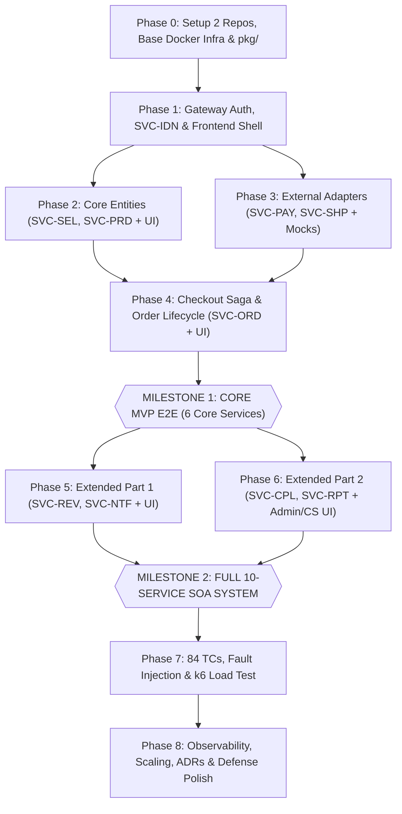

# 06. Implementation Plan — SOA-Market

> **Tổ chức đội ngũ:** Nhóm **5 thành viên** — học phần _Kiến trúc hướng dịch vụ (SOA)_  
> **Cấu trúc mã nguồn:** **2 Repository tách biệt** (`soa-market-backend` + `soa-market-frontend`), phân công theo **lát cắt dọc (Vertical Slices)** để cả 5 thành viên đều trực tiếp thực hành đầy đủ nguyên lý SOA.  
> **Thứ tự thực hiện:** Chia thuần theo phụ thuộc kỹ thuật từ **Phase 0 → Phase 8** (không gắn cố định số tuần), có **2 Mốc nghiệm thu lớn**: **Milestone 1 (Core MVP — 6 dịch vụ lõi sau Phase 4)** và **Milestone 2 (Full 10 dịch vụ sau Phase 6)**.

---

## 1. Quy tắc làm việc với AI Coding Agents & Quản trị hợp đồng (Contract-First)

Áp dụng đúng quy trình của `vibecoding.pdf`:

1. **Tuyệt đối không yêu cầu AI sinh toàn bộ app trong 1 lần.**
2. Khi mở phiên làm việc mới với AI Agent (cho từng dịch vụ hoặc từng Phase), luôn cung cấp cả 6 file trong `docs/vibecoding/` và dùng prompt mở đầu:
   > _"Đọc kỹ 7 tài liệu trong `docs/vibecoding/`. Chưa viết code vội. Hãy tóm tắt phạm vi Phase X / dịch vụ SVC-YYY bạn phụ trách, liệt kê các hợp đồng API/Event liên quan và kế hoạch file cần tạo, sau đó thực hiện từng bước."_
3. **Luật Contract-First giữa 2 Repo (`soa-market-backend` ↔ `soa-market-frontend`):**
   - Mọi thay đổi API phải cập nhật struct Huma → sinh tự động file OpenAPI 3.0 vào `contracts/openapi/<svc>.yaml` → merge PR được Tech Lead review tương thích ngược (`NFR-MNT-001`).
   - Repo `soa-market-frontend` chạy `npm run sync-contracts` để tái sinh TypeScript types bằng `openapi-typescript` trước khi code UI — cấm gõ tay kiểu dữ liệu API rời rạc.
4. **Luật ranh giới SOA khi code Go:** `pkg/` chỉ chứa hạ tầng kỹ thuật thuần (logger, otel, envelope, outbox, httpclient, jwt-middleware); **tuyệt đối cấm đặt struct/logic nghiệp vụ hoặc import giữa các thư mục `services/svc-*`**.

---

## 2. Cấu trúc 2 Repository (Directory Blueprint)

### Repo 1: `soa-market-backend` (Monorepo 10 Go Modules độc lập)

```text
soa-market-backend/
├── contracts/
│   ├── openapi/                 # OpenAPI 3.0 YAML tự sinh từ Huma cho 10 dịch vụ
│   ├── events/                  # JSON Schema cho 34 sự kiện miền + EventEnvelope
│   └── adr/                     # ADR-01..ADR-05 (NFR-MNT-006)
├── infra/
│   ├── docker-compose.yml       # Core services + infra (--profile observability)
│   ├── postgres/init-schemas.sql# 10 schemas + 10 restricted DB roles (SOA-R02)
│   ├── traefik/                 # Traefik v3 static & dynamic config (Consul provider)
│   ├── nats/                    # JetStream config & stream/KV bootstrap script
│   ├── consul/                  # Consul config & seed 21 PRM-xx vào Consul KV
│   └── observability/           # OTel Collector, Prometheus, Loki, Tempo, Grafana dashboards
├── pkg/                         # Shared technical libraries (go.mod riêng, ZERO business logic)
│   ├── config/                  # Consul KV + Viper dynamic param loader
│   ├── logger/                  # Structured JSON slog + PII masker + X-Correlation-Id
│   ├── telemetry/               # OpenTelemetry tracing + Prometheus /metrics
│   ├── httpclient/              # Timeout, retry backoff, sony/gobreaker, internal HMAC signing
│   ├── messaging/               # NATS JetStream publisher/consumer + Outbox relay + DLQ
│   ├── postgres/                # pgxpool, advisory lock, migration runner
│   └── middleware/              # Gateway signature verifier, RBAC guard, Idempotency helper
├── services/
│   ├── gateway-auth/            # Go ForwardAuth (JWT JWKS + NATS KV revoked + Rate Limit)
│   ├── svc-idn/                 # Mỗi svc là 1 go.mod + Dockerfile + sqlc + migrations riêng!
│   ├── svc-sel/
│   ├── svc-prd/
│   ├── svc-ord/
│   ├── svc-pay/
│   ├── svc-shp/
│   ├── svc-rev/
│   ├── svc-cpl/
│   ├── svc-ntf/
│   └── svc-rpt/
└── tests/
    ├── integration/             # E2E Go integration tests (testcontainers-go)
    ├── fault-injection/         # Kịch bản tiêm lỗi SOA (kill NATS, kill REV, late payment...)
    └── load/                    # k6 scripts (200 RPS, 10 checkout/s, 500 VUs)
```

### Repo 2: `soa-market-frontend` (React + Vite SPA — 3 Portals)

```text
soa-market-frontend/
├── Dockerfile                   # Multi-stage Node build -> Nginx Alpine
├── nginx.conf                   # SPA fallback + gzip
├── scripts/sync-contracts.mjs   # Kéo OpenAPI specs -> sinh src/api/generated/*.d.ts
└── src/
    ├── api/                     # openapi-fetch client, JWT refresh interceptor, Idempotency helper
    ├── components/
    │   ├── ui/                  # shadcn/ui primitives
    │   └── shared/              # ShopPackageCard, PartialRefundBreakdown, ServiceFallbackBanner,
    │                            # SlaCountdownPill, AuditReasonDialog, SyncTimestampBadge
    ├── locales/vi/              # Chuỗi tiếng Việt tách rời (NFR-USA-001)
    ├── layouts/                 # BuyerLayout, SellerLayout, AdminLayout (menu ≤ 3 cấp)
    └── features/                # Chia đúng theo miền 5 thành viên để hạn chế merge conflict!
        ├── auth-profile/        # (TV1 — Trần Thanh Cường)
        ├── seller-shop/         # (TV2 — Nguyễn Nhật Khánh)
        ├── catalog-inventory/   # (TV3 — Nguyễn Huy Hoàng)
        ├── cart-checkout-order/ # (TV4 — Nguyễn Khánh Dương)
        ├── payment-shipping/    # (TV5 — Huỳnh Hữu Đan)
        ├── reviews/             # (TV2 — Nguyễn Nhật Khánh)
        ├── notifications/       # (TV3 — Nguyễn Huy Hoàng)
        ├── complaints/          # (TV4 — Nguyễn Khánh Dương)
        └── admin-reports/       # (TV1 — Trần Thanh Cường)
```

---

## 3. Ma trận phân công nhóm 5 người (Vertical Slice Ownership)

Mỗi thành viên sở hữu **2 dịch vụ Backend Go** (1 ở Giai đoạn 1 Core MVP + 1 ở Giai đoạn 2 Extended) cùng **các màn hình Frontend tương ứng**, bảo đảm cả 5 người đều trực tiếp triển khai đầy đủ chuẩn SOA (OpenAPI, schema riêng, Outbox, NATS, Consul, test). Bảng bóc tách ticket/task chi tiết từng người nằm tại `07-Team-Task-Breakdown.md`.

|   Mã    | Thành viên             | Vai trò kiêm nhiệm                         | Giai đoạn 1 (Core MVP)                                                                                         | Giai đoạn 2 (Extended)                                                                   | Frontend Modules (`soa-market-frontend`)                                                                                 |
| :-----: | :--------------------- | :----------------------------------------- | :------------------------------------------------------------------------------------------------------------- | :--------------------------------------------------------------------------------------- | :----------------------------------------------------------------------------------------------------------------------- |
| **TV1** | **Trần Thanh Cường**   | **SOA Infra & Security Lead**              | Hạ tầng `infra/`, `pkg/`, `gateway-auth` + **`SVC-IDN`** (kèm Mailpit OTP stub)                                | **`SVC-RPT`** (Read models, 21 PRM động, AuditLog, Health/DLQ, Reports)                  | `auth-profile/`, `admin-reports/` (Users, Params, Audit, System/DLQ, Reports)                                            |
| **TV2** | **Nguyễn Nhật Khánh**  | **FE Foundation & Design System Lead**     | Khung `soa-market-frontend`, Design System, OpenAPI codegen + **`SVC-SEL`**                                    | **`SVC-REV`** (Đánh giá, tổng hợp điểm, phản hồi, kiểm duyệt)                            | `layouts/`, `components/shared/`, `seller-shop/`, `reviews/`                                                             |
| **TV3** | **Nguyễn Huy Hoàng**   | **Catalog, Inventory & Messaging**         | **`SVC-PRD`** (Danh mục 2 cấp, SP/SKU, tìm kiếm 50k SP, tồn kho `validate-and-reserve`)                        | **`SVC-NTF`** (Full 28-event consumer Email + In-App Notification Center)                | `catalog-inventory/` (Home, Search, Product Detail, Seller Products/Inventory, Categories), `notifications/`             |
| **TV4** | **Nguyễn Khánh Dương** | **Saga & Process Orchestration Lead**      | **`SVC-ORD`** (Giỏ đa nhà bán, Checkout Saga, tách `SellerOrder`, schedulers `T_PAY`/`T_CONFIRM`/`T_COMPLETE`) | **`SVC-CPL`** (Khiếu nại nhiều bên, thương lượng, CSKH Arbitration & thực thi)           | `cart-checkout-order/` (Cart, Checkout ≤3 màn hình, Buyer/Seller Orders), `complaints/` (Buyer, Seller, CSKH Split-View) |
| **TV5** | **Huỳnh Hữu Đan**      | **External Adapters & QA/Resilience Lead** | **`SVC-PAY`** (VNPay + MockPayment) & **`SVC-SHP`** (GHN + MockShipping)                                       | Bộ **Integration Tests, Fault Injection, `k6` Load Test (200 RPS)** & Sandbox smoke test | `payment-shipping/` (Checkout Result, Tracking Timeline, Exceptions, Manual Refund, Mock Control Panel)                  |

---

## 4. Biểu đồ thứ tự phụ thuộc các Phase (Build Sequence)



---

## 5. Kế hoạch triển khai chi tiết từng Phase (Phase 0 → Phase 8)

### Phase 0 — Khởi tạo 2 Repo, Hạ tầng Docker SOA & Thư viện kỹ thuật `pkg/`

**Xây dựng đầu tiên (What to build first):** Nền móng hạ tầng và khung chuẩn hóa để cả 5 người có thể chạy song song không xung đột.

- **Setup steps (`TV1 — Trần Thanh Cường` chủ trì, cả nhóm phối hợp):**
  1. Khởi tạo 2 Git repo (`soa-market-backend`, `soa-market-frontend`), cấu hình `.gitignore`, `Makefile`, GitHub Actions CI cơ bản (`go test -race ./...`, `golangci-lint`, `npm run typecheck`).
  2. Tạo `infra/postgres/init-schemas.sql` sinh đủ **10 schema (`svc_idn`..`svc_rpt`) + 10 user/role cô lập quyền**; kiểm chứng thử user `usr_svc_ord` không thể `SELECT` từ `svc_pay` (`SOA-R02`).
  3. Tạo `infra/docker-compose.yml` chạy nền: **PostgreSQL 16**, **NATS JetStream** (kèm bootstrap script tạo stream `SOA_EVENTS`, `SOA_DLQ` và KV bucket `revoked_users`), **Consul**, **Traefik v3** (Consul Catalog provider), **MinIO** (5 buckets), **Mailpit** (`:1025` / `:8025`).
  4. Xây dựng `pkg/` (chỉ thư viện kỹ thuật): JSON logger có `X-Correlation-Id` & PII masking; OTel + Prometheus exporter; NATS JetStream publisher/consumer + Transactional Outbox Relay (`FOR UPDATE SKIP LOCKED`); `httpclient` (timeout + retry backoff + `sony/gobreaker` + HMAC nội bộ); Consul registration + Viper/Consul KV dynamic config loader; Huma standard error model.
  5. Tạo sẵn khung thư mục và `go.mod` + `Dockerfile` template + `sqlc.yaml` cho 10 dịch vụ.
- **Deliverables:** `docker compose up -d` khởi chạy xanh 100% các thành phần hạ tầng; Consul UI (`:8500`), Traefik Dashboard, MinIO Console, Mailpit (`:8025`) hoạt động; script verify cô lập DB role pass.

---

### Phase 1 — Xác thực, API Gateway ForwardAuth & Khung Frontend Shell

**Xây dựng thứ hai (What to build second):** Mọi dịch vụ nghiệp vụ khác đều phụ thuộc JWT, danh tính người dùng và khung UI chung.

- **Authentication & Gateway (`TV1 — Trần Thanh Cường`):**
  1. Viết `services/svc-idn`: migration 7 bảng `svc_idn`, `sqlc` queries, đầy đủ **20 API** (`FR-ACC-001..006`), ký JWT RS256 + `GET /v1/auth/keys` (JWKS), Refresh Token rotation + reuse detection, lưu `privacyConsentedAt` (NĐ 13/2023), khóa tài khoản phát `user.status_changed` + `audit.recorded` qua Outbox. Gắn adapter SMTP tạm gửi OTP & reset password thẳng vào **Mailpit** (sẽ chuyển qua `SVC-NTF` ở Phase 5).
  2. Viết `services/gateway-auth`: ForwardAuth endpoint cho Traefik — cache JWKS từ `SVC-IDN`, subscribe `user.status_changed` cập nhật NATS KV `revoked_users`, kiểm tra thu hồi JWT tức thì, enforce rate limit (100 req/phút/user, 20 req/phút/IP), sinh `X-Correlation-Id`, ký `X-Gateway-Signature` chuyển tiếp `X-User-Id`/`X-User-Roles`.
- **Core UI Shell (`TV2 — Nguyễn Nhật Khánh`):**
  1. Dựng `soa-market-frontend`: Vite + React + TypeScript + Tailwind v4 + shadcn/ui + font `Be Vietnam Pro` & `JetBrains Mono` + màu Clean Modern Commerce (`#1D4ED8` / `#EA580C`).
  2. Tạo `BuyerLayout`, `SellerLayout`, `AdminLayout` (sidebar ≤ 3 cấp), `RoleGuard`, `i18next` tiếng Việt, `openapi-fetch` client + silent JWT refresh interceptor + `Idempotency-Key` helper.
  3. Tạo sẵn 6 component đặc thù: `<ShopPackageCard />`, `<PartialRefundBreakdown />`, `<ServiceFallbackBanner />`, `<SlaCountdownPill />`, `<AuditReasonDialog />`, `<SyncTimestampBadge />`.
- **Auth UI (`TV1 — Trần Thanh Cường`):** Màn hình `/register` (checkbox NĐ 13/2023 chưa tích sẵn), `/verify-otp`, `/login`, `/forgot-password`, `/reset-password`, `/account/profile`, `/account/addresses`, `/admin/users`.
- **Deliverables:** Đăng ký nhận OTP trên Mailpit → đăng nhập → gọi API qua Traefik → Admin khóa tài khoản thì access token cũ bị chặn **ngay lập tức** (`TC-ACC-01..08` đạt).

---

### Phase 2 — Dịch vụ Thực thể Lõi: Nhà bán (`SVC-SEL`) & Sản phẩm/Tồn kho (`SVC-PRD`)

_(Chạy song song với Phase 3 bởi TV2 — Nguyễn Nhật Khánh và TV3 — Nguyễn Huy Hoàng!)_

- **`SVC-SEL` (`TV2 — Nguyễn Nhật Khánh`):**
  1. Migration + `sqlc` cho `seller_applications`, `shops`, `pickup_addresses`.
  2. Cài đặt **13 API** (`FR-SEL-001..005`), upload tài liệu KYC lên MinIO (`private-kyc`, kiểm tra magic bytes & dung lượng), phát 4 sự kiện (`seller.application_submitted`, `seller.approved`, `seller.rejected`, `shop.status_changed`).
  3. Cập nhật consumer `seller.approved` trên `SVC-IDN` (`TV1 — Trần Thanh Cường`) để tự động gán vai trò `SELLER`.
  4. UI Frontend (`TV2 — Nguyễn Nhật Khánh`): `/seller-onboarding`, `/admin/seller-applications`, `/seller/shop`, `/shops/:id`, `/admin/shops`.
- **`SVC-PRD` (`TV3 — Nguyễn Huy Hoàng`):**
  1. Migration + `sqlc` cho `categories` (≤ 2 cấp), `products` (TSVECTOR search), `product_variants` (bắt buộc `weight_gram` 10–50.000), `inventory_items` (`reserved <= on_hand`), `inventory_reservations`, `stock_adjustments`, `shop_status_replicas`.
  2. Cài đặt **18 API** (`FR-PRD-001..009`), trọng tâm:
     - `POST /internal/v1/inventory/validate-and-reserve` (giao dịch cục bộ all-or-nothing, khóa lạc quan `version`, `Idempotency-Key`), `commit`, `release`.
     - Cron `robfig/cron` + `FOR UPDATE SKIP LOCKED` tự giải phóng giữ chỗ quá `T_RESERVE`.
     - Consumer nhận `shop.status_changed` tự ẩn/hiện sản phẩm và nhận `sellerorder.cancelled` trả tồn kho.
  3. UI Frontend (`TV3 — Nguyễn Huy Hoàng`): `/`, `/products` (tìm kiếm/lọc/sắp xếp), `/products/:id`, `/seller/products`, `/seller/inventory`, `/admin/categories`, `/admin/moderation/products`.
- **Deliverables:** Luồng đăng ký nhà bán → Admin duyệt → tự có role `SELLER` → tạo sản phẩm nhiều SKU → tìm kiếm → khóa shop sản phẩm biến mất khỏi tìm kiếm trong ≤ 5s; kiểm thử tranh chấp 2 goroutine giữ món cuối cùng chỉ 1 thắng (`TC-SEL-01..05`, `TC-PRD-01..09` đạt).

---

### Phase 3 — Dịch vụ Đối tác Ngoài: Thanh toán (`SVC-PAY`) & Vận chuyển (`SVC-SHP`)

_(Chạy song song với Phase 2 bởi TV5 — Huỳnh Hữu Đan!)_

- **`SVC-PAY` (`TV5 — Huỳnh Hữu Đan`):**
  1. Migration + `sqlc` cho `payment_transactions` (unique partial index `DC-11`), `payment_allocations`, `refunds`, `seller_ledger_entries`, `webhook_event_logs`, `outbox_events`, `idempotency_records`.
  2. Cài đặt `PaymentGatewayAdapter` với 2 implementation: **`MockPaymentAdapter`** (mặc định, có trang giả lập thanh toán + API điều khiển tiêm lỗi `delay/fail/duplicate/bad-hmac/late`) và **`VnPayAdapter`** (VNPay Sandbox).
  3. Cài đặt **11 API** (`FR-PAY-001..007`), xác thực webhook HMAC + `T_SKEW` + khử trùng lặp, truy vấn chủ động `inquiry`, hoàn tiền idempotent + cron retry `N_RETRY` backoff + `POST /v1/admin/refunds/{id}/mark-manual-success`, tính `SellerLedgerEntry` (phí 5% `itemsAmount`).
- **`SVC-SHP` (`TV5 — Huỳnh Hữu Đan`):**
  1. Migration + `sqlc` cho `carriers`, `shipping_rates` (bảng phí dự phòng `ASM-12`), `shipments`, `tracking_events`, `webhook_event_logs`.
  2. Cài đặt `ShippingCarrierAdapter`: **`MockShippingAdapter`** (mặc định, có điều khiển kích hoạt từng chặng `PICKED_UP → DELIVERED` hoặc `DELIVERY_ATTEMPT_FAILED ×3 → RETURNED`, `failCreateCount`, out-of-order webhook) và **`GhnAdapter`** (GHN Sandbox).
  3. Cài đặt **8 API** (`FR-SHP-001..006`), consumer `sellerorder.confirmed` tự tạo vận đơn (retry `N_RETRY`, hết lượt đặt `CREATE_FAILED` phát `shipment.creation_failed`), webhook chống lùi trạng thái theo `occurredAt`, hủy vận đơn chỉ khi `CREATED`, tạo vận đơn hoàn hàng `/internal/v1/return-shipments`.
- **Deliverables:** Unit & integration test xác thực webhook HMAC, chống trùng, retry backoff, bảng phí dự phòng, kiểm soát `PaymentAllocation` khớp tuyệt đối (`TC-PAY-01..06`, `TC-SHP-01..06` đạt).

---

### Phase 4 — Điều phối Giỏ hàng, Checkout Saga & Vòng đời Đơn hàng (`SVC-ORD`) → MILESTONE 1 (CORE MVP)

**Bước hội tụ lõi của toàn bộ 6 dịch vụ Giai đoạn 1 (`TV4 — Nguyễn Khánh Dương` chủ trì, `TV5 — Huỳnh Hữu Đan` hỗ trợ UI Payment/Tracking):**

- **`SVC-ORD` Backend (`TV4 — Nguyễn Khánh Dương`):**
  1. Migration + `sqlc` cho `carts`, `cart_items`, `orders`, `seller_orders`, `order_items`, `order_status_history`, `checkout_processes`, `shipping_quote_cache`, `shop_status_replicas`.
  2. Cài đặt **15 API** (`FR-CRT-001..004`, `FR-ORD-001..010`):
     - Giỏ đa nhà bán gọi batch `SVC-PRD` cảnh báo đổi giá/hết hàng, chặn tự mua hàng shop mình (`BR-SEL-05`).
     - Checkout Summary cache báo giá ship 5 phút; `POST /v1/checkout` thực thi **Saga bền vững** (`validate-and-reserve` → tạo `Order` + `k SellerOrder` → `POST /internal/v1/payments` → bồi thường nếu lỗi).
     - Máy trạng thái `SellerOrder` với khóa lạc quan `version`, tự suy ra trạng thái `Order` (`BR-ORD-09`).
     - Xử lý sự kiện `payment.succeeded` (commit kho, hoặc nếu Order đã `CANCELLED` phát `order.payment_rejected` hoàn 100% — `FR-ORD-008`), `payment.failed`, `shipment.*`, `shop.status_changed`.
     - 3 Cron Jobs (`robfig/cron` + `FOR UPDATE SKIP LOCKED`): quá hạn `T_PAY` (hỏi `SVC-PAY inquiry` trước khi hủy!), quá hạn `T_CONFIRM` (hủy riêng 1 `SellerOrder` + hoàn tiền một phần), tự hoàn tất `T_COMPLETE` (chỉ khi `has_open_complaint = FALSE`).
- **Frontend Core Checkout & Orders (`TV4 — Nguyễn Khánh Dương` + `TV5 — Huỳnh Hữu Đan`):**
  - Buyer: `/cart`, `/checkout`, `/checkout/result` (≤ 3 màn hình!), `/account/orders`, `/account/orders/:id` (nhiều `<ShopPackageCard />`, `<PartialRefundBreakdown />`, hành trình vận chuyển có giảm cấp khi tắt `SVC-SHP`).
  - Seller: `/seller/orders`, `/seller/orders/:id` (Xác nhận/Từ chối/Hủy, In nhãn, Retry vận đơn `CREATE_FAILED`).
  - Admin cơ bản: `/admin/exceptions` (xác nhận hoàn tiền thủ công `mark-manual-success`).
- **Deliverables (MILESTONE 1 — CORE MVP):** Chạy demo E2E thành công kịch bản 1 giỏ hàng **3 nhà bán**: thanh toán 1 lần → Nhà bán A xác nhận & giao thành công → Nhà bán B không xác nhận quá `T_CONFIRM` tự hủy & hoàn tiền 1 phần → Nhà bán C giao thất bại 3 lần hoàn hàng & hoàn 100% tiền gói C (`TC-CRT-01..04`, `TC-ORD-01..14` đạt).

---

### Phase 5 — Dịch vụ Mở rộng Phần 1: Đánh giá (`SVC-REV`) & Thông báo (`SVC-NTF`)

_(Chạy song song với Phase 6 bởi TV2 — Nguyễn Nhật Khánh và TV3 — Nguyễn Huy Hoàng!)_

- **`SVC-REV` (`TV2 — Nguyễn Nhật Khánh`):**
  1. Migration + `sqlc` cho `eligible_order_items`, `reviews`, `review_replies`, `review_reports`, `rating_aggregates`.
  2. Cài đặt **7 API** (`FR-REV-001..005`), bộ lọc từ cấm cấu hình, cơ chế giữ hiển thị dưới ngưỡng `N_REPORT_HIDE=3` (`OQ-10`), consumer `sellerorder.delivered`, phát `review.published` & `review.visibility_changed` để `SVC-PRD` và `SVC-SEL` cập nhật điểm tổng hợp.
  3. UI Frontend (`TV2 — Nguyễn Nhật Khánh`): Khối đánh giá trong `/products/:id` và `/shops/:id` (có `<ServiceFallbackBanner />` khi tắt `SVC-REV`), `/account/reviews`, `/seller/reviews`, `/admin/moderation/reviews`.
- **`SVC-NTF` (`TV3 — Nguyễn Huy Hoàng`):**
  1. Migration + `sqlc` cho `notification_templates`, `event_template_mappings`, `notifications` (`UNIQUE (event_id, recipient_id, channel)`), `delivery_attempts`.
  2. Cài đặt **4 API** (`FR-NTF-001..002`), consumer đăng ký toàn bộ **28 sự kiện miền**, gửi email qua `EmailAdapter` (Mailpit/SMTP) kèm retry `N_RETRY`, đồng thời lưu thông báo In-App.
  3. Chuyển `SVC-IDN` (`TV1 — Trần Thanh Cường`) từ SMTP stub sang gọi đồng bộ `POST /internal/v1/notifications` (có timeout/circuit breaker).
  4. UI Frontend (`TV3 — Nguyễn Huy Hoàng`): Chuông thông báo + badge số chưa đọc trên Topbar & trang `/account/notifications`.
- **Deliverables:** Luồng đánh giá cập nhật điểm sang `SVC-PRD`/`SVC-SEL` ≤ 5s; tắt `SVC-REV` hoặc `SVC-NTF`/Mailpit luồng đặt hàng vẫn 200 OK; mọi sự kiện sinh đúng 1 email trên Mailpit + 1 thông báo In-App (`TC-REV-01..05`, `TC-NTF-01..02` đạt).

---

### Phase 6 — Dịch vụ Mở rộng Phần 2: Khiếu nại (`SVC-CPL`) & Quản trị/Báo cáo (`SVC-RPT`) → MILESTONE 2 (FULL SYSTEM)

_(Chạy song song với Phase 5 bởi TV4 — Nguyễn Khánh Dương và TV1 — Trần Thanh Cường!)_

- **`SVC-CPL` (`TV4 — Nguyễn Khánh Dương`):**
  1. Migration + `sqlc` cho `complaints` (partial unique index `DC-16`), `complaint_messages`, `evidences` (SHA-256, MinIO `private-evidence`), `resolutions`, `complaint_status_history`, `seller_order_replicas`.
  2. Cài đặt **10 API** (`FR-CPL-001..009`), tách độc lập nhiều khiếu nại liên kết `orderId`, phát `complaint.opened` (giữ `SellerOrder` ở `DELIVERED` & giữ `SellerLedgerEntry` ở `ON_HOLD`), cron tự chuyển cấp `T_CPL_SELLER` / `T_CPL_NEGOTIATE`, điều phối thực thi `RETURN_REFUND` (tạo vận đơn hoàn qua `SVC-SHP` → chỉ gửi lệnh hoàn tiền `SVC-PAY` sau khi nhận `shipment.returned` — `OQ-11` → chỉ `CLOSED` sau `refund.completed`).
  3. UI Frontend (`TV4 — Nguyễn Khánh Dương`): `/account/complaints`, `/seller/complaints`, `/admin/complaints/queue` (SLA countdown sort), `/admin/complaints/:id` (3-column CSKH Arbitration Workspace).
- **`SVC-RPT` (`TV1 — Trần Thanh Cường`):**
  1. Migration + `sqlc` cho `audit_logs` (append-only `REVOKE UPDATE, DELETE`), `business_parameters` (seed 21 `PRM-01..21`), `exception_items`, các bảng `*_views` và `*_aggregates`.
  2. Cài đặt **12 API** (`FR-ADM-001..004`, `FR-RPT-001..002`), consumer tiêu thụ **24 sự kiện miền** cập nhật read models + đối soát định kỳ phát hiện lệch tiền – đơn đưa vào `exception_items` (`NFR-REL-004`), quản lý động 21 `PRM-xx` (ghi Consul KV + phát `config.changed`), đọc trạng thái 10 dịch vụ từ Consul + đọc/replay stream `SOA_DLQ`.
  3. UI Frontend (`TV1 — Trần Thanh Cường` + `TV5 — Huỳnh Hữu Đan`): `/admin` (Overview + biểu đồ Recharts), `/admin/orders`, `/admin/transactions`, `/admin/exceptions`, `/admin/config/params`, `/admin/audit-logs`, `/admin/system` (Health & DLQ Replay), `/seller` (Báo cáo hiệu suất gian hàng).
- **Deliverables (MILESTONE 2 — FULL 10 SERVICES):** Toàn bộ 10 dịch vụ, 69 FR, 118 API, 34 sự kiện vận hành khép kín; đổi `T_PAY` ở `/admin/config/params` áp dụng ngay cho đơn mới không cần rebuild (`TC-CPL-01..08`, `TC-ADM-01..04`, `TC-RPT-01..02` đạt).

---

### Phase 7 — Kiểm thử Toàn diện, Tiêm lỗi (Fault Injection) & Kiểm thử Tải (`k6`)

**`TV5 — Huỳnh Hữu Đan` chủ trì, cả 5 thành viên viết test cho 2 dịch vụ mình phụ trách:**

1. **Unit & Contract Testing (`go test -race -cover`):**
   - Đạt tối thiểu **≥ 70% coverage** cho tầng logic nghiệp vụ lõi của từng dịch vụ (`NFR-MNT-004`).
   - Tự động xuất OpenAPI 3.0 từ Huma và chạy contract test xác nhận khớp `contracts/openapi/*.yaml` & `contracts/events/*.json` (`TC-NFR-10`).
2. **Integration Testing (`testcontainers-go`):**
   - Dựng PostgreSQL + NATS JetStream + Consul cô lập; chạy tự động bộ kiểm thử xuyên dịch vụ phủ đủ **84 kịch bản kiểm thử (TC)** của SRS Chương 9 (kèm rút ngắn `T_PAY`/`T_CONFIRM`/`T_COMPLETE`/`T_CPL_SELLER` xuống vài giây qua Consul KV để test tự động không phải chờ).
3. **Fault Injection Suite (`tests/fault-injection/`):**
   - _FI-01 (Outbox):_ Dừng container NATS → thực hiện đặt hàng/xác nhận → bật lại NATS → xác nhận 0 sự kiện bị mất (`NFR-REL-001`).
   - _FI-02 (Graceful Degradation):_ Dừng `svc-rev`, `svc-ntf`, `svc-rpt` → duyệt SP, đặt hàng, thanh toán vẫn thành công 100%, FE hiện `<ServiceFallbackBanner />` (`NFR-REL-005`).
   - _FI-03 (Payment Anomalies):_ Gửi webhook trùng 3 lần, chữ ký sai, thanh toán đến muộn sau khi hủy đơn (`FR-ORD-008`), đánh rơi webhook để cron `inquiry` cứu đơn (`FR-PAY-003`).
   - _FI-04 (Shipping & DLQ):_ Tiêm lỗi ĐVVC hết `N_RETRY` → vận đơn `CREATE_FAILED`, đơn không tự hủy, Seller bấm Retry thành công; bắn poison message → vào `SOA_DLQ` → Admin replay trên UI (`NFR-REL-007`).
   - _FI-05 (Security & IDOR):_ Chạy kiểm thử chéo 2 tài khoản Buyer/Seller trên toàn bộ API xác nhận 0 lỗ hổng IDOR, quét tệp `EICAR`, kiểm thử rate limit 429 (`TC-NFR-05`, `TC-NFR-06`).
4. **Load Testing (`k6` — `tests/load/`):**
   - Seed dữ liệu chuẩn (50.000 sản phẩm, ≥ 3 nhà bán, nhiều biến thể, đủ 5 vai trò).
   - Chạy kịch bản hỗn hợp **200 req/s** (**10 checkout/s**, **500 VUs**) trong 15 phút → xác minh p95 đọc ≤ 500ms, ghi ≤ 800ms, search ≤ 1s, checkout ≤ 2s, lỗi 5xx < 1% (`TC-NFR-01`, `TC-PRD-06`).

- **Deliverables:** Báo cáo coverage ≥ 70%, kết quả pass 84/84 TC (`ACP-01..ACP-09`), báo cáo `k6` & báo cáo đối soát tiền – đơn 0 sai lệch.

---

### Phase 8 — Observability, Scaling, Sandbox Smoke Test & Hoàn thiện Bảo vệ Môn học

**Cả 5 thành viên cùng rà soát và diễn tập bảo vệ:**

1. **Bật & Tinh chỉnh Observability (`docker compose --profile observability up -d` — `TV1 — Trần Thanh Cường`):**
   - Dựng sẵn 2 Grafana Dashboard: (1) _SOA Overview_ (RPS, 5xx rate, p95 latency 10 dịch vụ từ Prometheus), (2) _Order End-to-End Trace_ (nhập `X-Correlation-Id` xem trọn log Loki + trace Tempo xuyên qua Traefik → `SVC-ORD` → `SVC-PRD` → `SVC-PAY` → `SVC-SHP` — `TC-NFR-07`).
2. **Kiểm chứng Multi-Replica Scaling & Rolling Update (`TV1 — Trần Thanh Cường` + `TV4 — Nguyễn Khánh Dương`):**
   - Chạy `docker compose up -d --scale svc-ord=2 --scale svc-prd=2`: xác minh Consul đăng ký 2 instance, Traefik chia tải, 2 bản sao cron không hủy/hoàn tiền trùng (`TC-NFR-02`, `TC-NFR-09`), tắt 1 bản sao khi có tải không lỗi 5xx (`NFR-AVA-005`).
3. **VNPay Sandbox & GHN Sandbox Smoke Test (`TV5 — Huỳnh Hữu Đan`):**
   - Đổi biến môi trường `PAYMENT_ADAPTER=vnpay`, `SHIPPING_ADAPTER=ghn` (không sửa 1 dòng logic nghiệp vụ!) → chạy thành công 1 giao dịch thực trên môi trường Sandbox để chứng minh `SOA-R05` (`NFR-MNT-003`, `NFR-CMP-005`).
4. **Kiểm tra UI/UX & Trình duyệt (`TV2 — Nguyễn Nhật Khánh` + `TV3 — Nguyễn Huy Hoàng`):**
   - Kiểm tra hiển thị 360px–1920px trên Chrome/Edge/Firefox, kiểm tra bàn phím/WCAG AA, chạy thử nghiệm khả dụng với 5 người dùng cho trang đơn đa nhà bán (`TC-NFR-08`).
5. **Hoàn thiện Hồ sơ Báo cáo & Kịch bản Demo 15 phút (`Cả nhóm` — xem phân vai chi tiết tại `07-Team-Task-Breakdown.md`):**
   - Hoàn thiện 5 tệp ADR (`contracts/adr/ADR-01..05.md`), bổ sung MSSV/vai trò hoàn tất `OQ-01`, cập nhật `README.md` 1-lệnh khởi chạy ở cả 2 repo.
   - **Kịch bản trình diễn bảo vệ SOA chuẩn (5 thành viên chia phần):**
     1. _Kiến trúc & Cô lập:_ Mở Consul UI (10 dịch vụ khỏe) + chạy query chứng minh DB role isolation (`SOA-R02`) + đổi `T_PAY` động qua UI (`NFR-MNT-005`).
     2. _Kịch bản lõi đa nhà bán:_ Đặt hàng 3 shop (≤ 3 màn hình) → Thanh toán 1 lần → Shop A giao thành công → Shop B quá hạn `T_CONFIRM` tự hủy & hoàn 1 phần → Shop C giao lỗi hoàn hàng.
     3. _Kịch bản chịu lỗi & Saga:_ Bật chế độ thanh toán đến muộn (tự hoàn 100%), tắt `SVC-REV` & `SVC-NTF` (FE giảm cấp mượt bằng Fallback Banner), tắt NATS rồi bật lại (Outbox không mất sự kiện), replay DLQ trên Admin UI.
     4. _Truy vết phân tán:_ Copy `X-Correlation-Id` của đơn vừa đặt vào Grafana/Loki/Tempo cho giảng viên thấy toàn bộ hành trình xuyên 10 dịch vụ.

- **Deliverables:** Bộ 2 repo sạch, chạy ổn định bằng `docker compose up -d`, đầy đủ tài liệu ADR/OpenAPI, báo cáo kiểm thử `k6`/84 TC và kịch bản demo bảo vệ môn học hoàn chỉnh.
