# 07. Bảng Phân Công Task Chi Tiết Cho Nhóm 5 Người — SOA-Market

> **Tài liệu bổ trợ cho:** `06-Implementation-Plan.md` (Ánh xạ 100% với SRS SOA-Market v2.2 & 2 Repository `soa-market-backend` + `soa-market-frontend`)  
> **Mục đích:** Cung cấp danh sách **75 task cụ thể (ready-to-import vào GitHub Projects / Trello / Jira)** cho 5 thành viên theo đúng thứ tự phụ thuộc `Phase 0 → Phase 8`, đảm bảo làm việc song song không nghẽn cổ chai và **cả 5 người đều thực hành đầy đủ kỹ thuật SOA**.

---

## 1. Tổng quan phân công & Cân bằng khối lượng (Workload Balance)

| Mã | Thành viên | Vai trò kiêm nhiệm | Dịch vụ Backend (Go) | Quy mô BE | Modules Frontend | Tổng số Task |
| :---: | :--- | :--- | :--- | :--- | :--- | :---: |
| **TV1** | **Trần Thanh Cường** | **SOA Infra & Security Lead** | `infra/`, `pkg/`, `gateway-auth`, **`SVC-IDN`**, **`SVC-RPT`** | 32 API, 12 FR, 2 schemas, 24 events in | `auth-profile/`, `admin-reports/` | **15 tasks** (`T1-01..15`) |
| **TV2** | **Nguyễn Nhật Khánh** | **FE Foundation & Design System Lead** | Khung FE + **`SVC-SEL`**, **`SVC-REV`** | 20 API, 10 FR, 2 schemas, 6 events out | `layouts/`, `components/shared/`, `seller-shop/`, `reviews/` | **15 tasks** (`T2-01..15`) |
| **TV3** | **Nguyễn Huy Hoàng** | **Catalog, Inventory & Messaging** | **`SVC-PRD`**, **`SVC-NTF`** | 22 API, 11 FR, 2 schemas, 33 events in | `catalog-inventory/`, `notifications/` | **15 tasks** (`T3-01..15`) |
| **TV4** | **Nguyễn Khánh Dương** | **Saga & Process Orchestration Lead** | **`SVC-ORD`**, **`SVC-CPL`** | 25 API, 23 FR, 2 schemas, 2 Orchestrators | `cart-checkout-order/`, `complaints/` | **15 tasks** (`T4-01..15`) |
| **TV5** | **Huỳnh Hữu Đan** | **External Adapters & QA/Resilience Lead** | **`SVC-PAY`**, **`SVC-SHP`**, Test Suite (`testcontainers-go`, Fault-Injection, `k6`) | 19 API (2 Webhooks), 13 FR, 2 schemas, 4 Adapters | `payment-shipping/` + Mock Control UI | **15 tasks** (`T5-01..15`) |

> **Kiểm tra cân bằng SOA:** Mỗi thành viên đều phải tự tay viết: PostgreSQL migrations + `sqlc`, Huma OpenAPI 3.0 contracts, Transactional Outbox, NATS JetStream consumers idempotent, Consul registration + dynamic config, unit/contract tests (`go test -race ≥ 70%`) và màn hình React/TypeScript của chính miền mình!

---

## 2. Bản đồ chạy song song & Điểm bàn giao chặn trước (Parallel Tracks & Handoffs)

```mermaid
flowchart LR
    subgraph P0["Phase 0 (Cả nhóm đồng bộ nền)"]
        A0["Cường: T1-01..03 (Infra + pkg/)"]
        B0["Khánh: T2-01..02 (FE Repo + Design System)"]
        C0["Hoàng/Dương/Đan: T3-01, T4-01, T5-01 (Draft OpenAPI/SQL/Event Contracts)"]
    end

    subgraph P1["Phase 1 (Mở khóa Auth & Shell)"]
        A1["Cường: T1-04..06 (SVC-IDN + gateway-auth + Auth UI)"]
        B1["Khánh: T2-03..04 (Layouts + 6 Shared Components + OpenAPI Codegen)"]
    end

    subgraph P23["Phase 2 & 3 (Chạy song song 4 luồng!)"]
        B2["Khánh: T2-05..07 (SVC-SEL + Shop UI)"]
        C2["Hoàng: T3-02..07 (SVC-PRD + Storefront/Inventory UI)"]
        E3["Đan: T5-02..08 (SVC-PAY + SVC-SHP + Mocks)"]
        D3["Dương: T4-02..04 (SVC-ORD Schema + Cart + Saga Mock-First)"]
    end

    subgraph P4["Phase 4 -> MILESTONE 1 (CORE MVP)"]
        D4["Dương + Đan: T4-05..08 & T5-09 (SVC-ORD E2E + Checkout/Order/Tracking UI)"]
    end

    subgraph P56["Phase 5 & 6 -> MILESTONE 2 (FULL 10 SVCs)"]
        B5["Khánh: T2-08..11 (SVC-REV + Review UI)"]
        C5["Hoàng: T3-08..11 (SVC-NTF + Notification UI)"]
        D6["Dương: T4-09..12 (SVC-CPL + Complaint/CSKH UI)"]
        A6["Cường: T1-07..11 (SVC-RPT + Admin/Config/DLQ UI)"]
        E6["Đan: T5-10..11 (Integration & Fault-Injection Harness)"]
    end

    subgraph P78["Phase 7 & 8 (QA, Load Test, Observability & Defense)"]
        ALL["Cả 5 người: Coverage >=70%, 84 TCs, k6 200 RPS, Grafana Trace, Sandbox Smoke, Demo 15p"]
    end

    P0 --> P1 --> P23 --> P4 --> P56 --> P78
```

### Quy tắc chống chờ nhau (Unblocking Rule)
- **Trong Phase 0–1**, khi Cường dựng `infra/` + `pkg/` + `SVC-IDN` và Khánh dựng khung FE, thì **Hoàng, Dương, Đan KHÔNG ngồi chờ**:
  - Hoàng viết trước schema SQL `svc_prd`, truy vấn `sqlc` và OpenAPI spec của `SVC-PRD` (`T3-01`, `T3-02`).
  - Đan viết trước schema SQL `svc_pay`/`svc_shp`, interface `PaymentGatewayAdapter`/`ShippingCarrierAdapter` và Mock adapters (`T5-01`, `T5-02`).
  - Dương viết trước schema SQL `svc_ord`, state machine `SellerOrder` và các unit test máy trạng thái thuần Go (`T4-01`, `T4-02`).
- **Trong Phase 2–3**, Dương gọi `SVC-PRD`/`SVC-PAY`/`SVC-SHP`/`SVC-SEL` qua Go interface client + mock server sinh từ OpenAPI đã chốt ở Phase 0; sang Phase 4 chỉ việc cắm URL thật qua Consul/Docker Compose!

---

## 3. Danh sách Task — TV1: Trần Thanh Cường (`SOA Infra & Security Lead`)

**Sở hữu:** `infra/`, `pkg/`, `gateway-auth`, **`SVC-IDN`** (20 API), **`SVC-RPT`** (12 API) | **FE:** `auth-profile/`, `admin-reports/`

| Mã Task | Phase | Repo | Tên Task & Chi tiết thực hiện | Truy vết SRS | Phụ thuộc | Tiêu chí hoàn thành (DoD) |
| :---: | :---: | :---: | :--- | :--- | :---: | :--- |
| `T1-01` | P0 | BE | **Khởi tạo repo `soa-market-backend` & CI cơ bản:** Cấu trúc monorepo 10 Go modules, `Makefile`, GitHub Actions (`go test -race`, lint), template `Dockerfile` & `sqlc.yaml`. | `SOA-R03` | — | Push nhánh `main` chạy CI xanh; tạo đủ khung 10 thư mục `services/svc-*`. |
| `T1-02` | P0 | BE | **Hạ tầng Docker Compose + Cô lập 10 Schema/Role PostgreSQL:** `docker-compose.yml` (Postgres 16, NATS JetStream + script tạo `SOA_EVENTS`/`SOA_DLQ`/`revoked_users` KV, Consul + seed 21 `PRM-xx`, Traefik v3, MinIO 5 buckets, Mailpit) + `init-schemas.sql`. | `CON-03`, `CON-07`, `SOA-R02`, `SOA-R12` | `T1-01` | `docker compose up -d` xanh 100%; kiểm chứng `usr_svc_ord` bị `permission denied` khi query `svc_pay`. |
| `T1-03` | P0 | BE | **Thư viện kỹ thuật dùng chung `pkg/` (ZERO business logic):** `logger` (JSON `slog` + PII mask + `X-Correlation-Id`), `messaging` (NATS JetStream + Outbox Relay `FOR UPDATE SKIP LOCKED` + DLQ), `httpclient` (timeout + retry + `sony/gobreaker` + HMAC nội bộ), `config` (Consul KV + Viper), `middleware` (Gateway sig + RBAC + Idempotency), `telemetry` (OTel + `/metrics`), `huma` error model. | `SOA-R06`, `SOA-R07`, `SOA-R10`, `NFR-MNT-005` | `T1-01` | Unit test pass với `go test -race`; có ví dụ tích hợp chuẩn để 4 bạn còn lại dùng ngay. |
| `T1-04` | P1 | BE | **Xây dựng `SVC-IDN` (DB + 20 API + OTP Mailpit stub):** Migration 7 bảng `svc_idn`, `sqlc`, đăng ký OTP + `privacyConsentedAt` (NĐ 13/2023), đăng nhập JWT RS256 + `GET /v1/auth/keys` (JWKS), refresh token rotation + reuse detection, hồ sơ/địa chỉ, quên/đổi mật khẩu, RBAC & khóa/mở tài khoản phát `user.status_changed` + `audit.recorded`, xuất OpenAPI `contracts/openapi/svc-idn.yaml`. | `FR-ACC-001..006`, `DC-01`, `NFR-SEC-003` | `T1-02`, `T1-03` | Đủ 20 API hoạt động; đăng ký nhận OTP trên Mailpit; unit test ≥ 70%. |
| `T1-05` | P1 | BE | **Xây dựng `gateway-auth` (Go ForwardAuth + NATS KV, Zero Redis):** Xác thực JWT qua JWKS, subscribe `user.status_changed` đồng bộ vào NATS KV `revoked_users` (chặn tức thì), rate limit (100 req/min/user, 20 req/min/IP → 429), sinh `X-Correlation-Id`, ký `X-Gateway-Signature` tiêm `X-User-Id`/`X-User-Roles`. | `FR-ACC-006`, `NFR-SEC-001`, `NFR-SEC-006`, `SOA-R11` | `T1-02`, `T1-04` | Khóa tài khoản ở `SVC-IDN` thì access token cũ bị Gateway trả 401/403 ngay lập tức; vượt rate limit trả 429 (`TC-ACC-03`, `TC-ACC-04`, `TC-NFR-06`). |
| `T1-06` | P1 | FE | **UI Xác thực, Hồ sơ, Địa chỉ & Quản lý Tài khoản (`auth-profile/`):** `/register` (checkbox NĐ 13/2023 không tích sẵn), `/verify-otp`, `/login`, `/forgot-password`, `/reset-password`, `/account/profile`, `/account/addresses`, `/admin/users` (phân quyền & khóa dùng `<AuditReasonDialog />`). | `FR-ACC-001..006`, `NFR-SEC-009` | `T1-05`, `T2-03` | Chạy thông suốt luồng đăng ký → OTP Mailpit → login → bị khóa văng ra `/login` kèm cảnh báo (`TC-ACC-01..08`). |
| `T1-07` | P2 | BE | **Consumer `seller.approved` trên `SVC-IDN`:** Lắng nghe sự kiện từ `SVC-SEL` (idempotent qua `processed_events`), tự động thêm vai trò `SELLER` vào `svc_idn.user_roles`. | `FR-ACC-005`, `FR-SEL-002` | `T1-04`, `T2-05` | Duyệt nhà bán xong, user refresh token/đăng nhập lại có role `SELLER` trong JWT (`TC-SEL-02`). |
| `T1-08` | P5 | BE | **Chuyển `SVC-IDN` gửi OTP/Reset PW qua `SVC-NTF`:** Thay SMTP stub nội bộ bằng lời gọi đồng bộ `POST /internal/v1/notifications` có timeout & circuit breaker. | `FR-ACC-001`, `FR-NTF-001` | `T3-09` | OTP gửi qua `SVC-NTF` thành công; tắt `SVC-NTF` thì `SVC-IDN` trả lỗi mềm cho phép gửi lại OTP. |
| `T1-09` | P6 | BE | **Xây dựng `SVC-RPT` — Schema, Consumers (24 sự kiện) & AuditLog:** Migration `svc_rpt` (gồm `REVOKE UPDATE, DELETE` trên `audit_logs`), seed 21 `PRM-01..21`, consumer cập nhật read models (`order_views`, `transaction_views`, `shipment_views`, `complaint_views`, `report_daily_aggregates`, `seller_performance_aggregates`, `exception_items`) + cron đối soát tiền – đơn hằng ngày. | `FR-ADM-001`, `FR-ADM-003`, `NFR-REL-004`, `DC-19` | `T1-03`, `T4-05`, `T5-03` | 24 sự kiện cập nhật read model ≤ 5s; `UPDATE`/`DELETE` trên `audit_logs` bị PostgreSQL từ chối. |
| `T1-10` | P6 | BE | **Xây dựng `SVC-RPT` — 12 API Quản trị, Tham số động & DLQ Replay:** `GET /v1/admin/{orders,transactions,exceptions,audit-logs,reports/overview,reports/sellers}`, `GET /v1/seller/reports/performance`, `GET/PUT /v1/admin/config/params` (ghi Consul KV + phát `config.changed`), `GET /v1/admin/system/{health,dlq}`, `POST .../replay` (có audit log). | `FR-ADM-001..004`, `FR-RPT-001..002`, `NFR-MNT-005` | `T1-09` | Đổi `T_PAY` qua API cập nhật sang các dịch vụ không cần rebuild; replay DLQ thành công & ghi audit (`TC-ADM-01..04`, `TC-RPT-01..02`). |
| `T1-11` | P6 | FE | **UI Quản trị, Tham số, Kiểm toán, Health/DLQ & Báo cáo (`admin-reports/`):** `/admin` (Overview + biểu đồ Recharts), `/admin/orders`, `/admin/transactions`, `/admin/config/params`, `/admin/audit-logs`, `/admin/system` (10 service health cards + bảng DLQ replay), `/seller` (Dashboard hiệu suất) — có `<SyncTimestampBadge />`. | `FR-ADM-001..004`, `FR-RPT-001..002` | `T1-10`, `T2-04` | Đủ biểu đồ, bộ lọc, `<AuditReasonDialog />` cho mọi thao tác sửa tham số & replay DLQ; báo cáo 1 tháng ≤ 5s. |
| `T1-12` | P7 | BE | **Unit, Contract & Security Tests cho `SVC-IDN`, `gateway-auth`, `SVC-RPT`:** Đạt coverage ≥ 70%, contract test OpenAPI/Event, kiểm thử IDOR & khóa tài khoản. | `NFR-MNT-004`, `TC-ACC-01..08`, `TC-ADM-01..04`, `TC-RPT-01..02` | `T1-10` | `go test -race -cover` ≥ 70%; pass 100% TC thuộc phạm vi. |
| `T1-13` | P8 | BE | **Profile Observability (`--profile observability`) & Grafana Dashboards:** Cấu hình OTel Collector, Prometheus, Loki, Tempo, Grafana; tạo 2 dashboard *SOA Overview* và *Order End-to-End Trace (`X-Correlation-Id`)*. | `NFR-MON-001..006`, `TC-NFR-07` | `T1-02`, `T1-10` | Nhập `X-Correlation-Id` của 1 đơn trên Grafana thấy trọn vẹn log + span xuyên 10 dịch vụ. |
| `T1-14` | P8 | BE | **Kiểm chứng Multi-Replica Scaling & Rolling Update (`--scale`):** Chạy 2 bản sao `svc-ord`, `svc-prd`, `gateway-auth`, diễn tập tắt 1 bản sao khi đang có tải và backup/restore `pg_dump`. | `NFR-AVA-002..005`, `NFR-SCA-001..003`, `TC-NFR-02`, `TC-NFR-09` | `T1-13`, `T4-05` | Tắt 1 replica không rớt request; Consul tự loại node lỗi khỏi định tuyến. |
| `T1-15` | P8 | BE | **Hoàn thiện ADR-01..ADR-05 & `README.md` backend:** Ghi rõ quyết định Go Cloud-Native, Zero Redis (NATS KV + PG locks), 10 schemas/10 roles, 2 repos, hướng dẫn chạy 1 lệnh. | `NFR-MNT-006`, `OQ-01` | `T1-14` | Đủ 5 file `contracts/adr/ADR-01..05.md` và `README.md` chạy chuẩn trên máy sạch. |

---

## 4. Danh sách Task — TV2: Nguyễn Nhật Khánh (`FE Foundation & Design System Lead`)

**Sở hữu:** Khung `soa-market-frontend`, `layouts/`, `components/shared/`, **`SVC-SEL`** (13 API), **`SVC-REV`** (7 API) | **FE:** `seller-shop/`, `reviews/`

| Mã Task | Phase | Repo | Tên Task & Chi tiết thực hiện | Truy vết SRS | Phụ thuộc | Tiêu chí hoàn thành (DoD) |
| :---: | :---: | :---: | :--- | :--- | :---: | :--- |
| `T2-01` | P0 | FE | **Khởi tạo repo `soa-market-frontend` & Toolchain:** React 19 + Vite 6 + TypeScript strict + React Router v7 + Tailwind CSS v4 + shadcn/ui + TanStack Query v5 + React Hook Form + Zod + `i18next` (`locales/vi`) + `dayjs` (UTC+7) + Nginx `Dockerfile`. | `NFR-CMP-001..002`, `NFR-USA-001` | — | `npm run dev` & `docker build` Nginx chạy xanh; CI typecheck + build pass. |
| `T2-02` | P0 | FE | **Hệ thống Design Tokens & Script đồng bộ hợp đồng OpenAPI:** Thiết lập font `Be Vietnam Pro` + `JetBrains Mono`, bảng màu Clean Modern Commerce (`#1D4ED8`, `#EA580C`, Semantic Status Badges đạt WCAG 2.1 AA), hàm format VND & ngày giờ UTC+7, script `scripts/sync-contracts.mjs` (`openapi-typescript` + `openapi-fetch`). | `NFR-USA-004`, `BR-GEN-03` | `T2-01` | Chạy `npm run sync-contracts` sinh type từ `contracts/openapi/*.yaml` không lỗi; contrast badge ≥ 4.5:1. |
| `T2-03` | P1 | FE | **3 Layouts Cổng Web, Route Guards & API Client Interceptor:** `BuyerLayout` (Header tìm kiếm, giỏ hàng, nút chuyển Kênh Người bán), `SellerLayout`, `AdminLayout` (menu 4 nhóm ≤ 2 cấp theo `NFR-USA-006`), `RoleGuard`, silent JWT refresh queue (tránh race refresh), xử lý văng ra `/login` khi bị khóa tài khoản, helper sinh `Idempotency-Key`. | `NFR-USA-006`, `FR-ACC-002`, `FR-ACC-006` | `T2-02`, `T1-04` | Chuyển cổng Buyer/Seller/Admin đúng phân quyền; truy cập sai role hiện trang 403 chuẩn. |
| `T2-04` | P1 | FE | **Xây dựng 6 Component đặc thù dùng chung (`components/shared/`):** `<ShopPackageCard />`, `<PartialRefundBreakdown />`, `<ServiceFallbackBanner />`, `<SlaCountdownPill />`, `<AuditReasonDialog />`, `<SyncTimestampBadge />` kèm trang Storybook/Preview nội bộ cho 4 bạn dùng chung. | `NFR-USA-005`, `NFR-REL-005`, `BR-GEN-04` | `T2-02` | Đủ 6 component responsive 360px–1920px, hỗ trợ bàn phím + ARIA, có docs props rõ ràng. |
| `T2-05` | P2 | BE | **Xây dựng `SVC-SEL` — DB, Upload KYC MinIO & 13 API:** Migration 3 bảng `svc_sel` (`seller_applications` có `tax_code`, `identity_or_business_number` theo NĐ 52/2013, `shops`, `pickup_addresses`), `sqlc`, kiểm tra magic bytes upload bucket `private-kyc` & `public-shops`, đủ **13 API** (12 GW + `GET /internal/v1/shops/{id}`), phát 4 sự kiện qua Outbox (`seller.application_submitted`, `seller.approved`, `seller.rejected`, `shop.status_changed`), xuất `contracts/openapi/svc-sel.yaml`. | `FR-SEL-001..005`, `DC-02`, `OQ-08`, `NFR-SEC-011` | `T1-02`, `T1-03` | Duyệt hồ sơ dùng khóa lạc quan (2 admin duyệt cùng lúc chỉ 1 thắng — 409); khóa shop phát `shop.status_changed`; từ chối thiếu lý do trả 422. |
| `T2-06` | P2 | FE | **UI Đăng ký Nhà bán & Duyệt Hồ sơ (`seller-shop/`):** `/seller-onboarding` (form cá nhân/tổ chức, upload CCCD/ĐKKD, xem trạng thái PENDING/REJECTED nộp lại), `/admin/seller-applications` (xem ảnh KYC qua proxy API, duyệt/từ chối dùng `<AuditReasonDialog />`). | `FR-SEL-001`, `FR-SEL-002` | `T2-03`, `T2-05` | Nộp lần 2 khi còn PENDING bị 409; Admin duyệt/từ chối hoạt động chuẩn (`TC-SEL-01`, `TC-SEL-02`). |
| `T2-07` | P2 | FE | **UI Quản lý Gian hàng, Địa chỉ lấy hàng & Trang Gian hàng công khai (`seller-shop/`):** `/seller/shop` (sửa thông tin, logo, địa chỉ lấy hàng, tự tạm ngưng/mở lại), `/admin/shops` (Admin khóa/mở gian hàng), `/shops/:id` (trang gian hàng công khai kết hợp `SVC-PRD` + khối đánh giá `SVC-REV` có giảm cấp). | `FR-SEL-003..005` | `T2-04`, `T2-05`, `T3-04` | Gian hàng `LOCKED` khóa form chỉnh sửa; trang `/shops/:id` không lỗi 5xx khi tắt `SVC-REV` (`TC-SEL-03..05`). |
| `T2-08` | P5 | BE | **Xây dựng `SVC-REV` — DB & Consumer `sellerorder.delivered`:** Migration 5 bảng `svc_rev` (`eligible_order_items`, `reviews` `UNIQUE(order_item_ref)`, `review_replies`, `review_reports`, `rating_aggregates`), `sqlc`, consumer nhận `sellerorder.delivered` mở quyền đánh giá hạn `T_REVIEW=14 ngày`. | `FR-REV-001`, `DC-15`, `BR-REV-01` | `T1-03`, `T4-05` | Chỉ người mua có `OrderItem` đã giao mới nằm trong `eligible_order_items`; xử lý trùng sự kiện idempotent. |
| `T2-09` | P5 | BE | **Xây dựng `SVC-REV` — 7 API Đánh giá, Bộ lọc từ cấm, Báo cáo & Kiểm duyệt:** Đủ **7 API** (`FR-REV-001..005`), upload ảnh đánh giá ≤ 5 ảnh lên MinIO `public-reviews`, lọc từ cấm cấu hình, quy tắc `OQ-10` (dưới `N_REPORT_HIDE=3` vẫn hiển thị công khai, chạm ngưỡng hoặc dính từ cấm tự ẩn `PENDING_MODERATION`), tính `rating_aggregates`, phát `review.published` & `review.visibility_changed`, xuất OpenAPI. | `FR-REV-001..005`, `OQ-10`, `PRM-19..20` | `T2-08` | Nhà bán phản hồi tối đa 1 lần (lần 2 trả 409); ẩn đánh giá trừ khỏi điểm trung bình & đồng bộ sang `SVC-SEL`/`SVC-PRD` ≤ 5s. |
| `T2-10` | P5 | BE | **Consumer `review.*` trên `SVC-SEL`:** `SVC-SEL` lắng nghe `review.published` & `review.visibility_changed` cập nhật `rating_avg`, `rating_count` (kiểm tra `aggregateVersion` chống out-of-order). | `FR-REV-002`, `FR-SEL-005`, `NFR-REL-006` | `T2-05`, `T2-09` | Điểm sao trên trang gian hàng cập nhật trong ≤ 5s sau khi đăng/ẩn đánh giá. |
| `T2-11` | P5 | FE | **UI Đánh giá, Phản hồi & Kiểm duyệt (`reviews/`):** Khối đánh giá trong `/products/:id` & `/shops/:id` (lọc theo sao/có ảnh, dùng `<ServiceFallbackBanner />` khi `SVC-REV` chết), `/account/reviews` (gửi đánh giá + ảnh), `/seller/reviews` (phản hồi 1 lần + báo cáo), `/admin/moderation/reviews` (kiểm duyệt + `<AuditReasonDialog />`). | `FR-REV-001..005`, `NFR-REL-005` | `T2-04`, `T2-09` | Tắt `SVC-REV` trang chi tiết SP vẫn thêm giỏ bình thường; toàn bộ luồng đánh giá pass (`TC-REV-01..05`). |
| `T2-12` | P7 | BE | **Unit & Contract Tests cho `SVC-SEL` & `SVC-REV`:** Đạt coverage ≥ 70% tầng nghiệp vụ, test đồng thời duyệt hồ sơ / ẩn đánh giá / báo cáo trùng, contract test OpenAPI. | `NFR-MNT-004`, `TC-SEL-01..05`, `TC-REV-01..05` | `T2-05`, `T2-09` | `go test -race -cover` ≥ 70%; pass 10/10 TC. |
| `T2-13` | P8 | FE | **Rà soát Responsive (360px–1920px), Chéo trình duyệt & WCAG 2.1 AA:** Kiểm tra toàn bộ 3 cổng trên Chrome/Firefox/Edge, độ rộng 360px không tràn ngang, điều hướng bàn phím + focus ring + ARIA labels. | `NFR-CMP-001..002`, `NFR-USA-004`, `TC-NFR-08` | `T1-11`, `T3-11`, `T4-12`, `T5-09` | 0 lỗi tràn ngang ở 360px; Lighthouse Accessibility ≥ 90 trên các luồng chính. |
| `T2-14` | P8 | FE | **Thử nghiệm khả dụng (Usability Test 5 người) & Demo Helper Toolbar:** Tổ chức test 5 người xác định trạng thái gói hàng (`≥ 80%` đạt theo `NFR-USA-005`), thêm thanh Demo Toolbar (`VITE_DEMO_MODE=true`) mở nhanh Mailpit/Consul/Grafana/Mock Panel. | `NFR-USA-002`, `NFR-USA-005`, `TC-NFR-08` | `T2-13` | Biên bản test 5 người đạt ≥ 80%; đặt hàng từ giỏ ≤ 3 màn hình. |
| `T2-15` | P8 | FE | **Hoàn thiện `README.md` & Docker Production Build cho `soa-market-frontend`:** Hướng dẫn đồng bộ OpenAPI contract và chạy container Nginx nối mạng Traefik. | `NFR-MNT-002` | `T2-14` | Build & chạy mượt sau Traefik trên máy sạch. |

---

## 5. Danh sách Task — TV3: Nguyễn Huy Hoàng (`Catalog, Inventory & Messaging`)

**Sở hữu:** **`SVC-PRD`** (18 API), **`SVC-NTF`** (4 API, 28 events) | **FE:** `catalog-inventory/`, `notifications/`

| Mã Task | Phase | Repo | Tên Task & Chi tiết thực hiện | Truy vết SRS | Phụ thuộc | Tiêu chí hoàn thành (DoD) |
| :---: | :---: | :---: | :--- | :--- | :---: | :--- |
| `T3-01` | P0 | BE | **Thiết kế trước Schema SQL & Hợp đồng API nội bộ `SVC-PRD`:** Viết migration 7 bảng `svc_prd` (`categories`, `products` có `TSVECTOR`, `product_variants` bắt buộc `weight_gram` 10–50.000, `inventory_items` `CHECK(reserved <= on_hand)`, `inventory_reservations`, `stock_adjustments`, `shop_status_replicas`) và bản nháp hợp đồng 4 API `/internal/v1/*` chốt với Dương (`SVC-ORD`). | `DC-03..06`, `OQ-09`, `FR-PRD-008` | `T1-01` | Migration chạy sạch; Dương duyệt xong contract `validate-and-reserve`/`commit`/`release`. |
| `T3-02` | P2 | BE | **Xây dựng `SVC-PRD` — Danh mục 2 cấp & CRUD Sản phẩm/SKU:** `sqlc` + API danh mục (`GET/POST/PUT/DELETE`, cấm cấp 3, cấm xóa khi còn SP/con), CRUD sản phẩm (`POST/PUT/hide/DELETE` xóa mềm, upload ≤ 8 ảnh MinIO `public-products`, khóa lạc quan `version`), kiểm duyệt hậu kiểm mặc định `PRE_MODERATION_ENABLED=false` (đọc Consul KV) + hàng chờ kiểm duyệt (`FR-PRD-009`), phát `product.published`. | `FR-PRD-001..005`, `FR-PRD-009`, `OQ-14`, `PRM-16`, `PRM-21` | `T1-02`, `T1-03`, `T3-01` | Cấp 3 trả 422; xóa danh mục có SP trả 409; sản phẩm có từ cấm vào `PENDING_REVIEW`. |
| `T3-03` | P2 | BE | **Xây dựng `SVC-PRD` — Tìm kiếm, Lọc, Sắp xếp hiệu năng cao:** `GET /v1/products` (từ khóa FTS `GIN(search_vector)`, lọc danh mục lá, khoảng giá, shop, điểm sao, còn hàng; sắp xếp giá/mới nhất/phổ biến; ẩn tuyệt đối SP thuộc danh mục `HIDDEN` hoặc shop `SUSPENDED/LOCKED` — `BR-PRD-03`). | `FR-PRD-006`, `NFR-PER-003`, `OQ-14` | `T3-02` | Script seed 50.000 sản phẩm; truy vấn tìm kiếm/lọc p95 ≤ 1 giây (`TC-PRD-06`). |
| `T3-04` | P2 | BE | **Xây dựng `SVC-PRD` — Tồn kho, `validate-and-reserve` & Cron hết hạn `T_RESERVE`:** API nhà bán xem/chỉnh tồn kho (`GET /v1/seller/inventory`, `PUT /v1/seller/variants/{id}/stock` có `version` + `stock_adjustments`, chặn `onHand < reserved`), **4 API nội bộ** (`products/validate`, `inventory/validate-and-reserve` all-or-nothing + `Idempotency-Key`, `commit` trả 410 nếu đã hết hạn, `release`), cron `robfig/cron` + `FOR UPDATE SKIP LOCKED` giải phóng giữ chỗ quá `T_RESERVE`, xuất `contracts/openapi/svc-prd.yaml`. | `FR-PRD-007`, `FR-PRD-008`, `DC-05`, `DC-06`, `BR-PRD-05..06` | `T3-02` | Test đua tranh 20 goroutine cùng giữ món cuối cùng: đúng 1 thành công, không âm kho (`TC-PRD-07`, `TC-PRD-08`). |
| `T3-05` | P2 | BE | **Consumers sự kiện trên `SVC-PRD`:** Nhận `shop.status_changed` (tự ẩn sản phẩm kèm cờ `hidden_by_shop_status`, hiện lại đúng sản phẩm khi shop `ACTIVE` lại), `sellerorder.cancelled` (cộng lại `onHand` idempotent — KHÔNG tự cộng khi `shipment.returned` theo `BR-PRD-08`), `review.published`/`review.visibility_changed` (cập nhật `rating_avg`/`rating_count`), `config.changed`. | `FR-PRD-003`, `BR-PRD-08`, `NFR-REL-006` | `T3-04` | Khóa shop → SP biến mất khỏi tìm kiếm trong ≤ 5s; mở lại shop → SP tự ẩn hiện lại, SP seller chủ động ẩn vẫn giữ ẩn. |
| `T3-06` | P2 | FE | **UI Cổng Người mua — Trang chủ, Tìm kiếm & Chi tiết Sản phẩm (`catalog-inventory/`):** `/` (Trang chủ + cây danh mục 2 cấp), `/products` (tìm kiếm, lọc sidebar/mobile bottom sheet, sắp xếp, phân trang, empty state), `/products/:id` (gallery ảnh, chọn SKU, hiển thị Hết hàng, chặn mua hàng shop mình, gọi tách query đánh giá để chịu giảm cấp). | `FR-PRD-004..006`, `NFR-REL-005` | `T2-03`, `T2-04`, `T3-03` | Giao diện chuẩn Clean Modern Commerce 360px–1920px; SP DRAFT/HIDDEN trả 404 (`TC-PRD-04`, `TC-PRD-06`). |
| `T3-07` | P2 | FE | **UI Nhà bán (Sản phẩm/Kho) & Admin (Danh mục/Kiểm duyệt) (`catalog-inventory/`):** `/seller/products` (+ new/edit nhiều SKU có `weightGram`, ẩn/xóa mềm), `/seller/inventory` (hiển thị rõ `onHand` / `reserved` / `available`, xử lý lỗi 409 reload version), `/admin/categories`, `/admin/moderation/products` (dùng `<AuditReasonDialog />`). | `FR-PRD-001..003`, `FR-PRD-005`, `FR-PRD-007`, `FR-PRD-009` | `T2-04`, `T3-04` | Đủ vòng đời đăng bán → chỉnh kho → duyệt/gỡ sản phẩm (`TC-PRD-01..05`, `TC-PRD-07`, `TC-PRD-09`). |
| `T3-08` | P5 | BE | **Xây dựng `SVC-NTF` — DB, Mẫu Email & `EmailAdapter` (Mailpit/SMTP):** Migration 4 bảng `svc_ntf` (`notification_templates`, `event_template_mappings`, `notifications` có `UNIQUE(event_id, recipient_id, channel)`, `delivery_attempts`), seed mẫu tiếng Việt sạch (không lộ mật khẩu/thẻ), `SmtpEmailAdapter` kết nối Mailpit + cờ `EMAIL_FAIL_MODE` tiêm lỗi. | `FR-NTF-001`, `NFR-MON-004` | `T1-02`, `T1-03` | Gửi thử email hiển thị đẹp trên Mailpit Web UI (`:8025`); không chứa dữ liệu nhạy cảm. |
| `T3-09` | P5 | BE | **Xây dựng `SVC-NTF` — 4 API & Consumer 28 Sự kiện Miền:** `POST /internal/v1/notifications` (phục vụ OTP/Reset PW đồng bộ của `SVC-IDN`), `GET /v1/notifications`, `POST /v1/notifications/{id}/read`, `POST /v1/notifications/read-all`; consumer xử lý đủ **28 sự kiện miền** với retry `N_RETRY` backoff và chống gửi trùng tuyệt đối, xuất OpenAPI. | `FR-NTF-001`, `FR-NTF-002`, `BR-GEN-02` | `T3-08` | Phát `order.paid` 2 lần chỉ gửi 1 email & 1 in-app cho mỗi người nhận; tắt Mailpit không ảnh hưởng giao dịch gốc (`TC-NTF-01`, `TC-NTF-02`). |
| `T3-10` | P5 | FE | **UI Trung tâm Thông báo (`notifications/`):** Icon chuông + badge số chưa đọc trên Topbar cả Buyer & Seller, dropdown xem nhanh & trang `/account/notifications` (phân trang, click mở thẳng đơn/khiếu nại tương ứng, đánh dấu đã đọc từng cái / tất cả). | `FR-NTF-002` | `T2-03`, `T3-09` | Số chưa đọc giảm ngay sau khi đọc; gọi API đọc thông báo người khác bị 403 (`TC-NTF-02`). |
| `T3-11` | P5 | BE | **Tích hợp & Kiểm thử Đồng bộ `SVC-PRD` ↔ `SVC-REV` ↔ `SVC-NTF`:** Đảm bảo đăng/ẩn đánh giá cập nhật lọc theo sao trên `SVC-PRD` ≤ 5s và phát thông báo chính xác. | `NFR-REL-006`, `FR-PRD-006` | `T2-09`, `T3-05`, `T3-09` | Test E2E tìm kiếm lọc theo số sao khớp sau khi có đánh giá mới. |
| `T3-12` | P7 | BE | **Unit & Contract Tests cho `SVC-PRD` & `SVC-NTF`:** Đạt coverage ≥ 70%, test concurrency giữ chỗ tồn kho với `-race`, test dedup 28 sự kiện `SVC-NTF`, contract test OpenAPI. | `NFR-MNT-004`, `TC-PRD-01..09`, `TC-NTF-01..02` | `T3-04`, `T3-09` | `go test -race -cover` ≥ 70%; pass 11/11 TC. |
| `T3-13` | P7 | BE | **Script Seed Dữ liệu Chuẩn quy mô Load Test:** Tạo script `infra/seed/seed-50k-products.go` sinh ≥ 50.000 sản phẩm, ≥ 3 nhà bán, nhiều biến thể/tồn kho, đủ 5 vai trò phục vụ `k6` của Đan (`TV5`). | `SRS §9.2`, `NFR-PER-003`, `NFR-PER-007` | `T3-04`, `T2-05`, `T1-04` | Chạy seed hoàn tất trong ≤ 2 phút; `k6` search 50k SP đạt p95 ≤ 1s. |
| `T3-14` | P8 | FE | **Kiểm tra Hiệu năng Frontend & Tối ưu Ảnh/Lazy-Load:** Kiểm tra bundle size, skeleton loading, cache TanStack Query cho trang Home/Search/Product Detail. | `NFR-CMP-002`, `NFR-USA-004` | `T3-06`, `T3-10` | Không layout shift khi tải ảnh; trang tìm kiếm mượt trên mobile 360px. |
| `T3-15` | P8 | BE | **Kiểm chứng Tắt `SVC-NTF`/Mailpit trong kịch bản Demo Giảm cấp:** Chuẩn bị lệnh demo tắt `SVC-NTF` và bật lại để chứng minh Outbox/NATS phát bù thông báo không rớt đơn. | `NFR-REL-005`, `TC-NTF-01` | `T3-09` | Demo chạy mượt 100%, không lỗi 5xx ở luồng mua hàng. |

---

## 6. Danh sách Task — TV4: Nguyễn Khánh Dương (`Saga & Process Orchestration Lead`)

**Sở hữu:** **`SVC-ORD`** (15 API — Checkout Saga Orchestrator), **`SVC-CPL`** (10 API — Complaint Orchestrator) | **FE:** `cart-checkout-order/`, `complaints/`

| Mã Task | Phase | Repo | Tên Task & Chi tiết thực hiện | Truy vết SRS | Phụ thuộc | Tiêu chí hoàn thành (DoD) |
| :---: | :---: | :---: | :--- | :--- | :---: | :--- |
| `T4-01` | P0 | BE | **Thiết kế Schema SQL `svc_ord` & Chốt Hợp đồng Saga với 4 dịch vụ:** Viết migration 9 bảng `svc_ord` (`carts`, `cart_items`, `orders`, `seller_orders` có `refund_status`, `discount_amount=0`, `order_items` snapshot, `order_status_history`, `checkout_processes`, `shipping_quote_cache`, `shop_status_replicas`); thống nhất contract gọi `SVC-PRD`, `SVC-SHP`, `SVC-PAY`, `SVC-SEL`. | `DC-07..10`, `OQ-13`, `BR-ORD-01..02` | `T1-01` | Migration chạy sạch; khóa chặt JSON request/response đồng bộ giữa 5 người. |
| `T4-02` | P2 | BE | **Xây dựng Máy trạng thái `SellerOrder`/`Order` & Giỏ hàng đa nhà bán:** Cài đặt State Machine thuần Go (`Hình 6.21`, quy tắc suy ra `Order.status` theo `BR-ORD-09`, khóa lạc quan `version`), **4 API Giỏ hàng** (`GET/POST/PUT/DELETE /v1/cart*`) gọi batch `SVC-PRD` cảnh báo đổi giá/hết hàng & chặn tự mua shop mình (`BR-SEL-05`), `POST /v1/checkout/summary` (cache báo giá ship 5 phút). | `FR-CRT-001..004`, `FR-ORD-003`, `BR-SEL-05` | `T1-03`, `T4-01`, `T3-04` | Giỏ 3 shop tách 3 nhóm; đổi giá trả cờ cảnh báo; chuyển `CANCELLED → CONFIRMED` bị 409 (`TC-CRT-01..04`, `TC-ORD-06`). |
| `T4-03` | P3 | BE | **Xây dựng Checkout Saga Orchestrator (`POST /v1/checkout`):** Thực thi tuần tự có bền vững trạng thái (`checkout_processes`) và `Idempotency-Key`: `validate-and-reserve` (all-or-nothing) → tái dùng/tính lại phí ship → chụp snapshot tạo `Order` + `k SellerOrder` → gọi `SVC-PAY` tạo phiên & phân bổ → bồi thường (`release` kho / `CANCELLED`) nếu bước sau lỗi → xóa mục đã đặt khỏi giỏ. | `FR-ORD-001`, `FR-ORD-002`, `SOA-R08`, `NFR-PER-005` | `T4-02`, `T5-03`, `T5-06` | Đặt 3 nhà bán tạo 1 `Order` + 3 `SellerOrder`; thiếu 1 món không giữ kho món nào; gửi trùng `Idempotency-Key` trả `Order` cũ (`TC-ORD-01..04`). |
| `T4-04` | P4 | BE | **Xây dựng Vòng đời Đơn hàng & Consumers trên `SVC-ORD`:** Các API `GET /v1/orders*`, `GET /v1/seller-orders*`, `confirm`, `reject`, `cancel` (theo đúng quyền Buyer/Seller `BR-ORD-07`), `receipt` (chặn nếu có khiếu nại mở), `GET /internal/v1/seller-orders/{id}`; consumers nhận `payment.succeeded` (commit kho hoặc phát `order.payment_rejected` nếu Order đã hủy — `FR-ORD-008`), `payment.failed`, `shipment.*`, `complaint.opened`/`closed`, `shop.status_changed`, xuất `contracts/openapi/svc-ord.yaml`. | `FR-ORD-004`, `FR-ORD-007..010`, `ASM-11` | `T4-03` | Thanh toán đến muộn phát `order.payment_rejected` hoàn 100%; nhà bán từ chối 1 gói không ảnh hưởng 2 gói còn lại (`TC-ORD-07..08`, `TC-ORD-11..14`). |
| `T4-05` | P4 | BE | **Xây dựng 3 Cron Schedulers an toàn đa bản sao trên `SVC-ORD`:** Dùng `robfig/cron` + `FOR UPDATE SKIP LOCKED`: (1) Quá `T_PAY` → gọi `SVC-PAY inquiry` trước khi hủy (`BR-ORD-05`), (2) Quá `T_CONFIRM` → hủy riêng `SellerOrder` (`SELLER_TIMEOUT`) + hoàn tiền 1 phần, (3) Quá `T_COMPLETE` & không có khiếu nại mở → tự `COMPLETED`. | `FR-ORD-005`, `FR-ORD-006`, `FR-ORD-010`, `NFR-REL-009` | `T4-04` | Chạy 2 bản sao `svc-ord` song song không hủy/hoàn trùng; rút ngắn `T_PAY`/`T_CONFIRM` qua Consul KV chạy đúng (`TC-ORD-05`, `TC-ORD-09`, `TC-ORD-10`). |
| `T4-06` | P4 | FE | **UI Giỏ hàng đa nhà bán & Checkout ≤ 3 màn hình (`cart-checkout-order/`):** `/cart` (gom theo `<ShopPackageCard />`, tự bỏ chọn mục lỗi + cảnh báo giá đổi, chặn đặt khi `SVC-PRD` chết), `/checkout` (modal thêm địa chỉ tại chỗ, hiện phí ship riêng từng shop, nút Đặt hàng gắn `Idempotency-Key` & modal liệt kê mục thiếu kho). | `FR-CRT-001..004`, `FR-ORD-001`, `NFR-USA-002`, `NFR-USA-005` | `T2-03`, `T2-04`, `T4-03` | Buyer có địa chỉ hoàn tất đặt hàng từ giỏ tới cổng thanh toán đúng ≤ 3 màn hình; sticky bar mượt trên 360px. |
| `T4-07` | P4 | FE | **UI Đơn hàng của Buyer (`cart-checkout-order/`):** `/account/orders` (lọc trạng thái/thời gian), `/account/orders/:id` (hiển thị nhiều `<ShopPackageCard />`, `<PartialRefundBreakdown />` khi có hoàn 1 phần, nút Hủy theo giai đoạn, nút Đã nhận hàng, đếm ngược `T_COMPLETE`, ghép khối hành trình của Đan có `<ServiceFallbackBanner />`). | `FR-ORD-007`, `FR-ORD-009`, `FR-ORD-010`, `NFR-REL-005` | `T4-04`, `T4-06`, `T5-09` | Tắt `SVC-SHP` chi tiết đơn vẫn hiển thị bình thường kèm banner giảm cấp; hiển thị giá chụp bất biến (`TC-ORD-13`). |
| `T4-08` | P4 | FE | **UI Xử lý Đơn hàng của Seller (`cart-checkout-order/`):** `/seller/orders`, `/seller/orders/:id` (chỉ thấy `SellerOrder` của shop mình, đếm ngược `T_CONFIRM`, nút Xác nhận/Từ chối có lý do, Hủy trước lấy hàng, tích hợp nút In nhãn & Tạo lại vận đơn `CREATE_FAILED`). | `FR-ORD-004`, `FR-ORD-007`, `FR-SHP-002..003` | `T4-04`, `T5-09` | Thiếu địa chỉ lấy hàng trả cảnh báo 422 kèm link cấu hình; từ chối thiếu lý do bị chặn. |
| `T4-09` | P6 | BE | **Xây dựng `SVC-CPL` — DB, Bằng chứng SHA-256 & 7 API Buyer/Seller:** Migration 6 bảng `svc_cpl` (partial unique index `DC-16` chống mở trùng loại), `sqlc`, upload bằng chứng MinIO `private-evidence` (kiểm tra magic bytes, EICAR check, tính SHA-256, bất biến `DC-18`, ≤ `MAX_EVIDENCE=5`/bên), tự tách nhiều khiếu nại theo `SellerOrder` liên kết `orderId`, xác minh tự động (`unverified_flag` khi dịch vụ phụ lỗi), thương lượng/rút/escalate, phát `complaint.opened`. | `FR-CPL-001..004`, `FR-CPL-009`, `DC-16`, `DC-18`, `NFR-SEC-011` | `T1-03`, `T4-04` | Mở khiếu nại giữ `SellerOrder` không tự `COMPLETED` & giữ `SellerLedgerEntry` `ON_HOLD`; người ngoài truy cập bằng chứng trả 403 (`TC-CPL-01..04`). |
| `T4-10` | P6 | BE | **Xây dựng `SVC-CPL` — Cron Chuyển cấp, CSKH Phân xử & Điều phối Thực thi:** Cron tự chuyển `ESCALATED` khi quá `T_CPL_SELLER`/`T_CPL_NEGOTIATE`; **3 API CSKH** (`queue` sort theo SLA countdown, `claim` khóa lạc quan 409, `decision` kiểm tra số dư `SVC-PAY` chống hoàn vượt `BR-CPL-06` + lý do bắt buộc); điều phối thực thi: gọi `SVC-SHP` tạo vận đơn hoàn hàng → chờ `shipment.returned` (hoặc nhà bán xác nhận — `OQ-11`) → mới gọi `SVC-PAY` hoàn tiền idempotent → chỉ `CLOSED` sau `refund.completed`, xuất OpenAPI. | `FR-CPL-005..008`, `OQ-06`, `OQ-11`, `DC-17` | `T4-09`, `T5-04`, `T5-07` | Quyết định `RETURN_REFUND` không hoàn tiền trước khi nhận `shipment.returned`; gửi lệnh hoàn lặp không hoàn 2 lần (`TC-CPL-05..08`). |
| `T4-11` | P6 | FE | **UI Khiếu nại cho Buyer & Seller (`complaints/`):** `/account/complaints` (+ tạo khiếu nại nhiều shop tự tách, tải bằng chứng, rút, thương lượng, yêu cầu CSKH), `/seller/complaints` (phản hồi, đề xuất hoàn 1 phần, đếm ngược `<SlaCountdownPill />`). | `FR-CPL-001`, `FR-CPL-003`, `FR-CPL-004`, `FR-CPL-009` | `T2-04`, `T4-09` | Dòng thời gian bất biến đúng thứ tự; đề xuất hoàn vượt giá trị gói bị 422. |
| `T4-12` | P6 | FE | **UI CSKH Hàng chờ SLA & Workspace Phân xử 3 Cột (`complaints/`):** `/admin/complaints/queue` (sắp xếp theo hạn SLA còn lại, nút Claim), `/admin/complaints/:id` (3 cột: Hồ sơ tổng hợp đa dịch vụ + tab khiếu nại cùng `orderId` | Dòng thời gian & Bằng chứng hiện SHA-256 | Form ra quyết định kèm lý do bắt buộc). | `FR-CPL-006..009`, `FR-ADM-001` | `T2-04`, `T4-10` | 2 CSKH bấm Claim cùng lúc người sau nhận 409; tắt `SVC-PAY` hồ sơ vẫn mở kèm `<ServiceFallbackBanner />` (`TC-CPL-06..07`). |
| `T4-13` | P7 | BE | **Unit & Contract Tests cho `SVC-ORD` & `SVC-CPL`:** Coverage ≥ 70% tầng nghiệp vụ (state machines, Saga compensation, cron locks, complaint execution), contract test OpenAPI/Events. | `NFR-MNT-004`, `TC-CRT-01..04`, `TC-ORD-01..14`, `TC-CPL-01..08` | `T4-05`, `T4-10` | `go test -race -cover` ≥ 70%; pass 26/26 TC. |
| `T4-14` | P8 | BE | **Diễn tập Multi-Replica Cron & Crash Recovery cho `SVC-ORD`:** Kiểm thử kill container `svc-ord` giữa chừng lúc nhận `payment.succeeded` rồi bật lại xác nhận `checkout_processes` & NATS ack không mất/nhân đôi bước. | `FR-ORD-002` AC4, `NFR-REL-009` | `T4-05`, `T1-14` | Khôi phục trạng thái đơn 100% chính xác sau restart. |
| `T4-15` | P8 | BE+FE | **Chuẩn bị Dữ liệu & Kịch bản Demo 3 Nhà bán + Khiếu nại Trả hàng:** Script tạo nhanh kịch bản demo mượt cho buổi bảo vệ (3 shop, 1 giao thành công, 1 timeout hoàn tiền 1 phần, 1 khiếu nại CSKH). | Milestone 1 & 2 | `T4-12` | Chạy thử kịch bản demo liên tục 3 lần không lỗi. |

---

## 7. Danh sách Task — TV5: Huỳnh Hữu Đan (`External Adapters & QA/Resilience Lead`)

**Sở hữu:** **`SVC-PAY`** (11 API, 1 Webhook), **`SVC-SHP`** (8 API, 1 Webhook), Bộ **Integration / Fault-Injection / `k6` Load Tests** | **FE:** `payment-shipping/`

| Mã Task | Phase | Repo | Tên Task & Chi tiết thực hiện | Truy vết SRS | Phụ thuộc | Tiêu chí hoàn thành (DoD) |
| :---: | :---: | :---: | :--- | :--- | :---: | :--- |
| `T5-01` | P0 | BE | **Thiết kế Schema SQL `svc_pay` & `svc_shp` + Chốt Interface Adapters:** Migration 4 bảng nghiệp vụ + 4 bảng kỹ thuật cho `svc_pay` (partial unique index `DC-11` max 1 `PENDING`/`SUCCEEDED` per order) và 4 bảng nghiệp vụ + 3 bảng kỹ thuật cho `svc_shp` (`DC-14`); chốt Go interfaces `PaymentGatewayAdapter` & `ShippingCarrierAdapter`. | `DC-11..14`, `SOA-R05`, `NFR-MNT-003` | `T1-01` | Migrations chạy sạch; ràng buộc `DC-11`, `DC-12` được PostgreSQL cưỡng chế đúng. |
| `T5-02` | P3 | BE | **Xây dựng `MockPaymentAdapter` (kèm Fault-Injection) & `VnPayAdapter`:** `MockPaymentAdapter` có trang web thanh toán giả lập + endpoint điều khiển `delayMs`, `forceFail`, `duplicateWebhook`, `badSignature`, `dropWebhook`, `delayedSuccessAfterExpiry`; `VnPayAdapter` tích hợp VNPay Sandbox (HMAC-SHA512), chuyển đổi qua `PAYMENT_ADAPTER=mock|vnpay`. | `OQ-02`, `ASM-03`, `NFR-CMP-005` | `T5-01` | Chuyển đổi Mock ↔ VNPay chỉ đổi biến môi trường, 0 dòng sửa logic lõi. |
| `T5-03` | P3 | BE | **Xây dựng `SVC-PAY` — Giao dịch, Phân bổ, Webhook & Truy vấn (`inquiry`):** Cài đặt `POST/GET /internal/v1/payments`, `POST /internal/v1/payments/{id}/inquiry`, `POST /v1/webhooks/payment/{gateway}` (HMAC raw body + `T_SKEW=300s` + chống trùng `webhook_event_logs` + lệch số tiền gắn cờ `needs_manual_review`), `GET /v1/payments*`, `GET /internal/v1/allocations`, phát `payment.succeeded`/`payment.failed`. | `FR-PAY-001..004`, `FR-PAY-007`, `NFR-SEC-005`, `NFR-SEC-007`, `NFR-PER-006` | `T1-02`, `T1-03`, `T5-02` | Webhook phản hồi ≤ 2s; gửi trùng 3 lần tạo 1 sự kiện; sai chữ ký trả 401; không lưu bất kỳ số thẻ/CVV nào (`TC-PAY-01..03`, `TC-PAY-06`). |
| `T5-04` | P3 | BE | **Xây dựng `SVC-PAY` — Hoàn tiền Idempotent, Retry, Manual Success & Sổ cái Nhà bán:** Cài đặt `POST /internal/v1/refunds`, `GET /v1/admin/refunds`, `POST /v1/admin/refunds/{id}/mark-manual-success` (`OQ-07`), `GET /v1/admin/payables`; cron retry hoàn tiền `N_RETRY` backoff (hết lượt phát `refund.failed`); consumer `sellerorder.cancelled`, `order.payment_rejected`, `sellerorder.completed` (tính `platform_fee = itemsAmount × 5%` theo `OQ-04`), `complaint.opened`/`closed` (chống out-of-order bằng `aggregateVersion`), xuất `contracts/openapi/svc-pay.yaml`. | `FR-PAY-005`, `FR-PAY-006`, `OQ-04`, `OQ-07`, `BR-PAY-05..07` | `T5-03` | Không thể hoàn vượt số dư phân bổ (422); có khiếu nại mở thì `ON_HOLD`; `COMPLETED` chuyển `ELIGIBLE` (`TC-PAY-04`, `TC-PAY-05`). |
| `T5-05` | P3 | BE | **Xây dựng `MockShippingAdapter` (kèm Fault-Injection) & `GhnAdapter`:** `MockShippingAdapter` hỗ trợ báo giá, tạo/hủy vận đơn, sinh nhãn PDF/HTML và nút kích hoạt webhook từng chặng (`PICKED_UP` → `DELIVERED`, `DELIVERY_ATTEMPT_FAILED ×3 → RETURNED`, `failCreateCount`, out-of-order); `GhnAdapter` tích hợp GHN Sandbox (`SHIPPING_ADAPTER=mock|ghn`). | `OQ-03`, `ASM-03`, `ASM-12`, `NFR-CMP-005` | `T5-01` | Chuyển đổi Mock ↔ GHN chỉ qua biến môi trường; có bảng phí dự phòng `shipping_rates` khi ĐVVC lỗi. |
| `T5-06` | P3 | BE | **Xây dựng `SVC-SHP` — Báo giá, Tạo/Hủy Vận đơn & In nhãn:** `POST /internal/v1/shipping/quotes` (dùng mặc định 20×15×10 cm nếu thiếu `dimensions` — `OQ-09`), consumer `sellerorder.confirmed` tự tạo vận đơn (retry `N_RETRY`, hết lượt đặt `CREATE_FAILED` phát `shipment.creation_failed` — KHÔNG tự hủy đơn), `GET /v1/shipments*`, `GET .../label`, `POST .../retry`, `POST .../cancel` (chỉ khi `CREATED`, trước `PICKED_UP` — `OQ-03`), `POST /internal/v1/return-shipments`. | `FR-SHP-001..003`, `BR-SHP-01..02`, `BR-SHP-05`, `OQ-03`, `OQ-09` | `T1-02`, `T1-03`, `T5-05` | Hủy khi đã `PICKED_UP` bị 409; hết lượt retry tạo vận đơn chuyển `CREATE_FAILED` và Seller bấm retry thành công (`TC-SHP-01..03`). |
| `T5-07` | P3 | BE | **Xây dựng `SVC-SHP` — Webhook Hành trình & Giao thất bại/Hoàn hàng:** `POST /v1/webhooks/shipping/{carrier}` (HMAC + `T_SKEW` + dedup `carrier_event_id`), chống lùi trạng thái theo `occurredAt` (vẫn ghi vào `tracking_events` — `BR-SHP-03`), đếm tối đa `1 + R_REDELIVERY` lần giao → `RETURNING`/`RETURNED` phát `shipment.returned` (kích hoạt hoàn 100% cả phí ship — `OQ-05`), `GET /v1/shipments/{id}/tracking`, xuất `contracts/openapi/svc-shp.yaml`. | `FR-SHP-004..006`, `OQ-05`, `BR-SHP-03..04` | `T5-06` | Webhook `PICKED_UP` đến sau `DELIVERED` không làm lùi trạng thái; giao lỗi 3 lần hoàn 100% tiền gói hàng (`TC-SHP-04..06`). |
| `T5-08` | P4 | FE | **UI Thanh toán, Hành trình Vận đơn & Mock Control Panel (`payment-shipping/`):** `/checkout/result` (polling trạng thái, nút Thanh toán lại trong `T_PAY`, thông báo tự hoàn tiền khi thanh toán muộn), Component `<ShipmentTrackingTimeline />` (nhúng vào `/account/orders/:id` & `/seller/orders/:id`), trang In nhãn & nút Retry vận đơn `CREATE_FAILED`, bảng điều khiển Mock Payment/Shipping (`VITE_DEMO_MODE=true`). | `FR-PAY-002..003`, `FR-SHP-002..005`, `FR-ORD-008` | `T2-04`, `T5-03`, `T5-07` | Hiển thị 3 hành trình độc lập theo thứ tự `occurredAt`; kích hoạt chặng giao hàng từ Mock Panel cập nhật đơn tức thì. |
| `T5-09` | P4 | FE | **UI Quản trị Ngoại lệ, Hoàn tiền thủ công & Khoản phải trả (`payment-shipping/`):** `/admin/exceptions` (danh sách 4 loại ngoại lệ + modal **"Xác nhận hoàn tiền thủ công"** nhập `bankTransactionRef` & `reason` gọi `mark-manual-success`, tab `GET /v1/admin/payables` xem khoản phải trả từng nhà bán). | `FR-PAY-005..006`, `FR-ADM-001`, `OQ-07` | `T2-04`, `T5-04` | Hoàn tiền thất bại hiển thị trong danh sách ngoại lệ; xác nhận thủ công chuyển `Refund` sang `SUCCEEDED` & ghi audit. |
| `T5-10` | P6 | BE | **Khung Kiểm thử Tích hợp E2E (`tests/integration/` dùng `testcontainers-go`):** Dựng harness chạy Postgres + NATS JetStream + Consul thật; viết bộ test E2E cho luồng lõi đa nhà bán (đặt 3 shop → thanh toán → tách đơn → giao/hủy/hoàn tiền 1 phần → khiếu nại trả hàng). | `SRS §9.2`, `ACP-02` | `T4-05`, `T5-04`, `T5-07` | Chạy `go test ./tests/integration/...` tự động hoàn toàn không cần setup tay. |
| `T5-11` | P7 | BE | **Unit & Contract Tests cho `SVC-PAY` & `SVC-SHP`:** Đạt coverage ≥ 70%, test webhook HMAC/replay/skew/lệch tiền, test tính phí nền tảng 5%, test out-of-order tracking. | `NFR-MNT-004`, `TC-PAY-01..06`, `TC-SHP-01..06` | `T5-04`, `T5-07` | `go test -race -cover` ≥ 70%; pass 12/12 TC. |
| `T5-12` | P7 | BE | **Bộ Kịch bản Tiêm lỗi (`tests/fault-injection/` — `FI-01..FI-05`):** Tự động hóa & viết script chạy 5 kịch bản: (1) Kill NATS test Outbox, (2) Kill `SVC-REV`/`SVC-NTF`/`SVC-RPT` test giảm cấp, (3) Thanh toán muộn & đánh rơi webhook, (4) Lỗi ĐVVC hết retry + Poison message vào `SOA_DLQ`, (5) Chéo tài khoản IDOR + tệp EICAR + Rate Limit 429. | `TC-NFR-03..06`, `NFR-REL-001..008`, `NFR-SEC-002` | `T5-10`, `T1-10`, `T2-09`, `T3-09`, `T4-10` | Pass 5/5 kịch bản tiêm lỗi; 0 sự kiện mất; 0 sai lệch đối soát tiền – đơn (`TC-NFR-11`). |
| `T5-13` | P7 | BE | **Kiểm thử Tải Chuẩn bằng `k6` (`tests/load/`):** Viết kịch bản `k6` chạy trên dữ liệu 50.000 SP của Hoàng (`T3-13`): hỗn hợp **200 RPS** (**10 checkout/s**, **500 VUs**) trong 15 phút; xuất báo cáo p95 & tỷ lệ lỗi 5xx. | `NFR-PER-001..007`, `TC-NFR-01` | `T3-13`, `T5-10` | Đạt p95 đọc ≤ 500ms, ghi ≤ 800ms, search ≤ 1s, checkout ≤ 2s, lỗi 5xx < 1%. |
| `T5-14` | P8 | BE | **VNPay Sandbox & GHN Sandbox Smoke Test + Bảng tổng hợp 84/84 TC:** Chạy 1 đơn thật qua VNPay Sandbox & GHN Sandbox bằng đổi env; tổng hợp Ma trận nghiệm thu `ACP-01..09` & kết quả 84 TC. | `NFR-CMP-005`, `TC-NFR-10`, `ACP-01..09` | `T1-12`, `T2-12`, `T3-12`, `T4-13`, `T5-11..13` | Có log/ảnh chụp giao dịch thành công trên VNPay & GHN Sandbox; bảng nghiệm thu 84/84 TC hoàn chỉnh. |
| `T5-15` | P8 | BE | **Kịch bản Chạy Fault-Injection Live cho Buổi Bảo vệ:** Chuẩn bị script `Makefile` chạy 1 lệnh (`make demo-kill-rev`, `make demo-late-payment`, `make demo-poison-dlq`) hỗ trợ trình diễn trước giảng viên. | `SOA-R05..09` | `T5-12` | Mọi lệnh `make demo-*` chạy ổn định, dễ phục hồi trạng thái ban đầu. |

---

## 8. Quy trình làm việc nhóm 5 người trên 2 Repository (Git & Contract Rules)

1. **Nhánh Git (Branching):** `main` luôn chạy được (bảo vệ bằng PR); mỗi task tạo nhánh riêng dạng `feat/<task-id>-<short-name>` (VD: `feat/T3-04-inventory-reserve`, `feat/T4-06-multi-shop-cart`).
2. **Quy tắc Merge PR (Bắt buộc ít nhất 1 reviewer):**
   - **Backend PR:** Chạy qua `go test -race ./...`; không sửa schema của dịch vụ khác; nếu đổi API phải kèm diff file `contracts/openapi/<svc>.yaml` do Huma sinh tự động và tag **TV1 (Cường)** + **TV2 (Khánh)** review tương thích ngược.
   - **Frontend PR:** Chạy `npm run sync-contracts && npm run typecheck && npm run build` xanh; chỉ sửa trong thư mục `src/features/<domain-cua-minh>/` (thay đổi ở `components/shared/` hoặc `layouts/` phải báo **TV2 (Khánh)** review để tránh xung đột).
3. **Cổng kiểm duyệt 2 Milestone:**
   - **Gate Milestone 1 (sau Phase 4):** Cả 5 bạn họp chạy cùng 1 lệnh `docker compose up -d` dựng đủ 6 dịch vụ lõi + FE, chạy thông kịch bản đặt hàng 3 nhà bán trước khi mở khóa Phase 5–6.
   - **Gate Milestone 2 (sau Phase 6):** Đủ 10 dịch vụ + 69 FR chạy khớp, chuyển đồng loạt sang Phase 7 (Test & Load Test) và Phase 8 (Observability & Bảo vệ).

---

## 9. Phân vai Kịch bản Demo Bảo vệ Môn học SOA (15 phút — 5 thành viên)

| Thứ tự | Thành viên | Thời lượng | Nội dung trình diễn trực tiếp & Trả lời phản biện trọng tâm |
| :-: | :--- | :-: | :--- |
| **1** | **Trần Thanh Cường (TV1)** | ~3 phút | Mở **Consul UI** (10 dịch vụ Go khỏe), chạy query chứng minh **cô lập 10 DB role (`SOA-R02`)**, demo đăng ký nhận OTP Mailpit → Admin khóa tài khoản thu hồi JWT tức thì qua **NATS KV (không Redis)**, đổi tham số `T_PAY` động không cần rebuild (`NFR-MNT-005`). |
| **2** | **Nguyễn Nhật Khánh (TV2)** | ~3 phút | Giới thiệu kiến trúc **2 repo tách biệt & Contract-First OpenAPI 3.0**, demo duyệt hồ sơ KYC nhà bán → tự cấp role `SELLER` qua sự kiện `seller.approved`, demo trang gian hàng & đánh giá, trình diễn UI giảm cấp **Fallback Banner** khi tắt `SVC-REV`. |
| **3** | **Nguyễn Huy Hoàng (TV3)** | ~3 phút | Demo quản lý sản phẩm nhiều biến thể (`weightGram`), tìm kiếm lọc trên bộ **50.000 sản phẩm ≤ 1s**, demo khóa gian hàng sản phẩm tự biến mất sau ≤ 5s, demo tồn kho **khóa lạc quan** (`onHand`/`reserved`) & **28 sự kiện thông báo** trên Mailpit + In-App. |
| **4** | **Nguyễn Khánh Dương (TV4)** | ~3 phút | Demo kịch bản đắt giá nhất: **Giỏ hàng 3 nhà bán → Checkout ≤ 3 màn hình → Thanh toán 1 lần → tách 3 `SellerOrder`** (Shop A giao thành công, Shop B quá hạn `T_CONFIRM` tự hủy & hiện **bảng đối chiếu hoàn tiền 1 phần**), và luồng **Khiếu nại 3 cột CSKH** (`RETURN_REFUND` chỉ hoàn tiền sau `shipment.returned`). |
| **5** | **Huỳnh Hữu Đan (TV5)** | ~3 phút | Demo **tiêm lỗi trực tiếp**: thanh toán đến muộn tự hoàn 100% (`FR-ORD-008`), tắt NATS chứng minh **Outbox** không mất sự kiện, poison message vào **DLQ** & Admin replay, chuyển env chạy **VNPay/GHN Sandbox**, kết thúc bằng báo cáo **`k6` 200 RPS** & mở **Grafana Trace (`X-Correlation-Id`)** xuyên 10 dịch vụ. |
